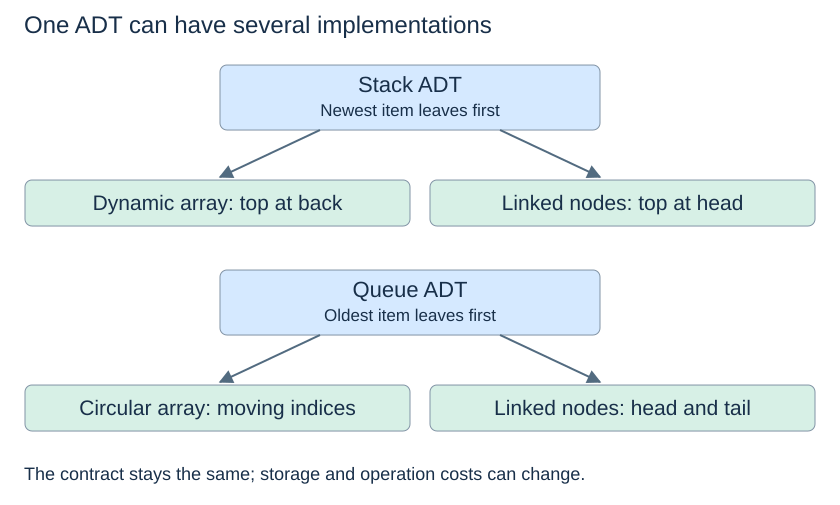

# ADTs and contracts

The [brief introduction in Topic 1](../foundations/adt-basics.md) separates behaviour from representation using a stack. Here we make operation contracts precise and connect them to the implementations in this topic.

(abstract-data-type)=
## Specify operations and behaviour

An **abstract data type (ADT)** describes the values being managed, the operations available, and the rules those operations must follow. It leaves the internal representation unspecified. The word *abstract* means we can reason about what an operation does without first knowing how the computer performs it.

Two objects that both provide `add(x)` and `remove()` need not implement the same ADT. One might remove the oldest item, while another removes the newest. Names alone do not establish behaviour.

(adt-contract)=
## An interface is a behavioural contract

Consider a queue for print jobs. A suitable contract says:

| Operation | Result and state change |
|---|---|
| `enqueue(job)` | Add the job after all waiting jobs |
| `dequeue()` | Remove and return the earliest waiting job |
| `front()` | Return the earliest waiting job without removing it |
| `is_empty()` | Report whether any jobs remain |

The contract must also explain exceptional cases. In the implementations here, removal or inspection of an empty collection raises `IndexError`. A fixed-capacity queue also raises `OverflowError` if an enqueue finds it full. Other designs can choose other policies, but clients must know which policy applies.

(observers-and-mutators)=
## Observing differs from modifying

An **observer**, such as `front()`, returns information without changing the logical collection. A **mutator**, such as `dequeue()`, changes it. Both might return the same job on one call, yet leave different states afterwards.

An operation contract includes preconditions, returned results, and postconditions. For example, after a successful dequeue, exactly one job is removed and the remaining jobs preserve their arrival order. A rejected empty dequeue should leave the state unchanged.

(adt-and-representation)=
## One behaviour, several representations

A queue can use a circular array or linked nodes. Either implementation can satisfy the same arrival-order rule. Conversely, one representation can support several ADTs: a dynamic array can implement a sequence or a stack, depending on the operations exposed.

Correctness and efficiency are separate questions. `list.append(x)` paired with `list.pop(0)` produces correct FIFO behaviour, but every front removal shifts the remaining references. A circular array preserves FIFO without those shifts.

(linear-sequence-adt)=
## Linear order and positional access

In a **linear** collection, items have a sequential order. This logical arrangement does not require the objects to occupy neighbouring memory locations. Linked nodes also form a linear sequence.

A List or Sequence ADT exposes positions through operations such as `get(i)`, `set(i, x)`, `insert(i, x)` and `remove_at(i)`. Here `remove_at` means removal by position; Python's `list.remove(x)` instead searches for a value. After insertion or removal, later positions change. Starting with `[A, B, C, D]`, removing position 1 gives `[A, C, D]`; setting position 1 to X then gives `[A, X, D]`.

Stack and queue interfaces deliberately expose fewer access choices. Those restrictions express the intended policy and make accidental violations harder. Choose the policy from the problem before choosing a familiar Python container.

Next: [Stacks](stacks.md).
