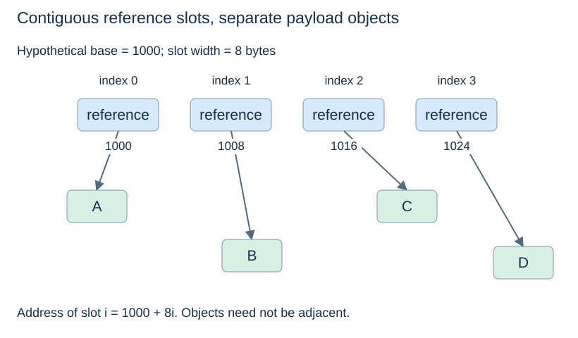
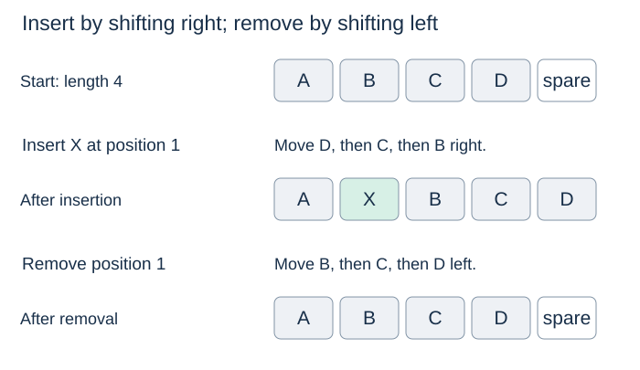

# Arrays and positional operations

(array-representation)=
## Equal-sized slots give direct access

An array stores equal-sized slots consecutively. If the base address is $b$ and each slot occupies $w$ bytes, slot $i$ begins at

$$ b + i w. $$

Computing this address does not require visiting slots $0$ through $i-1$. In the usual constant-time machine-word model, accessing or replacing a valid indexed slot is $O(1)$.

An array of references is different from an array of numeric values. In CPython, a list uses an array of object references. Those slots are contiguous, but the referenced objects can live elsewhere and have different types and sizes. This connects to [Topic 1's object model](../foundations/objects-and-references.md).



The illustrated addresses and slot width are hypothetical. What matters is the fixed distance between slots. The object is reached through its reference; its complete contents are not necessarily stored inside the slot.

(array-insertion)=
## Insertion must preserve the later items

To insert X at position 1 in `[A, B, C, D]`, with one spare slot available, move D right, then C, then B, and fill the gap with X. The order of shifting matters: moving B first would overwrite C before preserving it.



For a sequence of length $n$, insertion at position $i$ shifts $n-i$ references. Insertion near the front therefore takes $\Theta(n)$ work even if there is spare capacity. Insertion at the back shifts none, though it may require [resizing](dynamic-arrays.md).

(array-removal)=
## Removal closes a gap

Removing position $i$ shifts the later $n-i-1$ references left. A simple fixed-buffer implementation clears the unused last slot so it no longer retains an unwanted reference. Removing the front is linear; removing the last occupied slot requires no shifting.

Replacing a value is different from inserting one. `a[i] = x` retains the same length and other positions. `a.insert(i, x)` increases the length and changes the positions of later items.

```python
route = ["A", "B", "C", "D"]
route.insert(1, "X")
assert route == ["A", "X", "B", "C", "D"]
assert route.pop(1) == "X"
route[1] = "Y"
assert route == ["A", "Y", "C", "D"]
```

(array-locality)=
## Locality and limitations

Sequential array slots favour memory locality: nearby references can be fetched together in cache. This can improve practical speed beyond what Big-O describes. An array of references does not, however, guarantee locality of all the referenced objects.

Direct indexing also does not mean a value can be found instantly. If only a value is given and its position is unknown, searching an unsorted array may still require a linear scan. The operation and information available determine the cost.

Representation reference: [How lists are implemented in CPython](https://docs.python.org/3/faq/design.html#how-are-lists-implemented-in-cpython). Next: [Dynamic arrays](dynamic-arrays.md).
