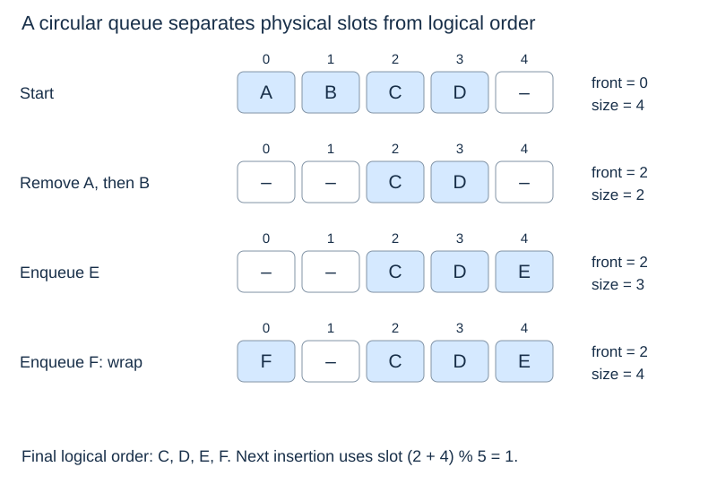

# Circular-array queues

(circular-array-queue)=
## Reuse space instead of shifting

An array queue can remove the front by advancing an index rather than moving every remaining item. Without reuse, this leaves unused space before the front. A **circular array** wraps indices back to zero, making that space available for later insertions.

For positive capacity $c$, maintain `front` and the number of live items `size`. Logical item $i$ occupies physical slot

$$ (\text{front}+i)\bmod c, \qquad 0\leq i<\text{size}. $$

(circular-queue-invariant)=
## Length separates empty from full

Maintain $0\leq\text{size}\leq c$ and $0\leq\text{front}<c$. The next enqueue position is `(front + size) % c`. That position equals `front` both when empty and when full; `size` distinguishes the two states. Looking only at the two endpoint indices is insufficient for this representation.



(bounded-queue)=
## A complete fixed-capacity implementation

This queue rejects an enqueue when full. It does not silently discard an older item. `None` is allowed as data: occupancy is determined by indices and size, not by testing whether a slot contains `None`.

```python
class CircularQueue:
    def __init__(self, capacity):
        if type(capacity) is not int or capacity <= 0:
            raise ValueError("capacity must be a positive integer")
        self._data = [None] * capacity
        self._front = 0
        self._size = 0

    def __len__(self):
        return self._size

    def is_empty(self):
        return self._size == 0

    def enqueue(self, item):
        if self._size == len(self._data):
            raise OverflowError("queue is full")
        back = (self._front + self._size) % len(self._data)
        self._data[back] = item
        self._size += 1

    def front(self):
        if self.is_empty():
            raise IndexError("front of empty queue")
        return self._data[self._front]

    def dequeue(self):
        item = self.front()
        self._data[self._front] = None
        self._front = (self._front + 1) % len(self._data)
        self._size -= 1
        return item
```

`dequeue` first uses the observing method `front()` to check for emptiness and save the item. Clearing the vacated slot releases the queue's reference to that object. Then the index advances modulo capacity and the size decreases. No remaining item shifts.

Enqueue writes after the existing logical items and increases size. Both methods preserve the logical FIFO order even when physical slot order wraps around. Rejected operations raise before changing the state. Capacity one works with the same formulas.

(circular-queue-cost)=
## Fixed capacity changes the guarantee

Each successful endpoint operation takes $O(1)$ time under constant-time indexing and arithmetic. Initialisation takes $\Theta(c)$ time and storage. The backing array still occupies $\Theta(c)$ space when the queue is empty.

A growing circular queue can obtain more space when full, but it must copy items in **logical** order, starting at the old front. Typically it resets the new front to zero. Geometric resizing gives amortised constant-time enqueue; an individual resizing enqueue remains linear. The fixed-capacity code above has no resize step.

Next: [Linked queues](linked-queues.md).
