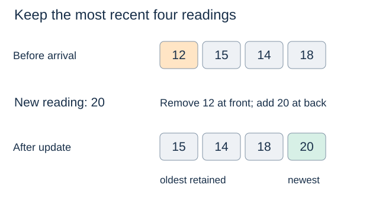

# Deques: both endpoints

**After this page, you should be able to:**

- Trace both-end additions, observations and removals under one contract.
- Compare endpoint costs and distinguish eviction from full-queue rejection.

**Builds on:** [Queues](queues-and-deques.md) restrict additions/removals to opposite ends; here both ends are exposed.

**Code languages:** Python defines the explanations, figures and self-checks. Use the [language guide](../../code-languages.md) for native conventions and dependencies. Complete runnable topic examples: [JavaScript](../../examples/languages/linear-structures.js) · [Julia](../../examples/languages/linear-structures.jl).

Julia uses one-based positions and named functions such as enqueue! rather than Python-style instance methods. Endpoint adapters use the supplied linked DequeBuffer, so they do not hide linear array-front shifts. Empty operations reject the request; null/nothing remain valid payloads.

(deque-operation-contract)=
## A deque exposes both ends

A **deque** (double-ended queue) allows insertion and removal at both ends. Distinguish the container name *deque* from the queue operation *dequeue*.

| Operation | Returned result | State change or empty policy | Library mapping |
|---|---|---|---|
| `add_first(x)` | `None` | Add at front | `appendleft(x)` |
| `add_last(x)` | `None` | Add at back | `append(x)` |
| `peek_first()` | Front item | Observe; empty raises `IndexError` | `d[0]` |
| `peek_last()` | Back item | Observe; empty raises `IndexError` | `d[-1]` |
| `remove_first()` | Front item | Remove; empty raises `IndexError` | `popleft()` |
| `remove_last()` | Back item | Remove; empty raises `IndexError` | `pop()` |
| `size()` / `len(d)` | Number of items | Observe | `len(d)` |
| `is_empty()` | Boolean | Observe | `len(d) == 0` |

The interface below is unbounded: it does not automatically discard an item. Repeated values and `None` are valid. Empty observations/removals raise before changing state. “First” and “last” identify ends, not minimum and maximum keys.

## Representation, invariant and trace

The wrapped library deque stores exactly the logical records, from first to last. All methods preserve that order except for the one endpoint addition/removal requested. The next listing uses library names to show the underlying operations directly:

::::{tab-set}
:class: code-language-tabs

:::{tab-item} Python
:sync: python

```python
from collections import deque

items = deque()
items.append("B")
items.appendleft("A")
items.append("C")
assert items.pop() == "C"
items.appendleft("X")
assert items.popleft() == "X"
assert list(items) == ["A", "B"]
```

:::

:::{tab-item} JavaScript
:sync: javascript

```javascript
// Use the shared linked DequeBuffer; JavaScript has no built-in deque.
var items = new DequeBuffer();
items.add_last("B"); items.add_first("A"); items.add_last("C");
console.assert(items.remove_last() === "C");
items.add_first("X");
console.assert(items.remove_first() === "X");
console.assert(JSON.stringify([...items]) === '["A","B"]');
```

:::

:::{tab-item} Julia
:sync: julia

```julia
items = DequeBuffer()
db_add_last!(items, "B"); db_add_first!(items, "A"); db_add_last!(items, "C")
@assert db_remove_last!(items) == "C"
db_add_first!(items, "X")
@assert db_remove_first!(items) == "X"
@assert db_values(items) == ["A", "B"]
```

:::

::::

(deque-wrapper-code)=
## Python implementation with the ADT names

::::{tab-set}
:class: code-language-tabs

:::{tab-item} Python
:sync: python

```python
from collections import deque

class Deque:
    def __init__(self):
        self._items = deque()

    def __len__(self):
        return len(self._items)

    def size(self):
        return len(self)

    def is_empty(self):
        return len(self) == 0

    def add_first(self, item):
        self._items.appendleft(item)

    def add_last(self, item):
        self._items.append(item)

    def peek_first(self):
        if self.is_empty():
            raise IndexError("first of empty deque")
        return self._items[0]

    def peek_last(self):
        if self.is_empty():
            raise IndexError("last of empty deque")
        return self._items[-1]

    def remove_first(self):
        if self.is_empty():
            raise IndexError("remove first from empty deque")
        return self._items.popleft()

    def remove_last(self):
        if self.is_empty():
            raise IndexError("remove last from empty deque")
        return self._items.pop()
```

:::

:::{tab-item} JavaScript
:sync: javascript

```javascript
class Deque {
    constructor() { this._items = new DequeBuffer(); }
    size() { return this._items.size(); }
    is_empty() { return this.size() === 0; }
    add_first(item) { this._items.add_first(item); }
    add_last(item) { this._items.add_last(item); }
    peek_first() { return this._items.peek_first(); }
    peek_last() { return this._items.peek_last(); }
    remove_first() { return this._items.remove_first(); }
    remove_last() { return this._items.remove_last(); }
}
```

:::

:::{tab-item} Julia
:sync: julia

```julia
mutable struct Deque
    items::DequeBuffer
end
Deque() = Deque(DequeBuffer())
Base.length(q::Deque) = q.items.n
Base.isempty(q::Deque) = length(q) == 0
add_first!(q::Deque, x) = db_add_first!(q.items, x)
add_last!(q::Deque, x) = db_add_last!(q.items, x)
peek_first(q::Deque) = db_first(q.items)
peek_last(q::Deque) = db_last(q.items)
remove_first!(q::Deque) = db_remove_first!(q.items)
remove_last!(q::Deque) = db_remove_last!(q.items)
```

:::

::::

## Implementation choices and correctness

The methods delegate to the corresponding endpoint, so each successful removal returns and removes exactly that endpoint record. The wrapper keeps the abstract names consistent without recreating the library's internals. A circular buffer or a doubly linked chain is an alternative representation. A singly linked chain with only head/tail references still needs a predecessor search to remove its tail.

(deque-operation-costs)=
## Time and space costs

All operations in the table use O(1) time in the ordinary endpoint-operation model and O(1) wrapper workspace. The underlying library describes endpoint updates as approximately constant time. Storage is O(n+1) for n live items; payload objects are not copied by endpoint operations. These are not guarantees of hard real-time allocation.

Python's deque supports approximately constant-time additions and removals at either end. Indexed access near the middle is linear, so a deque is not a replacement for an array when arbitrary indexed access dominates. Empty endpoint removal or inspection raises `IndexError`.

A deque can implement stack behaviour by using only one end, or queue behaviour by adding at one end and removing at the other. A restricted stack or queue interface can still communicate the intended policy more clearly.

(deque-rolling-window)=
## When to use it: keep the latest readings

To retain the latest four readings, add each new reading at the back and discard the oldest at the front when the window exceeds four items.

::::{tab-set}
:class: code-language-tabs

:::{tab-item} Python
:sync: python

```python
window = deque([12, 15, 14, 18])
window.append(20)
if len(window) > 4:
    window.popleft()
assert list(window) == [15, 14, 18, 20]
```

:::

:::{tab-item} JavaScript
:sync: javascript

```javascript
var window = new DequeBuffer([12, 15, 14, 18]);
window.add_last(20);
if (window.size() > 4) window.remove_first();
console.assert(JSON.stringify([...window]) === "[15,14,18,20]");
```

:::

:::{tab-item} Julia
:sync: julia

```julia
window = DequeBuffer([12, 15, 14, 18])
db_add_last!(window, 20)
window.n > 4 && db_remove_first!(window)
@assert db_values(window) == [15, 14, 18, 20]
```

:::

::::



The invariant after each update is: the window contains the most recent at most four readings, in arrival order. This policy intentionally discards old data. A bounded `deque(maxlen=4)` can perform that eviction automatically on append, while a bounded queue may instead reject an insertion when full. These are different contracts.

(deque-palindrome)=
## Compare the front and back

A palindrome reads the same in both directions. A deque can hold its characters: repeatedly remove and compare both ends until fewer than two remain. `RACECAR` gives matching pairs R/R, A/A and C/C, with E left in the middle.

::::{tab-set}
:class: code-language-tabs

:::{tab-item} Python
:sync: python

```python
def is_palindrome(sequence):
    remaining = deque(sequence)
    while len(remaining) > 1:
        if remaining.popleft() != remaining.pop():
            return False
    return True
```

:::

:::{tab-item} JavaScript
:sync: javascript

```javascript
function is_palindrome(sequence) {
    const remaining = new DequeBuffer(sequence);
    while (remaining.size() > 1)
        if (remaining.remove_first() !== remaining.remove_last()) return false;
    return true;
}
```

:::

:::{tab-item} Julia
:sync: julia

```julia
function is_palindrome(sequence)
    remaining = DequeBuffer(sequence)
    while remaining.n > 1
        db_remove_first!(remaining) != db_remove_last!(remaining) && return false
    end
    return true
end
```

:::

::::

This checks exact element equality: it does not remove spaces or normalise case. Building and scanning the deque takes $O(n)$ time and $O(n)$ additional space for $n$ input elements. Two indices into an existing sequence can avoid that extra copy; the deque version illustrates the access policy.

:::{tip} Common misconception
**A deque removes the smallest or largest value.** First/last refer to sequence positions; keys are not ordered.
:::

(linear-deque-checks)=
## Check your understanding

Predict the operation result and the resulting state before opening the explanation.

**1. Add B at the back, A at the front and C at the back; remove last. What is returned and what remains?**

:::{dropdown} Show explanation
C is returned; A,B remain from first to last.
:::

**2. Does a full rolling window have to raise OverflowError on a new reading?**

:::{dropdown} Show explanation
No. The rolling-window contract intentionally evicts an old reading. A bounded queue that promises rejection has a different policy.
:::

Reference: [Python deque documentation](https://docs.python.org/3/library/collections.html#collections.deque). Next: [Arrays and positional operations](arrays.md).
