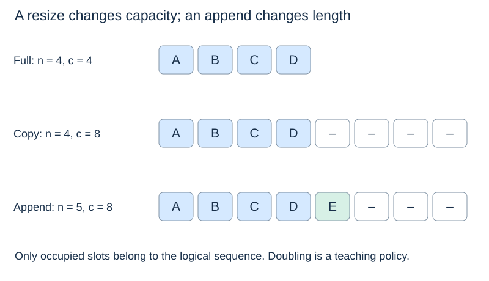

# Dynamic arrays: length, capacity and resizing

(length-and-capacity)=
## Occupied slots differ from allocated slots

The **length** $n$ is the number of logical items. The **capacity** $c$ is the number of slots currently available in the backing storage. A valid representation maintains $0\leq n\leq c$; only positions before $n$ belong to the logical sequence.

A fixed-capacity array cannot accommodate arbitrarily many items without obtaining different storage. A **dynamic array** manages that replacement internally so the user sees one growing sequence. Python's list is a familiar example. Fixed-size numeric buffers, including many uses of NumPy arrays, expose a different storage model; they are not automatically dynamic lists.

(dynamic-array-resize)=
## Allocate, copy and replace

When an append finds spare capacity, place the new reference at position $n$ and increment the length. When the backing array is full, allocate larger storage, copy the existing references in order, append the item, and use the new storage thereafter.

The picture uses doubling to make the analysis simple. It is not a claim that Python lists always double. Actual growth and shrink policies are implementation details.

Copying object references during a resize does not deep-copy the objects. An external reference to one stored object still refers to that same object afterwards. The backing storage may change while the public list object remains the same.

(amortised-array-append)=
## An expensive append can coexist with a cheap sequence

Assume an initially empty buffer with capacity 1, doubling whenever full. Appends that trigger growth copy

$$1,2,4,8,\ldots$$

existing references. Across $m\geq1$ appends, these copy counts sum to less than $2m$. There are also $m$ writes of the newly appended items. Total work is therefore $O(m)$, giving $O(1)$ **amortised** time per append.

The guarantee concerns the total cost of every such append sequence from that initial state. It is not a probability statement and does not require random input. A single append that copies $n$ references still costs $\Theta(n)$.

This also explains why growing by just one slot each time is inadequate: it would copy $1+2+\cdots+(m-1)=\Theta(m^2)$ references. Reserving a fixed fraction of spare capacity makes geometric growth possible.

(dynamic-array-space)=
## Account for spare and temporary storage

For geometric growth, allocated capacity is $O(n)$ for nonempty append-only sequences, with some unused slots. During a teaching-model resize, old and new buffers coexist temporarily; that peak storage is still $O(n)$, but it matters in memory-constrained systems.

Shrinking is a separate design decision. Shrinking immediately after every removal and growing immediately after every insertion can cause repeated copies near a boundary. A common policy leaves a gap between the grow and shrink thresholds, so many updates can occur between expensive reallocations.

Dynamic arrays make indexed access and back growth convenient. They do not eliminate the shifts needed for front or middle edits. Next: [Linked structures](linked-structures.md).
