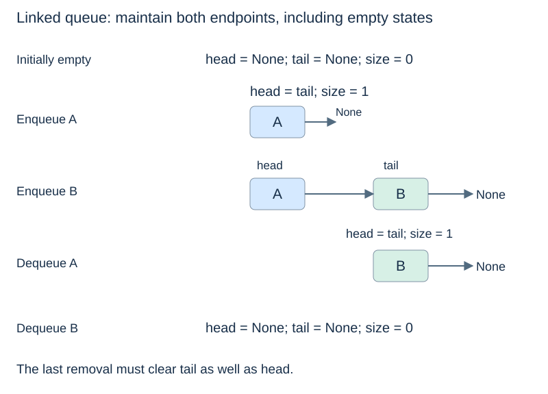

# Linked queues

**After this page, you should be able to:**

- Preserve head/tail/size invariants through first insertion and last removal.
- Compare node-based queue costs with fixed circular storage.

**Builds on:** [Queue contracts](queues-and-deques.md) and the [Node class](linked-structures.md).

## Operation contract for this implementation

Use the same [FIFO operation table](queues-and-deques.md#queue-adt). Enqueue returns `None`; front observes; dequeue removes and returns the earliest waiting record. `size()` and `len(q)` return the stored count. Empty front/dequeue raise `IndexError` before mutation. This version has no configured capacity or full-state rejection. Duplicates and `None` are allowed.

(linked-queue)=
## Head removes; tail appends

A singly linked queue places the oldest item at `head` and the newest at `tail`. Dequeue removes the head; enqueue links a new node after the tail. Holding both references avoids traversing the chain to append.

(head-tail-invariant)=
## State the endpoint invariant

The maintained rules are:

- The chain from head contains all queued items in arrival order.
- The last node is tail and its `next` is `None`.
- The stored size equals the number of reachable nodes.
- The queue is empty exactly when size is zero and both head and tail are `None`.

The empty case matters twice: adding the first item must establish both endpoints, and removing the last item must clear both endpoints.



(linked-queue-code)=
## Implement the two transitions explicitly

This code reuses the `Node` class from [Linked structures](linked-structures.md). It does not impose a fixed capacity.

```python
class LinkedQueue:
    def __init__(self):
        self._head = None
        self._tail = None
        self._size = 0

    def __len__(self):
        return self._size

    def size(self):
        return len(self)

    def is_empty(self):
        return self._size == 0

    def enqueue(self, item):
        new = Node(item)
        if self.is_empty():
            self._head = new
        else:
            self._tail.next = new
        self._tail = new
        self._size += 1

    def front(self):
        if self.is_empty():
            raise IndexError("front of empty queue")
        return self._head.value

    def dequeue(self):
        if self.is_empty():
            raise IndexError("dequeue from empty queue")
        removed = self._head
        self._head = removed.next
        self._size -= 1
        if self._head is None:
            self._tail = None
        removed.next = None
        return removed.value
```

On the first enqueue, `new.next` is already `None`; assigning head and tail to the same node establishes the invariant. On later enqueues, link the old tail to the new node before changing tail.

On dequeue, save the old head, move head to its successor, and reduce size. If there is no successor, the queue is now empty, so tail must become `None` too. Otherwise it would retain a reference to an object that is no longer in the queue. The removed node is detached after head has been updated.

(linked-queue-cost)=
## The tail removes a search, not all constraints

Each operation touches a constant number of nodes and fields, giving $O(1)$ time under the standard model that treats allocating one fixed-size node as constant time. Real memory allocation can have additional costs. The queue uses $\Theta(n)$ node storage for $n$ queued items, with per-node reference and object overhead.

Without tail, enqueue must find the final node and can take $\Theta(n)$ time. Conversely, holding tail does not make **removing the tail** constant time in this singly linked representation: finding its predecessor may still require traversal. That distinction explains why a singly linked queue is not automatically an efficient deque.

## Implementation choices and suitability

Cached head, tail and size make every exposed operation O(1) under the fixed-size-node allocation model. Updates use O(1) working storage, including a new node on enqueue; persistent storage is O(n+1). Nodes avoid copying the whole queue on growth but require per-item allocation and links. Choose this representation for changing queue size when indexed access is unnecessary.

:::{tip} Common misconception
**After removing the last node, an old tail is harmless metadata.** Both endpoints must represent the empty state.
:::

(linear-linked-queue-checks)=
## Check your understanding

Predict the operation result and the resulting state before opening the explanation.

**1. Enqueue A, dequeue it, then enqueue B. Which endpoints refer to B?**

:::{dropdown} Show explanation
Both head and tail; B.next is None and size is one.
:::

**2. Which queue operation becomes linear if tail is not maintained?**

:::{dropdown} Show explanation
Appending at the back: the final node must be found by traversal.
:::

Next: [Choosing an ADT and representation](choosing-linear-structures.md).
