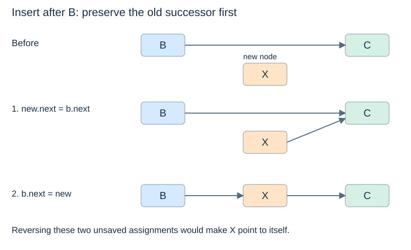
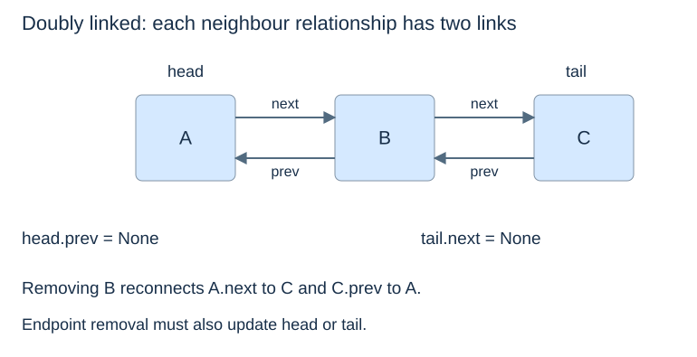

# Linked structures and safe updates

(singly-linked-list)=
## The links establish the sequence

A singly linked node stores a value and a reference to its successor. The **head** refers to the first node; the last node's `next` is `None`. An empty chain has `head = None`. Nodes need not occupy consecutive memory locations.

```python
class Node:
    def __init__(self, value, next_node=None):
        self.value = value
        self.next = next_node

c = Node("C")
b = Node("B", c)
head = Node("A", b)
```

This is the same reference idea as [Topic 1's route nodes](../foundations/collections-and-classes.md#linked-objects), with a generic `value` field. The node and its payload are separate concepts: the node supplies a position in the chain.

(linked-traversal)=
## Traverse without changing the links

```python
def linked_values(head):
    values = []
    current = head
    while current is not None:
        values.append(current.value)
        current = current.next
    return values

assert linked_values(head) == ["A", "B", "C"]
```

Before each iteration, `current` is the next unvisited node. Rebinding it advances the traversal; it does not change `head` or any link. Visiting $n$ nodes takes $\Theta(n)$ time. This collecting helper also uses $\Theta(n)$ output space; traversal that only processes each item needs $O(1)$ auxiliary space apart from that processing.

The termination argument assumes a finite acyclic chain. A cycle can prevent `current` from reaching `None`. To retrieve index $i$, follow $i$ links from the head, giving $\Theta(i+1)$ time for a valid index and $O(n)$ worst-case access.

(linked-insertion)=
## Preserve the successor before replacing its link

To insert X after the already-known node B, first connect X to B's old successor C, then connect B to X.

```python
new = Node("X")
new.next = b.next
b.next = new
assert linked_values(head) == ["A", "B", "X", "C"]
```



If we instead execute `b.next = new` followed by `new.next = b.next`, the second statement makes X point to itself. The old link to C has already been overwritten. A separately saved successor reference would permit another safe ordering, but the old remainder must remain reachable somewhere.

(linked-removal)=
## Bypass the unwanted node

To remove the node after B, redirect B to that node's successor. Require that B has a successor; otherwise there is no node to remove.

```python
def remove_after(node):
    if node.next is None:
        raise IndexError("no successor to remove")
    removed = node.next
    node.next = removed.next
    removed.next = None
    return removed.value

assert remove_after(b) == "X"
assert linked_values(head) == ["A", "B", "C"]
```

Detaching the removed node makes this operation's intent explicit; other references may still keep that object alive. Removing the head instead requires updating the head reference itself. Structures that maintain a tail or a length must update that metadata too.

(linked-update-cost)=
## Finding the place differs from changing it

Insertion after a known node and removal after a known predecessor change only a constant number of references: $O(1)$ work. Finding that node by value or index may first cost $O(n)$. Merely holding the node to delete does not generally supply its predecessor in a singly linked list.

(doubly-linked-list)=
## A second link supports the reverse direction

A **doubly linked** node also stores `prev`. For adjacent nodes, `u.next is v` must agree with `v.prev is u`. With head and tail references, both-end insertion and removal can be constant time, and a known node can be removed by reconnecting both neighbours.



The benefit costs one extra link per node and more updates. The first and last nodes need endpoint handling; the only node requires changing both head and tail to `None`. Extra metadata makes more operations cheap only when its invariants are maintained.

Next: [Circular-array queues](circular-queues.md).
