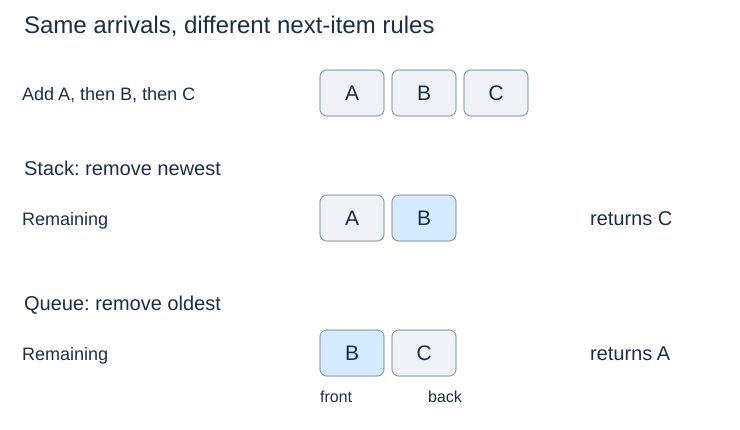

# Queues: earliest waiting item first

**After this page, you should be able to:**

- Trace FIFO additions, observations and removals with explicit return values.
- Compare a restricted deque-backed interface with circular-array and linked queues.

**Builds on:** [Stacks](stacks.md) shows newest-first removal; a queue selects by arrival order.

(queue-adt)=
## Purpose and operation contracts

A **queue** inserts at the back and removes from the front. Its **first in, first out (FIFO)** rule selects the earliest inserted item still waiting. A name such as `jobs` does not enforce FIFO: adding and removing at the back gives LIFO instead.

| Operation | Returned result | State change or empty/full policy |
|---|---|---|
| `enqueue(x)` | `None` | Add x after all waiting items |
| `front()` | Earliest waiting item | Observe only; empty raises `IndexError` |
| `dequeue()` | Earliest waiting item | Remove exactly that item; empty raises `IndexError` |
| `size()` / `len(q)` | Number of waiting items | Observe only |
| `is_empty()` | Boolean | Observe whether size is zero |

The queue below grows without a configured capacity. The later [fixed circular queue](circular-queues.md) instead rejects a full enqueue with `OverflowError`, preserving every waiting item. It never silently evicts one. Duplicates and `None` are valid data in all these examples; a valid result of `None` is different from an empty-operation exception.

## Representation, invariant and visual trace

In this adapter, the underlying deque's left end is the front and its right end is the back. Its elements remain in arrival order, and its length is the queue size.



| Call, starting empty | Return | Queue afterwards, front to back |
|---|---|---|
| `enqueue("A")` | `None` | A |
| `enqueue("B")` | `None` | A, B |
| `front()` | A | A, B |
| `dequeue()` | A | B |
| `enqueue("C")` | `None` | B, C |

(queue-adapter-code)=
## Python implementation

```python
from collections import deque

class Queue:
    def __init__(self):
        self._items = deque()

    def __len__(self):
        return len(self._items)

    def size(self):
        return len(self)

    def is_empty(self):
        return len(self) == 0

    def enqueue(self, item):
        self._items.append(item)

    def front(self):
        if self.is_empty():
            raise IndexError("front of empty queue")
        return self._items[0]

    def dequeue(self):
        if self.is_empty():
            raise IndexError("dequeue from empty queue")
        return self._items.popleft()
```

## Implementation choices and correctness

Appending at the right preserves the arrival order of all waiting items. Removing at the left selects exactly the oldest one and preserves the survivors' order. Empty checks happen before removal, so a rejected request leaves the state unchanged. The wrapper exposes only queue operations even though its underlying deque supports more.

Using a Python list with `pop(0)` would also give correct FIFO results, but shift remaining references. The [circular-array](circular-queues.md) and [head/tail linked](linked-queues.md) readings show how endpoint operations work without delegating them to a library deque. This adapter is complete queue code, not an implementation of the deque's internal storage.

(queue-operation-costs)=
## Time and space costs

The underlying deque provides approximately O(1) endpoint additions/removals and O(1) endpoint access. Thus each exposed operation takes O(1) under the ordinary container-operation model, with O(1) wrapper workspace. Queue storage is O(n+1) for n live items. Real allocation and payload destruction can add costs outside that model.

Fixed circular storage instead uses Θ(c) allocated slots even when empty; a linked queue stores O(n+1) nodes. These are representation costs, not guarantees attached to the word “queue.” See [Python's deque reference](https://docs.python.org/3/library/collections.html#collections.deque).

## When to use it

FIFO suits print jobs and [breadth-first graph traversal](../graphs/breadth-first-search.md). Urgency requires a [priority queue](../heaps/priority-queues.md), which follows a different selection rule.

:::{tip} Common misconception
**Inspecting the front also removes it.** `front()` observes; only `dequeue()` changes the waiting sequence.
:::

(linear-queue-checks)=
## Check your understanding

Predict the operation result and the resulting state before opening the explanation.

**1. Enqueue A and B, call `front()` twice, then dequeue. What is returned?**

:::{dropdown} Show explanation
A, A, then A. Both observations leave the queue unchanged; B remains after the removal.
:::

**2. A capacity-two circular queue contains A,B. What happens on enqueue C?**

:::{dropdown} Show explanation
It raises OverflowError and still contains A,B. This bounded-queue policy differs from rolling-window eviction.
:::

## Continue to both-end access

(deque-adt)=
### Deque operations

A deque adds/removes at both ends. Its separate [contract, implementation and costs](deques.md#deque-operation-contract) follow next.

(rolling-window)=
### Rolling windows

The [latest-readings trace](deques.md#deque-rolling-window) explains intentional eviction as a different contract from rejecting a full queue.

(palindrome-deque)=
### Palindromes

The [two-end comparison example](deques.md#deque-palindrome) uses a deque to remove matching endpoint characters.

Next: [Deques](deques.md).
