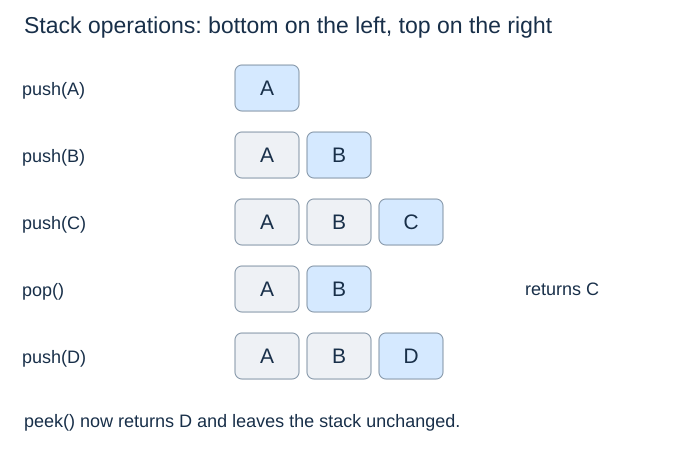
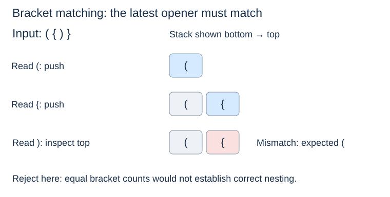

# Stacks: newest first

**After this page, you should be able to:**

- Trace newest-first access with explicit returns and empty behaviour.
- Connect an array-backed invariant to amortised endpoint costs.

**Builds on:** [Sequence operations](sequence-adt.md) permit arbitrary positions; a stack exposes only its top.

(stack-adt)=
## LIFO and the top

A **stack** adds and removes items at one logical end, the **top**. It follows **last in, first out (LIFO)**: the most recently pushed item still present is the next one popped.

| Operation | Returned result | Effect and empty policy |
|---|---|---|
| `push(x)` | `None` | Add x at the top |
| `pop()` | Top item | Remove it; empty raises `IndexError` |
| `peek()` | Top item | Observe only; empty raises `IndexError` |
| `size()` / `len(s)` | Number of items | Observe only |
| `is_empty()` | Boolean | Observe whether size is zero |



(stack-underflow)=
## Empty operations need a policy

Popping an empty stack is **underflow**. Here both empty `pop()` and empty `peek()` raise `IndexError`. Returning `None` instead would be ambiguous if `None` were a legitimate stored item, unless the interface supplied another way to distinguish these outcomes.

## Trace the result and state separately

Starting empty, push A, B and C: each push returns `None`. `peek()` returns C and leaves A,B,C stored. `pop()` returns C and leaves A,B. Pushing D then returns `None` and leaves A,B,D, matching the diagram. Duplicates and `None` are permitted; exceptions distinguish an empty stack from a stored `None`.

(array-stack)=
## An array-backed implementation

Use the back of a Python list as the top. Adding or removing there avoids shifting the earlier references.

```python
class Stack:
    def __init__(self):
        self._items = []

    def push(self, item):
        self._items.append(item)

    def pop(self):
        if self.is_empty():
            raise IndexError("pop from empty stack")
        return self._items.pop()

    def peek(self):
        if self.is_empty():
            raise IndexError("peek at empty stack")
        return self._items[-1]

    def __len__(self):
        return len(self._items)

    def size(self):
        return len(self)

    def is_empty(self):
        return not self._items
```

The representation rule is: `_items` holds the logical stack from bottom to top, and its last position is the top. The underscore marks internal state by convention; clients should use the stack methods. `push` returns `None`, while `pop` returns the removed item.

## Implementation choices and operation costs

Choosing the list's back as the top avoids shifting other records. Using index zero instead would preserve LIFO if both operations used that end, but would make updates linear. A linked stack puts its top at the head and changes a fixed number of links.

| Operation in this array-backed stack | Time | Extra workspace |
|---|---|---|
| Push / pop | O(1) amortised; O(n+1) individual resize | O(1) ordinarily; O(n+1) during resize |
| Peek / size / empty | O(1) | O(1) |

Persistent storage is O(n+1) references under ordinary dynamic-array capacity management. The invariant establishes correctness: append creates the newest top; back removal selects exactly that top; observation does not mutate it.

The amortised bound includes occasional growth or shrinking; it is not a constant worst-case promise for every call.

(stack-applications)=
## Reversing and nesting

Undo history reverses recent actions: changing a colour is undone before the earlier action of adding a label. A useful stack stores enough information to reverse each action, not merely its name. Function calls also nest: a called function finishes before its caller resumes. See [the call stack](../recursion/call-stack.md).

(bracket-matching)=
## Match the most recent unmatched opener

For nested brackets, keep unmatched opening symbols in a stack. A closing symbol must match the top. Counting opening and closing symbols is insufficient: `({)}` has equal counts but incorrect nesting.

```python
def brackets_balanced(text):
    openers = []
    matching = {')': '(', ']': '[', '}': '{'}
    for symbol in text:
        if symbol in '([{':
            openers.append(symbol)
        elif symbol in matching:
            if not openers or openers.pop() != matching[symbol]:
                return False
    return not openers
```

The invariant is that the stack contains exactly the unmatched openers in the processed prefix, in nesting order. An unexpected closer or wrong type rejects immediately; leftover openers reject at the end. This teaching function ignores all non-bracket characters; it does not parse quoted strings or comments in a programming language.



For $n$ characters, the scan takes $O(n)$ time and up to $O(n)$ auxiliary space; early rejection can finish sooner.

:::{tip} Common misconception
**A stored None means the stack is empty.** Emptiness follows the size; None may be a legitimate record.
:::

(linear-stack-checks)=
## Check your understanding

Predict the operation result and the resulting state before opening the explanation.

**1. Push None onto an empty stack, then pop. What is returned and what is the size?**

:::{dropdown} Show explanation
It returns the stored None and size becomes zero. A further pop raises IndexError.
:::

**2. If a list-backed stack uses the front for push and pop, is it still LIFO?**

:::{dropdown} Show explanation
Yes, if both operations use that end consistently. But Python-list front shifts make those operations linear.
:::

Next: [Queues](queues-and-deques.md).
