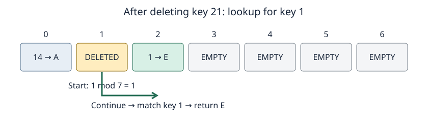

# Open addressing: probing and tombstones

**After this page, you should be able to:**

- Trace bounded lookup, update and removal through EMPTY and DELETED slots.
- Explain why insertion remembers a tombstone but continues checking for an existing key.

**Builds on:** [Hashing](hashing.md), [map contracts](maps.md) and collision handling in [chaining](chaining.md).

**Code languages:** Python defines the explanations, figures and self-checks. Use the [language guide](../../code-languages.md) for native conventions and dependencies. Complete runnable topic examples: [JavaScript](../../examples/languages/maps-sets-hashing.js) · [Julia](../../examples/languages/maps-sets-hashing.jl).

Native containers have different equality and iteration rules. JavaScript examples use primitive keys; array keys compare by identity. The low-level helpers use the supplied teaching hash: h(k)=k for integer traces. Julia helper indices are one-based; table layouts for other native hash functions need not match Python. Snapshot containers differ in type, not ownership.

Open addressing stores entries directly in table slots. A collision triggers a sequence of candidate positions. For **linear probing**, position $j$ in the sequence is $(h(k)+j)\bmod m$, for $j=0,\ldots,m-1$.

## Linear probing and wraparound

Use $h(k)=k$ and capacity 7. Insert 6, 13 and 20, in that order:

| Key | Initial index | Positions examined | Stored index |
|---|---|---|---|
| 6 | 6 | 6 | 6 |
| 13 | 6 | 6, 0 | 0 |
| 20 | 6 | 6, 0, 1 | 1 |

Modulo wraps the sequence back to index 0. Lookup must follow the same sequence used for insertion. The boundary of the array is not a stopping condition.

## Empty, occupied and deleted slots

| State | What lookup does | Why |
|---|---|---|
| Occupied | Compare keys; return on equality, otherwise continue | A collision may belong to another key |
| `DELETED` | Continue | A later entry may have been displaced past this slot |
| `EMPTY` | Report absence | Under this placement rule, the key would have been inserted before passing this unused slot |

## Deletion and tombstones

The `EMPTY` stopping rule depends on preserving the insertion invariant. Deleted entries must not simply be marked empty.

For example, insert 14, 21 and 1 into an empty capacity-7 table. They occupy indices 0, 1 and 2. Delete 21 at index 1. Key 1 begins lookup at index 1, so replacing 21 with `EMPTY` would incorrectly hide key 1. A tombstone records that the search must continue.



## Representation invariant and helper contracts

Occupied slots hold one `(key,value)` pair; all live keys are unique. Every key remains reachable along its linear probe path without crossing an EMPTY slot. DELETED preserves that path after a removal. Capacity m must be positive; keys have stable hashing and consistent reflexive equality. Values may be None.

| Helper | Return | Failure policy |
|---|---|---|
| `get_probed(table,key)` | Value | `KeyError` if absent |
| `put_probed(table,key,value)` | True for new key; False for replacement | `OverflowError` only if a new key has no reusable slot |
| `remove_probed(table,key)` | Removed value | `KeyError` if absent |

The table has fixed capacity in these functions. There is no hidden automatic growth. A public Map adapter can hide growth and translate helper results; the [HashMap interface](maps.md#map-interface-code) returns None from put. Cached n changes only for new-key insertion or successful deletion. Tombstone count d increases on deletion, decreases on tombstone reuse, and is reset on rebuilding.

## A bounded lookup

::::{tab-set}
:class: code-language-tabs

:::{tab-item} Python
:sync: python

```python
EMPTY = object()
DELETED = object()

def get_probed(table, key):
    m = len(table)
    start = hash(key) % m
    for step in range(m):
        slot = table[(start + step) % m]
        if slot is EMPTY:
            raise KeyError(key)
        if slot is DELETED:
            continue
        stored_key, value = slot
        if stored_key == key:
            return value
    raise KeyError(key)
```

:::

:::{tab-item} JavaScript
:sync: javascript

```javascript
var EMPTY = Symbol("empty"), DELETED = Symbol("deleted");
function get_probed(table, key) {
    const m = table.length, start = hash_index(key, m);
    for (let step = 0; step < m; step++) {
        const slot = table[(start + step) % m];
        if (slot === EMPTY) throw new KeyError(String(key));
        if (slot === DELETED) continue;
        if (slot[0] === key) return slot[1];
    }
    throw new KeyError(String(key));
}
```

:::

:::{tab-item} Julia
:sync: julia

```julia
const EMPTY = Ref(:empty)
const DELETED = Ref(:deleted)
function get_probed(table, key)
    m = length(table); start = hash_index(key, m)
    for step in 0:m-1
        slot = table[mod(start - 1 + step, m) + 1]
        slot === EMPTY && throw(KeyError(key))
        slot === DELETED && continue
        slot[1] == key && return slot[2]
    end
    throw(KeyError(key))
end
```

:::

::::

Create a new table with `[EMPTY] * 7`; sharing an unmodified marker object is intentional. Check marker identity before unpacking an occupied pair. The loop visits at most m slots, including when tombstones or live entries leave no `EMPTY` slot. Capacity must be positive.

## Tombstones and insertion

Suppose indices 1, 2 and 3 contain `DELETED`, `(22, C)` and `EMPTY`. Both key 22 and key 15 start at index 1.

- To put `(22, X)`, continue past the tombstone and replace the entry at index 2.
- To put `(15, B)`, remember index 1, continue through index 2, and reach `EMPTY` at index 3. Absence is now established, so reuse index 1.

Inserting immediately at the tombstone could create two copies of key 22. The insertion algorithm remembers the first deleted slot but continues searching for an equal key. A full cycle also proves absence; reuse a remembered tombstone or grow the full table.

:::{note} Pause and trace
First trace lookup past a tombstone and explain why only EMPTY permits an early stop. Then read the update helpers: insertion must prove whether the key already exists before reusing a remembered deleted slot.
:::

(probed-update-code)=
## Complete insertion, replacement and deletion helpers

Read these functions in the same session as the EMPTY/DELETED objects and lookup above. Marker identity must be shared across all operations.

::::{tab-set}
:class: code-language-tabs

:::{tab-item} Python
:sync: python

```python
def put_probed(table, key, value):
    m = len(table)
    start = hash(key) % m
    first_deleted = None
    for step in range(m):
        i = (start + step) % m
        slot = table[i]
        if slot is EMPTY:
            target = i if first_deleted is None else first_deleted
            table[target] = (key, value)
            return True
        if slot is DELETED:
            if first_deleted is None:
                first_deleted = i
        elif slot[0] == key:
            table[i] = (key, value)
            return False
    if first_deleted is not None:
        table[first_deleted] = (key, value)
        return True
    raise OverflowError("hash table is full")

def remove_probed(table, key):
    m = len(table)
    start = hash(key) % m
    for step in range(m):
        i = (start + step) % m
        slot = table[i]
        if slot is EMPTY:
            raise KeyError(key)
        if slot is not DELETED and slot[0] == key:
            table[i] = DELETED
            return slot[1]
    raise KeyError(key)
```

:::

:::{tab-item} JavaScript
:sync: javascript

```javascript
function put_probed(table, key, value) {
    const m = table.length, start = hash_index(key, m); let first_deleted = null;
    for (let step = 0; step < m; step++) {
        const i = (start + step) % m, slot = table[i];
        if (slot === EMPTY) { table[first_deleted === null ? i : first_deleted] = [key, value]; return true; }
        if (slot === DELETED) { if (first_deleted === null) first_deleted = i; }
        else if (slot[0] === key) { table[i] = [key, value]; return false; }
    }
    if (first_deleted !== null) { table[first_deleted] = [key, value]; return true; }
    throw new RangeError("hash table is full");
}
function remove_probed(table, key) {
    const m = table.length, start = hash_index(key, m);
    for (let step = 0; step < m; step++) {
        const i = (start + step) % m, slot = table[i];
        if (slot === EMPTY) throw new KeyError(String(key));
        if (slot !== DELETED && slot[0] === key) { table[i] = DELETED; return slot[1]; }
    }
    throw new KeyError(String(key));
}
```

:::

:::{tab-item} Julia
:sync: julia

```julia
function put_probed!(table, key, value)
    m = length(table); start = hash_index(key, m); first_deleted = nothing
    for step in 0:m-1
        i = mod(start - 1 + step, m) + 1; slot = table[i]
        if slot === EMPTY
            target = first_deleted === nothing ? i : first_deleted
            table[target] = (key, value); return true
        elseif slot === DELETED
            first_deleted === nothing && (first_deleted = i)
        elseif slot[1] == key
            table[i] = (key, value); return false
        end
    end
    if first_deleted !== nothing; table[first_deleted] = (key, value); return true; end
    throw(OverflowError("hash table is full"))
end
function remove_probed!(table, key)
    m = length(table); start = hash_index(key, m)
    for step in 0:m-1
        i = mod(start - 1 + step, m) + 1; slot = table[i]
        slot === EMPTY && throw(KeyError(key))
        if slot !== DELETED && slot[1] == key
            table[i] = DELETED; return slot[2]
        end
    end
    throw(KeyError(key))
end
```

:::

::::

A full table can still replace an existing key. If no EMPTY exists, a complete cycle either finds the key or proves its absence; a remembered tombstone can then be reused. With no reusable slot, a new-key put raises without changing the table. Delete marks a successful match as DELETED and returns its value; failed deletion leaves the table unchanged.

## Implementation choices and operation costs

Remembering the first tombstone avoids unnecessary displacement while continuing to protect key uniqueness. The code uses a bounded m-step loop, so missing queries terminate even when every slot is occupied or deleted. A different probing scheme or backward-shift deletion needs a matching invariant and is not implemented here.

Each helper costs O(p+1) for p examined slots, at most O(m), with O(1) workspace beyond the table. Persistent storage is Θ(m), even when empty. Scanning keys/items costs Θ(m) plus O(n) output storage. Cached size/empty queries cost O(1); recomputing size requires scanning. Expected constant-time claims require distribution and occupancy assumptions from [performance](performance.md), including tombstones.

## Clustering and alternatives

Linear probing can form contiguous clusters, making later probes longer. Quadratic probing and double hashing change the sequence. Their parameters and capacity rules must ensure adequate coverage; they cannot be substituted without changing the trace. The [performance page](performance.md) explains why low live load alone does not guarantee a short probe sequence.

:::{tip} Common misconception
**The first tombstone is proof that the key is absent.** An equal key may occur later on the probe path.
:::

(hash-probing-checks)=
## Check your understanding

Predict the result and resulting state before opening the explanation.

**1. A tombstone precedes an existing key 22. Where must put(22,X) write?**

:::{dropdown} Show explanation
At the existing key’s slot after searching past the tombstone. Reusing the tombstone immediately would create a duplicate.
:::

**2. A capacity-seven table has no EMPTY but one DELETED. Must inserting a new key fail?**

:::{dropdown} Show explanation
No. After a complete probe cycle proves absence, the remembered deleted slot can be reused.
:::

Next: [Load factor and performance](performance.md).

**Browse:** [Maps, Sets and Hashing](maps-sets-hashing.md) · [Concept index](../../concepts.md)
