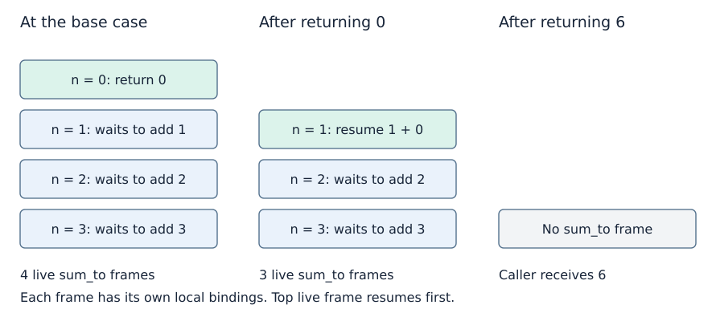

# The call stack and waiting work

**After this page, you should be able to:**

- Trace frame creation, suspension, resumption and return values.
- Separate total calls, maximum live frames, printed output and runtime limits.

**Builds on:** [Recursive summation](recursive-calls.md) and [working/output-space conventions](../analysis/code-and-space.md#auxiliary-and-output-space).

Recursion does not replace the current call. It starts another call while the caller retains the state needed to continue afterwards.

(stack-frames)=
## Each call has a separate frame

A **call frame** records the execution state of one invocation, including local bindings and where execution should resume. A **call stack** tracks active invocations. For ordinary sequential calls, the most recently called function must finish before its caller can continue.



The diagram shows snapshots at different times. It omits the surrounding module or caller’s own frame. In the first snapshot, `sum_to(0)` is active and the three earlier calls are suspended. When the base case returns, its frame is removed and `sum_to(1)` resumes with the returned value 0.

Local bindings are separate, but referenced objects may still be shared. Passing a list to a recursive call does not automatically copy it. The [object model](../foundations/mutation-and-copying.md#function-arguments) still applies.

(return-vs-print)=
## Returning a result differs from printing it

`return` supplies a value to the caller and ends that invocation. `print` displays text and does not supply that text as the function’s result. A function that reaches its end without an explicit return value returns `None`.

The distinction is especially visible when work occurs on both sides of a recursive call:

```python
def trace_calls(n):
    if n == 0:
        print("base")
        return
    print("enter", n)
    trace_calls(n - 1)
    print("leave", n)

trace_calls(2)
```

For this example, n is a nonnegative integer. The output is:

```text
enter 2
enter 1
base
leave 1
leave 2
```

The first prints happen during descent. The later prints happen as calls finish. A recursive function intended to compute a sum must **return** its child result; merely printing the child result would not make it available for the caller’s addition.

(recursive-trace-contract)=
## Keep computational results and observable traces separate

`trace_calls(n)` assumes a nonnegative integer, prints 2n+1 lines and returns `None`. Zero prints just `base`. Unlike `sum_to`, this tracing helper has no domain guard: do not assume a negative argument is rejected with the same `ValueError` policy. Valid inputs can still exceed Python's recursion capacity.

`sum_to_iterative(n)` below has the same input validation and numerical result as `sum_to`, but it neither prints inside the function nor grows an input-dependent recursive call chain. Its example `print(...)` is outside the function. Compare return values, side effects and exceptions as well as final mathematical answers when evaluating alternatives.

(depth-and-calls)=
## Depth, total calls and live storage differ

For `sum_to(3)`, four invocations occur in total and four are simultaneously live at the base case. In a branching computation those numbers generally differ: one branch can finish and release its frames before another branch begins.

Maximum live depth determines frame storage when each frame has constant-sized state. Total calls contributes to time, along with the work performed in each call. A shallow tree can contain many calls; counting its depth alone is not a time analysis.

For `sum_to(n)`, there are n + 1 calls and n + 1 live frames at maximum depth. Under the [word-cost model](../analysis/code-and-space.md#space-complexity), constant local work per frame gives Θ(n) time and Θ(n) frame storage. The addition result grows with n, so a more detailed bit-cost analysis would need to account for integer sizes too.

(python-recursion-limit)=
## Mathematical termination does not guarantee a successful Python run

Python limits recursion depth to protect the interpreter stack. A mathematically terminating computation can raise `RecursionError` before reaching its base case. The practical limit is finite and environment-dependent; it is not a complexity class.

An iterative version avoids growing the Python call stack:

```python
def sum_to_iterative(n):
    if type(n) is not int or n < 0:
        raise ValueError("Expected a nonnegative integer")
    total = 0
    for value in range(1, n + 1):
        total += value
    return total

print(sum_to_iterative(3))  # 6
```

Both versions perform linear work in n under the introductory model, but this loop uses Θ(1) working words. A recursive call placed last in a function does not make Python eliminate its frame. Prefer a suitable loop or explicit stack when input-dependent recursion can become deep, rather than assuming a larger recursion limit solves the design problem.

## Compare implementations under the same model

| Function | Returned result / observable effect | Time | Working storage excluding returned output |
|---|---|---|---|
| `sum_to(n)` | Integer sum; no internal printing | Θ(n+1) | Θ(n+1) live frames/words |
| `sum_to_iterative(n)` | Same integer sum; no internal printing | Θ(n+1) | O(1) words |
| `trace_calls(n)` | `None`; 2n+1 printed lines | Θ(n+1) if each printed line is treated as one output action | Θ(n+1) live frames/words |

For the trace, retained printed output is a separate resource: a terminal or capture buffer may store O(n+1) lines. Actual formatting and character/I/O costs are not necessarily constant per line, especially when n has many digits. The recursion stack stores pending work; it is not a copy of all text already printed.

A chain for n makes n+1 calls in total, with n+1 live helper frames at the base case: that is n edges but n+1 frames. An explicit stack is another implementation choice when pending work must be retained; replacing recursion with a stack does not automatically remove the need for that state. A direct running-total loop works here because additions can be accumulated without preserving all suspended calls.

:::{tip} Common misconception
**Printing a child result returns it to the caller.** `print` produces an output effect; a function must return a value if its caller is to use that result.
:::

(call-stack-checks)=
## Check your understanding

Trace the calls or predict the result before opening the explanation.

**1. What does trace_calls(1) print, and what value does it return?**

:::{dropdown} Show explanation
It prints enter 1, then base, then leave 1 on three separate lines. Its return value is None, including at the bare return in the base case.
:::

**2. Do logarithmic live depth and two recursive children imply logarithmic total work?**

:::{dropdown} Show explanation
No. Depth counts the longest active chain, while both subtrees may contain many calls and each call may perform additional work. Count all local work as well as depth.
:::

Next: [Divide, conquer and combine](divide-and-conquer.md).

**Browse:** [Recursion](recursion.md) · [Concept index](../../concepts.md)
