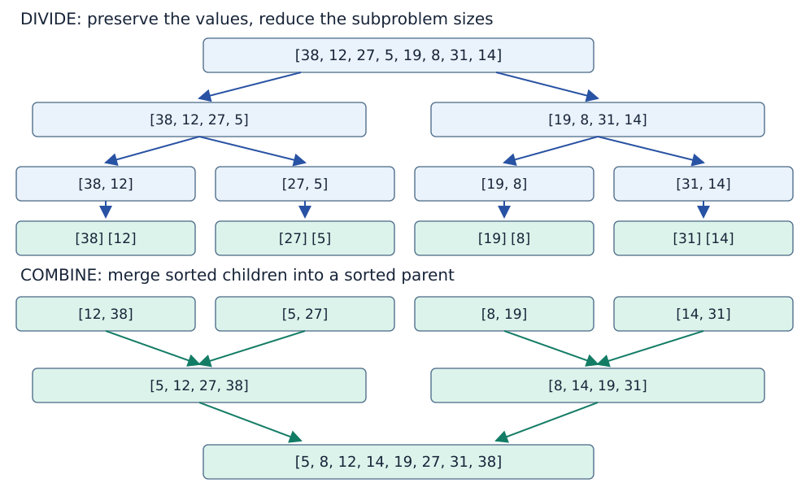
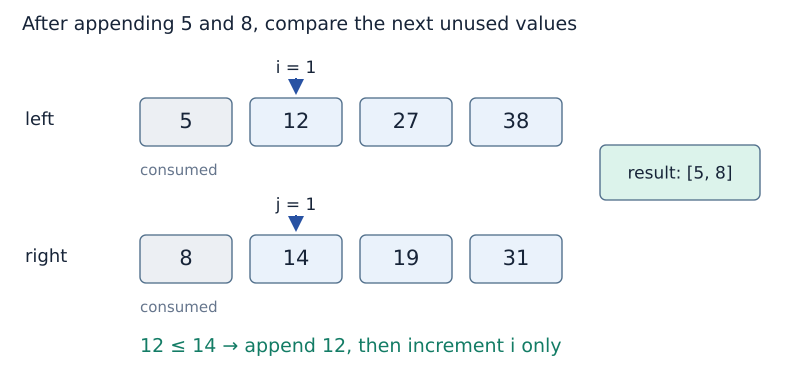

# Divide, conquer and combine

**After this page, you should be able to:**

- Connect splitting, recursive results and merging to a complete operation contract.
- Explain ordering, record preservation, stable ties and input/output ownership.

**Builds on:** [Recursive calls](recursive-calls.md), [stack sequencing](call-stack.md) and [shallow copying](../foundations/mutation-and-copying.md#shallow-copy).

**Code languages:** Python defines the explanations, figures and self-checks. Use the [language guide](../../code-languages.md) for native conventions and dependencies. Complete runnable topic examples: [JavaScript](../../examples/languages/recursion.js) · [Julia](../../examples/languages/recursion.jl).

The same base cases, smaller subproblems and merge choices apply. Native recursion limits and bounded numeric arithmetic still matter; copying slices is included in the implementation cost.

Recursion is a mechanism for expressing calls. **Divide-and-conquer** is a strategy for organising a solution: divide the problem into smaller subproblems, solve them, then combine their answers. Many implementations use recursion, but the two ideas are not synonyms.

(divide-conquer-combine)=
## The three stages need a complete connection

Merge sort makes the stages concrete:

| Stage | Merge-sort action | Requirement |
|---|---|---|
| Divide | Split the sequence into two parts | Parts preserve all input items |
| Conquer | Sort each part | Recursive calls return sorted results |
| Combine | Merge the sorted results | Output is sorted and preserves all items |

A split alone does not sort anything. Solving the smaller parts is also insufficient without a combine operation that produces the required whole result.

(split-and-combine)=
## Follow one dataset down and back up



The input is `[38, 12, 27, 5, 19, 8, 31, 14]`. Splitting preserves its values but does not order them. Singletons are already sorted. Combining `[38]` with `[12]` produces `[12, 38]`; combining that with `[5, 27]` produces `[5, 12, 27, 38]`. Finally merge the two sorted halves to obtain `[5, 8, 12, 14, 19, 27, 31, 38]`.

The tree expresses dependencies. In the sequential Python implementation below, the entire left recursive call finishes before the right call starts. The two branches do not run in parallel just because the drawing places them side by side.

(merge-two-sorted-sequences)=
## Merge only needs the first unused values

For two sorted inputs, the smallest unused value must be at one of their current fronts. Compare those candidates, append the smaller one, and advance only that side’s index.



| Candidates | Append | Result so far |
|---|---:|---|
| 5 and 8 | 5 | 5 |
| 12 and 8 | 8 | 5, 8 |
| 12 and 14 | 12 | 5, 8, 12 |
| 27 and 14 | 14 | 5, 8, 12, 14 |
| 27 and 19 | 19 | 5, 8, 12, 14, 19 |
| 27 and 31 | 27 | 5, 8, 12, 14, 19, 27 |
| 38 and 31 | 31 | 5, 8, 12, 14, 19, 27, 31 |
| Only 38 remains | 38 | 5, 8, 12, 14, 19, 27, 31, 38 |

(merge-invariant)=
## Why can the remainder be appended?

At each step, the output contains the smallest consumed values in sorted order, and each input index points to its first unused value. If both sides remain, selecting the smaller current candidate preserves that condition. If one side is exhausted, the other side’s remainder is already sorted and no remaining value on the exhausted side can intervene.

This argument depends on **both inputs being sorted**. Arbitrary input lists cannot be sorted by a single front-comparison pass. Repeated values are valid and must retain their multiplicities. Choosing the left item on equality will also support stable sorting, developed in Topic 4.

(recursive-merge-contract)=
## Specify merge and sort as different operations

| Function | Preconditions | Returned result and mutation |
|---|---|---|
| `merge_sorted(left, right)` | Two lists already in nondecreasing order; values support a consistent total ordering through `<=` | New sorted list containing every item from both lists, preserving multiplicity; inputs unchanged |
| `merge_sort(values)` | A list whose values support that consistent ordering | New sorted shallow list containing the same records; caller's outer list unchanged |

Both return a new empty list on empty total input, and the sort returns a new outer list even for a singleton. Payload objects are shared rather than deeply copied. No type/order validation pass is supplied: incompatible comparisons can raise `TypeError`, and unsorted inputs violate the merge helper's precondition even if no exception is raised.

The merge's `<=` chooses the left item on a tie. Combined with contiguous left/right splitting, this preserves the original relative order of equally ordered records: the sort is stable. It is not in-place. There is no `key` or `reverse` argument in these teaching functions; later [sorting interfaces](../sorting/sorting-properties.md) discuss those choices.

(merge-sort-code)=
## A complete sequential implementation

::::{tab-set}
:class: code-language-tabs

:::{tab-item} Python
:sync: python

```python
def merge_sorted(left, right):
    result = []
    i = j = 0
    while i < len(left) and j < len(right):
        if left[i] <= right[j]:
            result.append(left[i])
            i += 1
        else:
            result.append(right[j])
            j += 1
    result.extend(left[i:])
    result.extend(right[j:])
    return result

def merge_sort(values):
    if len(values) <= 1:
        return values.copy()
    middle = len(values) // 2
    left = merge_sort(values[:middle])
    right = merge_sort(values[middle:])
    return merge_sorted(left, right)

values = [38, 12, 27, 5, 19, 8, 31, 14]
print(merge_sort(values))  # [5, 8, 12, 14, 19, 27, 31, 38]
```

:::

:::{tab-item} JavaScript
:sync: javascript

```javascript
function merge_sorted(left, right) {
    const result = [];
    let i = 0, j = 0;
    while (i < left.length && j < right.length) {
        if (left[i] <= right[j]) result.push(left[i++]);
        else result.push(right[j++]);
    }
    while (i < left.length) result.push(left[i++]);
    while (j < right.length) result.push(right[j++]);
    return result;
}
function merge_sort(values) {
    if (values.length <= 1) return values.slice();
    const middle = Math.floor(values.length / 2);
    return merge_sorted(merge_sort(values.slice(0, middle)), merge_sort(values.slice(middle)));
}

console.log(merge_sort([38, 12, 27, 5, 19, 8, 31, 14]));
```

:::

:::{tab-item} Julia
:sync: julia

```julia
function merge_sorted(left, right)
    result = Any[]
    i, j = 1, 1
    while i <= length(left) && j <= length(right)
        if left[i] <= right[j]
            push!(result, left[i]); i += 1
        else
            push!(result, right[j]); j += 1
        end
    end
    append!(result, left[i:end])
    append!(result, right[j:end])
    return result
end
function merge_sort(values)
    length(values) <= 1 && return copy(values)
    middle = div(length(values), 2)
    return merge_sorted(merge_sort(values[1:middle]), merge_sort(values[middle+1:end]))
end

values = [38, 12, 27, 5, 19, 8, 31, 14]
println(merge_sort(values))
```

:::

::::

This version accepts lists of mutually comparable values and returns a new sorted list. It does not mutate the caller’s outer list or copy the payload objects deeply. Empty and singleton inputs return a shallow copy immediately. Every larger call produces two strictly smaller inputs.

The base case is correct because a sequence of zero or one items is sorted. Assuming both smaller results are correct, the merge argument establishes a sorted permutation of the original input. Termination follows because each larger input is divided into smaller parts.

The [implementation page](implementation-costs.md) examines why slicing and indices matter. The [Sorting topic](../sorting/sorting.md) compares this strategy with insertion, bubble and quicksort.

## Costs and implementation choices

For merge inputs of lengths a and b, the shown index-based merge uses Θ(a+b+1) time and Θ(a+b+1) returned list storage. The indices need O(1) words, but `left[i:]` and `right[j:]` can temporarily allocate O(a+b+1) additional reference slots. Replacing remainder slices with indexed loops avoids those temporary lists while preserving linear work and a separate output list.

For n sorted or unsorted input items, this unoptimised merge sort performs Θ(n log(n+1)+1) time under constant-cost comparison and amortised append. Peak additional space including output is Θ(n+1); the stack alone is O(log(n+1)). It does not skip a merge just because the input was already sorted.

Midpoint splitting controls shape, `<=` controls ties, slicing controls allocation and indices avoid front-removal shifts. These are implementation decisions inside the strategy. A bottom-up iterative merge sort, for example, can use the same divide/combine organisation without recursive Python calls.

:::{tip} Common misconception
**One merge pass sorts two arbitrary lists.** The front-selection argument requires both inputs already sorted; recursive sorting establishes that precondition.
:::

(divide-conquer-checks)=
## Check your understanding

Trace the calls or predict the result before opening the explanation.

**1. Merging left=[1,3] and right=[1,2], which occurrence of 1 is chosen first?**

:::{dropdown} Show explanation
The left occurrence. On equality, <= selects left, which helps preserve stable order across the original contiguous halves.
:::

**2. Does merge_sort([record]) return the exact same outer list object?**

:::{dropdown} Show explanation
No. The base case returns values.copy(). The outer list is new, while the record object itself is still shared.
:::

Next: [Recursion trees and costs](recursion-costs.md).

**Browse:** [Recursion](recursion.md) · [Concept index](../../concepts.md)
