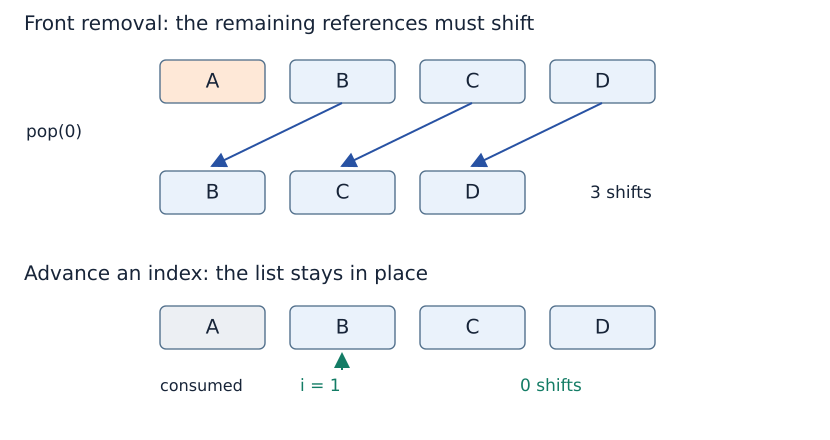

# Implementation choices can change the cost

“Take the smallest first unused item” is a sound merge strategy. How we implement “take” determines whether the code retains the intended cost.

(front-removal)=
## Removing the front of a list shifts references

Python lists support indexed access, but removing index zero requires moving the following references to close the gap. For a list currently holding m items, `pop(0)` shifts m − 1 remaining references and takes linear time in m.

The shifting concerns entries in the list’s storage; it does not move or deeply copy the payload objects themselves. Repeatedly shortening one side from m to zero can cause

$$
(m-1)+(m-2)+\cdots+1+0=\frac{m(m-1)}{2}
$$

reference shifts. For example, when every item in a left half precedes every item in a right half, front-removal merging empties that left half one item at a time. With halves of comparable length, this already produces quadratic shifting in the total merge size.

(index-based-merge)=
## Advancing an index preserves linear merging

The [complete merge code](divide-and-conquer.md#merge-sort-code) keeps indices i and j. Reading `left[i]` is constant time under our model; incrementing i changes which item is considered next without closing any gap in the input.

For input lengths a and b, at most a + b − 1 candidate comparisons are needed when both inputs are nonempty. Every input item is appended or extended into the result once. Total merge time is Θ(a + b) for nonempty total input, including copying the remainder.

The indices are positions, not raw machine pointers. This distinction also explains why the implementation leaves its input lists unchanged, whereas a version using `pop(0)` mutates them. Equal final sorted values do not make the side effects identical.

(slicing-cost)=
## Slices allocate new outer lists

The sort creates `values[:middle]` and `values[middle:]`. A list slice of k items allocates a new list and copies k references: Θ(k) time and space. Those referenced objects are still shared unless another operation copies them.

Both slices at one call copy n references in total. Across one full balanced level, the copied sizes also sum to n. This is why slicing adds work but still fits the Θ(n log n) time analysis.

Similarly, the merge code’s `left[i:]` and `right[j:]` produce temporary remainder slices. They can be replaced with loops that append remaining elements by index, avoiding those particular temporary lists. Both versions still have linear merge time and allocate a result list.

(strategy-and-representation)=
## Keep strategy, representation and cost connected

| Design decision | Consequence |
|---|---|
| Split near the midpoint | Logarithmic recursion depth |
| Solve both halves | Branching tree of calls; depth alone does not count all work |
| Merge with indices | Linear combining work under the stated model |
| Merge with repeated `pop(0)` | Repeated shifts can make combining quadratic |
| Pass list slices | Copies references into new outer lists |
| Retain left result while sorting right | Contributes to peak storage, even when its call has returned |

An alternative implementation can sort ranges within one array and reuse an auxiliary buffer. Its indices, side effects and storage accounting must be specified. We do not assume that every program called “merge sort” has identical costs or memory behaviour.

## Questions to revisit

Where is the reachable base case? What measure decreases? Which operations happen before and after child calls? How many calls are active simultaneously? What does the combine operation cost in the chosen representation?

Use those questions when reading the planned [Sorting](../sorting/sorting.md), [search-tree](../searching/searching.md) and [graph traversal](../graphs/graphs.md) topics.

**Browse:** [Recursion](recursion.md) · [Concept index](../../concepts.md)
