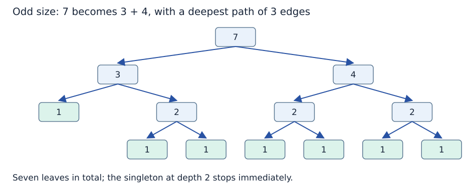
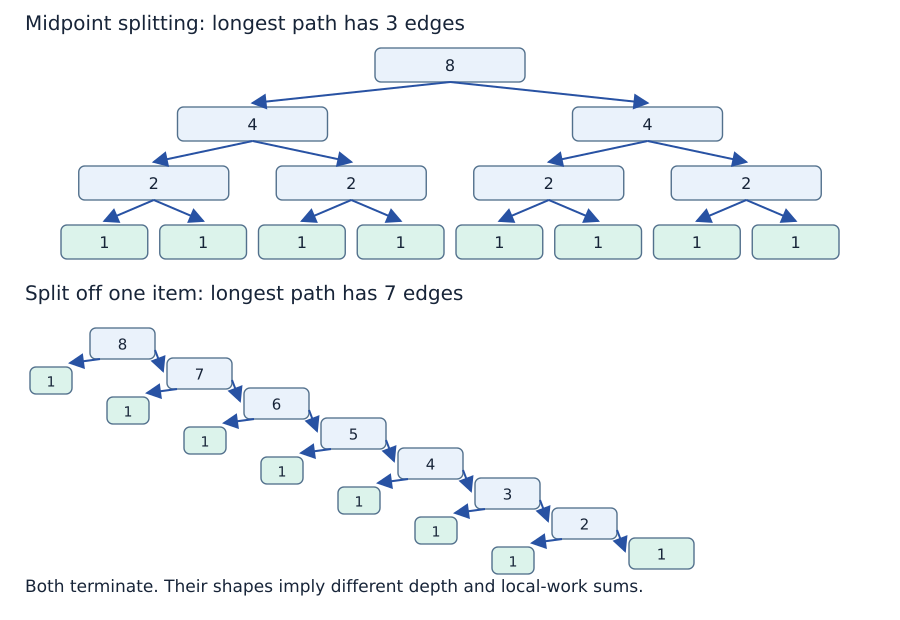
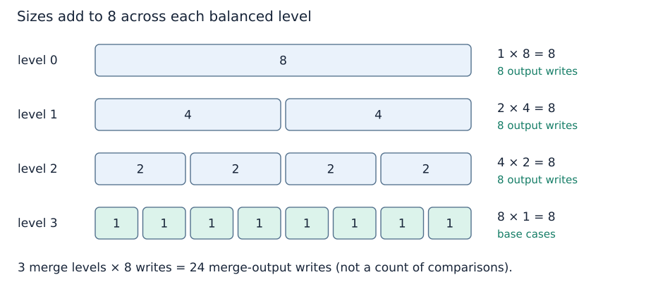

# Recursion trees: shape, work and storage

**After this page, you should be able to:**

- Derive depth, calls and level work from subproblem sizes and local costs.
- Distinguish peak frame/list storage from total allocations across execution.

**Builds on:** [The complete merge sort](divide-and-conquer.md), [cost models](../analysis/counting-work.md) and [asymptotic bounds](../analysis/cases-and-bounds.md).

A recursion tree represents invocations and their parent-child dependencies. Label nodes with subproblem sizes, then account for work **outside** their recursive calls. Otherwise counting a parent’s whole runtime and its descendants again would double-count work.

(balanced-and-odd-splits)=
## Balanced does not mean exactly equal

With midpoint division, seven items split into sizes 3 and 4. Those split into 1 and 2, and 2 and 2. Both sides still shrink by approximately a factor of two. Merge sort does not require input length to be a power of two.

(balanced-vs-unbalanced)=
## Decomposition controls the longest path

For n = 8, balanced splitting has three edges from root to deepest leaf. Splitting into 1 and n − 1 repeatedly instead leaves a longest path 8, 7, 6, …, 1: seven edges. Both terminate, but the latter is much deeper.

For midpoint merge-sort splitting with n ≥ 1, the longest path has **ceil(log₂ n) edges**. Including both root and leaf gives that many plus one live frames. For n = 7 the depth is 3, not floor(log₂ 7) = 2. We follow the larger rounded half on the longest path; this differs from Topic 2’s [floor-division loop](../analysis/code-and-space.md#repeated-halving), which follows the smaller rounded value.

(recursion-level-work)=
## Count work across an entire level

For a power-of-two size n, level d has 2ᵈ subproblems of size n/2ᵈ. Their sizes sum to n. At every non-leaf level, the merge procedures collectively write n output items. There are log₂ n such merge levels, giving Θ(n log n) merging work under constant-cost comparisons and amortised constant-cost append.

Leaves contribute Θ(n) base-case work. Slicing contributes linear total copying at each division level, so it does not change this implementation’s Θ(n log n) time class. Odd sizes give nearly balanced trees with the same asymptotic result.

Input order changes exact comparison counts. Merging `[1, 2, 3, 4]` with `[5, 6, 7, 8]` takes four candidate comparisons; interleaved halves can require seven. Both still write all eight output items. The shown standard implementation remains Θ(n log n) in best, average and worst cases under the model; an algorithm that explicitly skips already-ordered merges needs its own analysis.

(recurrences)=
## A recurrence records recursive cost

For the shown merge sort, one useful time model for n > 1 is

$$
T(n)=T(\lfloor n/2\rfloor)+T(\lceil n/2\rceil)+\Theta(n),
\qquad T(0),T(1)\in\Theta(1).
$$

For powers of two, this simplifies to T(n) = 2T(n/2) + Θ(n). The final term describes splitting and combining work outside the recursive calls. The level argument explains the solution without requiring a general recurrence-solving theorem.

If a decomposition repeatedly uses sizes 1 and n − 1 **and still performs linear local work**, its cost satisfies a different pattern: T(n) = T(n − 1) + Θ(n). Summing n + (n − 1) + … gives Θ(n²). The qualifier matters: a linear-depth recursion with constant local work, such as recursive summation, instead takes Θ(n) time.

(total-calls)=
## Many calls can coexist with shallow depth

For the merge-sort implementation on n ≥ 1 items, each non-leaf call has two children and there are n singleton leaves. The total number of calls is 2n − 1, even for odd n. That is Θ(n) calls, despite logarithmic depth.

This does not make runtime linear: larger internal calls also split and merge many items. Count calls **and** their local work. Conversely, a two-child recursion is not automatically exponential; here the two child sizes partition the input. Different recursions can repeat overlapping problems and behave very differently.

(recursive-space)=
## Peak live storage differs from cumulative allocation

With constant-sized frame state, midpoint splitting uses Θ(log n) stack frames at once. Its branching tree is executed sequentially, so sibling frames do not all accumulate as if the entire tree were live.

The shown slicing-based sort also creates sublists and merge results. Along an active branch their input sizes form a geometric series; completed results retained by waiting calls and temporary merge output keep peak list storage within Θ(n). The output itself requires Θ(n) references. Thus its **peak additional storage including output is Θ(n)**, with Θ(log n) frames as one component. It is not Θ(log n) total space merely because the call stack is shallow.

Across the whole execution, many lists are allocated and later released. Summing all allocations can give Θ(n log n) reference slots over time, but that is not the same as peak live space. These statements use Topic 2’s [storage convention](../analysis/code-and-space.md#auxiliary-and-output-space).

(recursion-cost-summary)=
## Summarise the quantities separately

| Quantity for the shown merge sort | n≥1 | Empty input |
|---|---|---|
| Longest root-to-leaf path | ceil(log₂ n) edges | No recursive child |
| Maximum simultaneous sort frames | ceil(log₂ n)+1 | One sort frame |
| Total sort invocations | 2n−1 | One invocation |
| Total time | Θ(n log(n+1)) under the stated model | Θ(1) |
| Peak additional storage including result | Θ(n) references/words | Θ(1) |
| Stack portion of peak storage | Θ(log(n+1)) frames | Θ(1) |

The invocation count includes only `merge_sort` calls; the separate merge helper also has a frame while combining. That changes constant frame overhead, not the logarithmic stack bound. The exact maximum sort-frame count refers to the active chain of sort calls, including its base case.

The recurrence's local Θ(n) term includes splitting/copying and merging once per internal node. Do not add the children's full costs again after already summing the recurrence over the tree. For powers of two, n−1 internal sort calls each perform one merge, but their local work depends on their individual subproblem sizes.

Uneven splits, repeated subproblems, variable comparison costs or a different combine operation require a new argument. A recursion tree's appearance alone proves neither exponential work nor a logarithmic total resource bound. The [implementation comparison](implementation-costs.md#recursive-implementation-costs) checks how representation changes these counts.

:::{tip} Common misconception
**Logarithmic recursion depth means logarithmic total space.** This sort also stores slices and returned lists; those dominate the stack in peak additional storage.
:::

(recursion-cost-checks)=
## Check your understanding

Trace the calls or predict the result before opening the explanation.

**1. For n=7, how many merge_sort calls occur, and how many sort frames can be live at once?**

:::{dropdown} Show explanation
There are 2×7−1=13 invocations in total, and ceil(log₂7)+1=4 simultaneous sort frames. Sequential sibling execution keeps these quantities different.
:::

**2. Does a linear-depth recursion necessarily take quadratic time?**

:::{dropdown} Show explanation
No. With constant local work, recursive summation takes linear word-model time. Linear local work at each size n,n−1,… produces a different, quadratic total.
:::

Next: [Implementation choices](implementation-costs.md).

**Browse:** [Recursion](recursion.md) · [Concept index](../../concepts.md)
