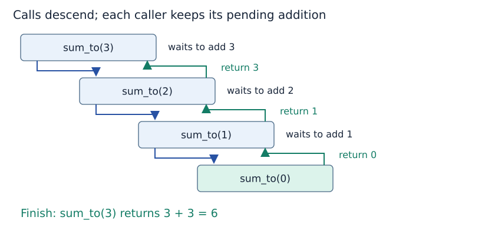

# Recursive calls, base cases and termination

**After this page, you should be able to:**

- Specify a recursive function's contract, reachable base case and decreasing measure.
- Trace returned child results and justify the local correctness step.

**Builds on:** [Function arguments and references](../foundations/mutation-and-copying.md#function-arguments) and [correctness/progress reasoning](../analysis/correctness.md).

A function is recursive when its computation leads to another call of itself, directly or through other functions. The examples here use direct recursion: the same function solves a smaller instance and uses its result to finish the original task.

(recursive-definition)=
## Express the problem using a smaller instance

For a nonnegative integer n, define S(n) as the sum of the integers from 1 through n. The empty sum S(0) is zero. For n > 0:

$$
S(n)=n+S(n-1),\qquad S(0)=0.
$$

The recursive rule does not yet perform the addition. It says that the result of S(n − 1) is needed first.

(base-and-recursive-cases)=
## Base case and recursive case

```python
def sum_to(n):
    if type(n) is not int or n < 0:
        raise ValueError("Expected a nonnegative integer")
    if n == 0:
        return 0
    return n + sum_to(n - 1)

print(sum_to(3))  # 6
print(sum_to(0))  # 0
```

The **base case** returns an answer directly. The **recursive case** calls the same function on a smaller value, then completes the pending addition. The guard rejects inputs outside the stated domain; otherwise a negative input would keep decreasing without reaching zero. The explicit check accepts Python `int` values exactly, excluding Booleans and other types.

(recursive-sum-contract)=
## Specify the result, domain and failure behaviour

`sum_to(n)` returns the integer sum 1+…+n for an exact Python `int` with n≥0. It accepts zero and returns 0. Negative integers, booleans, floats and other types raise `ValueError` through the explicit guard. It does not mutate a caller-owned collection or print from inside the function; the displayed `print(...)` calls are clients of its returned result.

The recursive step preserves the input domain because n>0 implies n−1≥0. Its mathematical result is defined for every valid n, but a particular Python execution can exhaust the call stack and raise `RecursionError`. That runtime limitation is separate from invalid-input rejection and from the proof of progress.

(calls-and-returns)=
## Calls go down; answers return up



For `sum_to(3)`, the outer call waits for `sum_to(2)`. That call waits for `sum_to(1)`, which waits for `sum_to(0)`. Returning 0 does not return from every call at once: it completes the innermost call only. The waiting additions then finish in reverse order.

| Call being completed | Returned child result | Remaining operation | This call returns |
|---|---:|---|---:|
| `sum_to(0)` | none | Base case | 0 |
| `sum_to(1)` | 0 | 1 + 0 | 1 |
| `sum_to(2)` | 1 | 2 + 1 | 3 |
| `sum_to(3)` | 3 | 3 + 3 | 6 |

Each call has its own argument value. The n in the outer call is still 3 while another call is working with n = 2. It has not been globally overwritten.

(recursive-termination)=
## A base case must be reachable

To justify termination, identify a measure that decreases on every recursive step and cannot decrease forever within the valid domain. Here that measure is the nonnegative integer n. Every recursive call reduces it by one, so zero must eventually be reached in the mathematical process.

A function that tests n == 0 but calls itself with n + 1 does not make progress from positive n. A call with the unchanged n fails for the same reason. A base case written in the code is insufficient unless valid recursive paths reach it.

Smaller need not always mean “subtract one”. Halving a positive size, advancing along a finite acyclic chain, or reducing an interval can also establish progress. The stopping rule must match the measure and domain.

(recursive-correctness)=
## Why can we trust the recursive result?

Separate termination from correctness. First, the base case gives the correct empty sum. Then assume the smaller call correctly returns 1 + … + (n − 1). Adding n gives the required sum through n. This reasoning is valid because the call is on a smaller instance and the sequence reaches a correct base case; it is not permission to assume an arbitrary self-call will work.

The formula n(n + 1)/2 can compute this sum without recursion. We use recursive summation to expose the call mechanism, not to recommend it as the fastest or safest implementation for large n.

## Costs, alternatives and suitability

For a valid n whose execution completes, the recursive sum makes n+1 invocations and n additions. In the word-cost model, its time and maximum live frame storage are Θ(n+1), while the single returned integer occupies O(1) model words. The total excludes unrelated caller frames and treats bounded-size arithmetic as constant-cost; a bit-level model must count larger integers differently.

A loop computes the same result with O(1) working words, as the [next reading](call-stack.md#python-recursion-limit) shows. The formula n(n+1)/2 uses a fixed number of arithmetic operations, but that alone does not make its bit cost constant for arbitrarily large Python integers. Recursive summation is a tracing example, not a recommendation for handling very large n.

Use recursion when smaller valid instances and their returned answers make the solution clear. A base case, a domain-preserving progress step and a correct combine step are all required; none can be inferred merely from the presence of a self-call.

:::{tip} Common misconception
**The smaller call overwrites the caller's n.** Each invocation has its own binding. The caller retains the value needed for its pending addition.
:::

(recursive-sum-checks)=
## Check your understanding

Trace the calls or predict the result before opening the explanation.

**1. What does sum_to(1) wait for, and what does it return?**

:::{dropdown} Show explanation
It waits for sum_to(0), which returns 0, then returns 1+0=1. There are two invocations, including the base case.
:::

**2. Does sum_to(True) return 1 because Python booleans behave numerically?**

:::{dropdown} Show explanation
No. The guard requires type(n) is int exactly, so True raises ValueError. This is an explicit contract choice.
:::

Next: [The call stack](call-stack.md).

**Browse:** [Recursion](recursion.md) · [Concept index](../../concepts.md)
