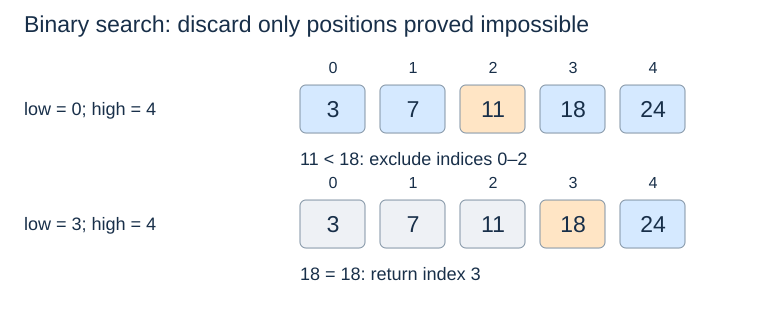

# Binary search and candidate intervals

**After this page, you should be able to:**

- Trace inclusive candidate bounds for success, failure and empty input.
- Distinguish an index result and a probe bound from sorted-data preparation.

**Builds on:** [Sorting contracts](../sorting/sorting-properties.md) supply the ordered-input precondition.

(linear-search)=
## What can a comparison exclude?

Linear search checks candidates one at a time and needs no sorted-input precondition. On an arbitrary unsorted list, seeing one unequal value does not tell us which other values can be skipped. An unsuccessful scan of $n$ items takes $\Theta(n)$ comparisons.

(binary-search)=
## Sorted order lets us discard a whole side

For an ascending sequence, if `a[mid] < target`, every position at or before `mid` also has a value below the target. If the middle value is too large, every position at or after it is too large. This implication depends on the sequence being sorted under the same comparison rule used by the search.



## Operation contract and implementation choices

`binary_search(a,target)` observes an ascending, random-access sequence and returns one matching index or `None`. It never changes the sequence. An empty input returns `None`; duplicates do not imply a first-match guarantee. Input and query comparisons must follow the same consistent ordering.

This implementation uses inclusive endpoints, integer midpoint calculation and index bounds instead of slices. Its workspace is constant; a recursive or slicing version needs a separate space/copy analysis. The trace above uses the same sorted input as the code's correctness argument.

(binary-search-invariant)=
## Keep an inclusive interval

The invariant is: **if the target occurs, at least one matching position remains in `low..high`**. Here both endpoints are inclusive. Initially this is the entire sequence; it becomes empty when `low > high`.

```python
def binary_search(a, target):
    low, high = 0, len(a) - 1
    while low <= high:
        mid = (low + high) // 2
        if a[mid] == target:
            return mid
        if target < a[mid]:
            high = mid - 1
        else:
            low = mid + 1
    return None
```

The result is an **index**, not the target value. Test absence with `result is None`; index zero is a valid success even though it is false in a Boolean context. Empty and singleton inputs use the same code.

Each mismatch excludes `mid` itself, so `high = mid - 1` or `low = mid + 1` strictly reduces the interval. Using `low = mid` can stall when only two candidates remain. An interval convention such as `[low, high)` also works, but its initialisation, loop condition and updates must be consistent with that convention.

(binary-search-correctness)=
## Explain the result and termination

Initialisation includes every possible match. A mismatch preserves the invariant by discarding only values proved too small or too large. The nonnegative number of candidates strictly decreases. Equality returns a valid match; an empty interval combined with the invariant establishes absence.

For example, searching for 20 in `[3, 7, 11, 18, 24]` inspects 11, 18 and 24, then ends with `low = 4, high = 3`. Failure is a justified result, not an exceptional case.

(binary-search-duplicates)=
## Repeated values and boundary queries

This function returns some matching position. In `[2, 2, 2]`, it can return index 1; it does not promise the first occurrence. Finding the first value at least a target is a different contract, often called a lower-bound query. Finding one match does not by itself establish either edge of a duplicate run.

(binary-search-cost)=
## Halving counts probes, not all preparation

With constant-time indexing and comparisons, the worst-case probe count is $O(\log n)$ and iterative auxiliary space is $O(1)$. A recursive implementation using index bounds instead has $O(\log n)$ call-stack space in the worst case. Slicing copies data and changes the cost analysis.

For empty input the cost is constant; a uniform bound is O(log(n+2)). No result list is allocated. This is a useful choice for mostly static sorted arrays; linked-list indexing does not satisfy the constant-time-access assumption.

Sorting an unsorted collection before a single query is additional work. Repeated queries may justify maintaining sorted data; binary search itself does not make insertions into a sorted array cheap.

:::{tip} Common misconception
**Index zero is a failure result.** Only None signals absence in this exact-search function.
:::

(tree-binary-checks)=
## Check your understanding

Predict the returned result, links or invariant before opening the explanation.

**1. What does exact search return on []? What about a match at the first position?**

:::{dropdown} Show explanation
An empty sequence returns None; a first-position match returns 0, which is a valid index.
:::

**2. Does low=mid always make progress after a mismatch?**

:::{dropdown} Show explanation
No. On two candidates, mid can equal low. The inclusive algorithm uses mid+1 to exclude the disproved midpoint.
:::

Next: [Search boundaries](search-boundaries.md).
