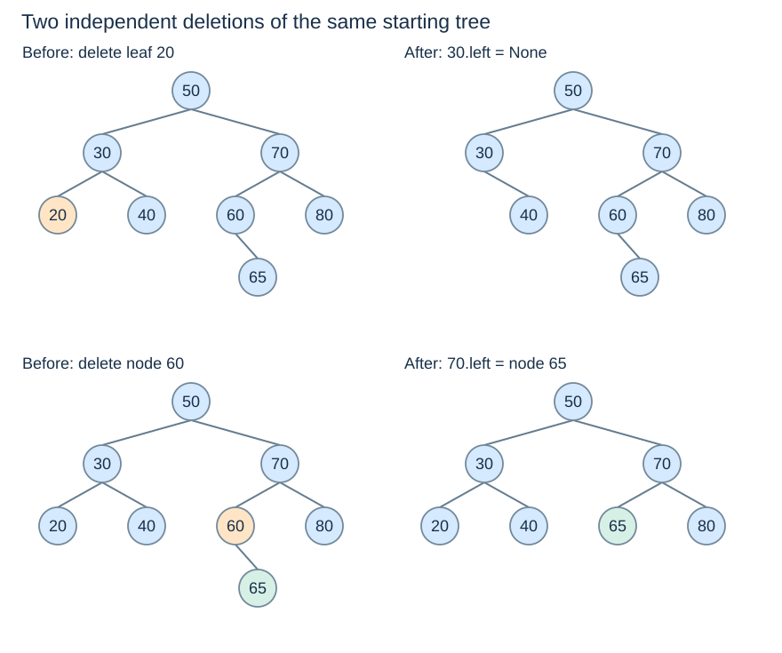
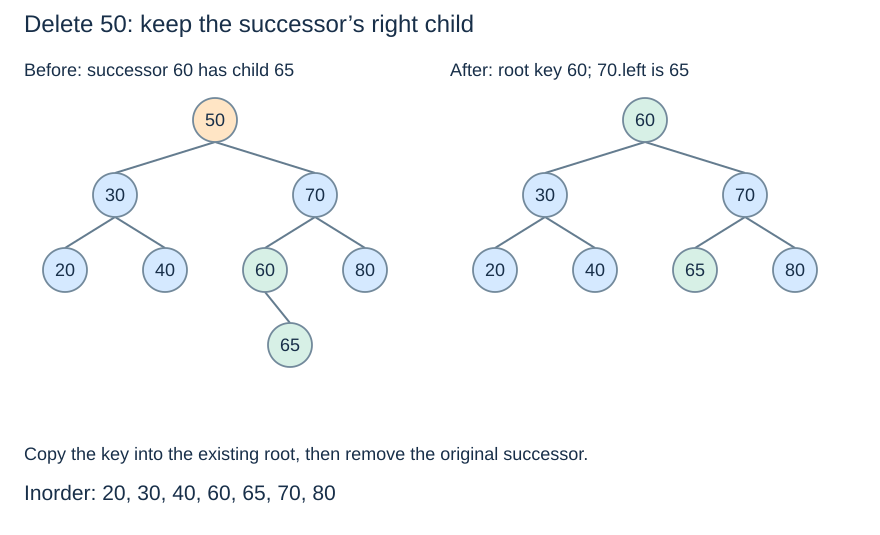

# BST deletion without losing subtrees

**After this page, you should be able to:**

- Reconnect leaf, one-child and successor-removal cases without losing keys.
- Separate key contents, node identity and returned-root semantics.

**Builds on:** [BST insertion](bst-lookup-insertion.md) and [minimum/successor](bst-traversal.md).

**Code languages:** Python defines the explanations, figures and self-checks. Use the [language guide](../../code-languages.md) for native conventions and dependencies. Complete runnable topic examples: [JavaScript](../../examples/languages/searching.js) · [Julia](../../examples/languages/searching.jl).

Python and JavaScript positions are zero-based; Julia vector positions and insertion boundaries are one-based. A missing lookup is None/null/nothing, while a boundary query can return the one-past-end position. Julia public ordered-set operations use functions such as add!, ordered_keys and range_keys.

## Operation contract and representation invariant

`bst_delete(root,key)` returns the resulting root, removes at most one matching key and leaves absence as a no-op. An empty tree returns `None`. Every other key must remain once under strict ancestor bounds. The function does not return the removed key or maintain a total count. The [ordered-set adapter](ordered-set-operations.md) supplies strict `remove`, tolerant `discard`, extraction and size bookkeeping.

(bst-deletion-cases)=
## Search, then identify the structural case

Deletion removes a key while retaining every other key and the ordering invariant. First locate the target. Then act according to its number of children:

| Children | Replacement for the target's subtree root |
|---|---|
| Zero | `None` |
| One | The existing child, with its whole subtree |
| Two | Keep the node, copy a successor key into it, then delete the original successor |

The examples below are **independent** edits of the tree containing `50, 30, 70, 20, 40, 60, 80, 65`. They are not one cumulative sequence.

(bst-leaf-one-child-deletion)=
## Leaf and one-child removal reconnect the parent

Delete leaf 20 by setting `30.left = None`. Delete one-child node 60 by setting `70.left` to node 65. If 65 had descendants, those links would remain intact: replacing a node by its child retains the entire child subtree, not just its key.



Deleting a root follows the same rule, except the external `root` reference must be updated. A singleton root becomes `None`; a root with one child becomes that child.

(bst-two-child-deletion)=
## Copy the successor, then remove its original node

For target 50, the successor is 60, the minimum in the right subtree. Copy 60 into the key field of the node formerly holding 50. That node stays in place with its child links. Then remove the **original** successor node by connecting `70.left` to its right child 65.



The successor is greater than all left-subtree keys and smaller than every other right-subtree key. Its original node has no left child, so its removal reduces to a leaf or one-child case. The final inorder sequence is `20, 30, 40, 60, 65, 70, 80`.

Choosing the largest key in the left subtree—the **predecessor**—is also valid with the mirrored procedure. The choice of successor is a convention, not a reason that the left side cannot be used.

(bst-delete-code)=
## Return the root after each edit

This code reuses `BSTNode` and `bst_minimum` from the preceding pages. Deleting an absent key leaves the key set unchanged.

::::{tab-set}
:class: code-language-tabs

:::{tab-item} Python
:sync: python

```python
def bst_delete(node, key):
    if node is None:
        return None
    if key < node.key:
        node.left = bst_delete(node.left, key)
    elif key > node.key:
        node.right = bst_delete(node.right, key)
    else:
        if node.left is None:
            return node.right
        if node.right is None:
            return node.left
        successor = bst_minimum(node.right)
        node.key = successor.key
        node.right = bst_delete(node.right, successor.key)
    return node
```

:::

:::{tab-item} JavaScript
:sync: javascript

```javascript
function bst_delete(node, key) {
    if (node === null) return null;
    if (key < node.key) node.left = bst_delete(node.left, key);
    else if (key > node.key) node.right = bst_delete(node.right, key);
    else {
        if (node.left === null) return node.right;
        if (node.right === null) return node.left;
        const successor = bst_minimum(node.right);
        node.key = successor.key;
        node.right = bst_delete(node.right, successor.key);
    }
    return node;
}
```

:::

:::{tab-item} Julia
:sync: julia

```julia
function bst_delete(node, key)
    node === nothing && return nothing
    if key < node.key; node.left = bst_delete(node.left, key)
    elseif key > node.key; node.right = bst_delete(node.right, key)
    else
        node.left === nothing && return node.right
        node.right === nothing && return node.left
        successor = bst_minimum(node.right)
        node.key = successor.key
        node.right = bst_delete(node.right, successor.key)
    end
    return node
end
```

:::

::::

Call it as `root = bst_delete(root, key)`. Returning and reconnecting subtree roots handles root replacement and internal edits uniformly. Searching and removing the successor together still follow only $O(h+1)$ links overall; recursive stack space is $O(h+1)$.

(bst-key-versus-node)=
## A key is not the identity of its node

Copying a successor key changes the contents of the target node; it does not move that object. Any external reference to that node now observes the replacement key. In a key–value map, copy the associated value too. If clients require stable record or node identities, choose a deletion design that explicitly supports that requirement.

## Implementation choices and costs

Copying the successor avoids storing parent pointers or moving entire node objects. Using the predecessor instead is a valid mirrored choice. The recursive implementation takes O(h+1) time and stack space, allocates no new tree nodes, and preserves the successor's possible right subtree. An iterative version needs its own reconnection bookkeeping. Neither choice automatically balances an ordinary BST.

:::{tip} Common misconception
**A successor has no children.** It has no left child, but its right subtree must be retained.
:::

(tree-bst-delete-checks)=
## Check your understanding

Predict the returned result, links or invariant before opening the explanation.

**1. When deleting 50 after adding 65, where does 65 end up?**

:::{dropdown} Show explanation
The original successor 60 is removed, and 70.left reconnects to its right child 65. The old root node now stores key 60.
:::

**2. Does raw deletion of an absent key raise KeyError?**

:::{dropdown} Show explanation
No. It leaves the stored key set unchanged. The public adapter’s strict remove checks membership and raises separately.
:::

Next: [The common ordered-set interface](ordered-set-operations.md).
