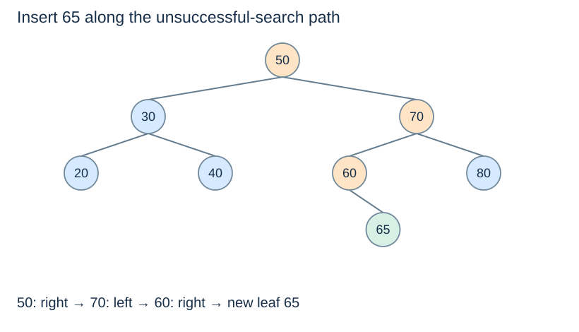

# BST lookup and insertion

**After this page, you should be able to:**

- Trace a one-path lookup and insertion under whole-subtree bounds.
- Distinguish node/absence results from returned roots after an update.

**Builds on:** [BST terminology and bounds](tree-basics.md).

**Code languages:** Python defines the explanations, figures and self-checks. Use the [language guide](../../code-languages.md) for native conventions and dependencies. Complete runnable topic examples: [JavaScript](../../examples/languages/searching.js) · [Julia](../../examples/languages/searching.jl).

Python and JavaScript positions are zero-based; Julia vector positions and insertion boundaries are one-based. A missing lookup is None/null/nothing, while a boundary query can return the one-past-end position. Julia public ordered-set operations use functions such as add!, ordered_keys and range_keys.

## Operation contracts and representation choices

| Helper | Return | Duplicate / absent policy |
|---|---|---|
| `bst_search(root,key)` | Matching node or `None` | Absence returns `None`; no mutation |
| `bst_insert(root,key)` | Resulting subtree root | Existing key is unchanged; empty root creates one leaf |

Keys use a stable consistent total order, and each appears at most once. Nodes store keys and two child references, with no parent pointer, cached height or count. The [public ordered-set adapter](ordered-set-operations.md) later owns a count and translates these helpers into add/contains contracts. A node return is not a copied key; a root return is not a success flag.

(bst-node)=
## Represent the two possible continuations

::::{tab-set}
:class: code-language-tabs

:::{tab-item} Python
:sync: python

```python
class BSTNode:
    def __init__(self, key):
        self.key = key
        self.left = None
        self.right = None
```

:::

:::{tab-item} JavaScript
:sync: javascript

```javascript
class BSTNode {
    constructor(key) { this.key = key; this.left = null; this.right = null; }
}
```

:::

:::{tab-item} Julia
:sync: julia

```julia
mutable struct BSTNode
    key
    left
    right
end
BSTNode(key) = BSTNode(key, nothing, nothing)
```

:::

::::

`None` represents an empty subtree. A root variable holds a node reference, not a copied tree. Distinguish changing `node.left` from merely rebinding a local variable.

(bst-search)=
## Each comparison excludes a subtree

::::{tab-set}
:class: code-language-tabs

:::{tab-item} Python
:sync: python

```python
def bst_search(node, target):
    while node is not None:
        if target == node.key:
            return node
        if target < node.key:
            node = node.left
        else:
            node = node.right
    return None
```

:::

:::{tab-item} JavaScript
:sync: javascript

```javascript
function bst_search(node, target) {
    while (node !== null) {
        if (target === node.key) return node;
        node = target < node.key ? node.left : node.right;
    }
    return null;
}
```

:::

:::{tab-item} Julia
:sync: julia

```julia
function bst_search(node, target)
    while node !== nothing
        target == node.key && return node
        node = target < node.key ? node.left : node.right
    end
    return nothing
end
```

:::

::::

The return value is the matching **node**, or `None`. If a target is below the current key, the entire right subtree is impossible by the BST invariant. Otherwise an unequal larger target excludes the left subtree. Reaching an empty child proves absence within the remaining candidate subtree.

Before inserting 65, in the seven-node reference tree, finding 60 follows `50 → 70 → 60`. Searching for 65 follows those same comparisons and then reaches the missing right child of 60. These are sequential decisions, not simultaneous searches of both sides.

(bst-insertion)=
## Insert where unsuccessful search stops

::::{tab-set}
:class: code-language-tabs

:::{tab-item} Python
:sync: python

```python
def bst_insert(node, key):
    if node is None:
        return BSTNode(key)
    if key < node.key:
        node.left = bst_insert(node.left, key)
    elif key > node.key:
        node.right = bst_insert(node.right, key)
    return node

root = None
for key in [50, 30, 70, 20, 40, 60, 80]:
    root = bst_insert(root, key)
root = bst_insert(root, 65)
```

:::

:::{tab-item} JavaScript
:sync: javascript

```javascript
function bst_insert(node, key) {
    if (node === null) return new BSTNode(key);
    if (key < node.key) node.left = bst_insert(node.left, key);
    else if (key > node.key) node.right = bst_insert(node.right, key);
    return node;
}
var root = null;
for (const key of [50, 30, 70, 20, 40, 60, 80]) root = bst_insert(root, key);
root = bst_insert(root, 65);
```

:::

:::{tab-item} Julia
:sync: julia

```julia
function bst_insert(node, key)
    node === nothing && return BSTNode(key)
    if key < node.key; node.left = bst_insert(node.left, key)
    elseif key > node.key; node.right = bst_insert(node.right, key); end
    return node
end
root = let tree = nothing
    for key in [50, 30, 70, 20, 40, 60, 80]; tree = bst_insert(tree, key); end
    bst_insert(tree, 65)
end
```

:::

::::

Each call returns the root of its resulting subtree. The caller reconnects that result to the appropriate child field. At the top level, `root = ...` handles the initially empty tree. The equality case returns the existing node without adding a duplicate.



(bst-insertion-correctness)=
## Why a local leaf satisfies global bounds

The path to the new leaf consists of comparisons with all relevant ancestors. Choosing the correct branch at each ancestor narrows the permitted interval. When an empty child is reached, the inserted key satisfies every accumulated bound, so adding the leaf preserves whole-subtree ordering.

Both lookup and insertion follow a path of length at most the tree height plus one. Their time is $O(h+1)$; for nonempty growing trees this is usually written $O(h)$. Iterative lookup uses $O(1)$ auxiliary space; the recursive insertion uses $O(h+1)$ stack space. An ordinary BST does not maintain a height bound: ascending insertions can form a chain.

:::{tip} Common misconception
**The inserted key is returned by bst_insert.** It returns the resulting subtree root, which the caller must retain.
:::

(tree-bst-insert-checks)=
## Check your understanding

Predict the returned result, links or invariant before opening the explanation.

**1. After adding 65 to the reference tree, which child link changes?**

:::{dropdown} Show explanation
The previously empty right child of node 60 becomes node 65; the other existing branches are retained.
:::

**2. What does raw bst_insert do when 30 is already present?**

:::{dropdown} Show explanation
It retains one node for 30 and returns the existing subtree root. The distinct-key set does not grow.
:::

Next: [Traversal and ordered queries](bst-traversal.md).
