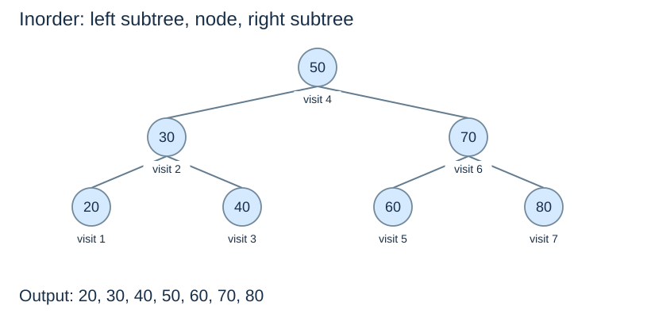

# Traversal and ordered operations

**After this page, you should be able to:**

- Trace all three visit orders and explain why inorder is sorted for a BST.
- Find extremes and strict neighbours with explicit missing-result behaviour.

**Builds on:** [BST nodes and lookup](bst-lookup-insertion.md) establish the representation.

## Operation contracts and invariant

All traversals return a new list of key references and leave links unchanged; empty trees give `[]`. All assume a finite acyclic tree. Inorder is sorted only under the strict BST invariant. Extreme/strict-neighbour helpers return a node, or `None` if no such node exists, without mutation.

(tree-traversals)=
## One tree, several visiting orders

Traversal visits every node rather than looking for one key. The names below locate the current node relative to its recursive child visits:

| Traversal | Visit order | Reference-tree output |
|---|---|---|
| Preorder | node, left, right | 50, 30, 20, 40, 70, 60, 80 |
| Inorder | left, node, right | 20, 30, 40, 50, 60, 70, 80 |
| Postorder | left, right, node | 20, 40, 30, 60, 80, 70, 50 |

These outputs refer to the seven-node reference tree **before** inserting 65. Preorder visits a parent before its descendants; postorder visits it after them. The tree's links stay unchanged.

(bst-inorder)=
## Inorder exposes the BST's sorted order

```python
def inorder_keys(root):
    result = []

    def visit(node):
        if node is None:
            return
        visit(node.left)
        result.append(node.key)
        visit(node.right)

    visit(root)
    return result
```

Why sorted? Recursively sorted left keys are all smaller than the node; recursively sorted right keys are all larger. Concatenating them in left–node–right order preserves ascending order. This conclusion uses the **BST** invariant: inorder on an arbitrary binary tree need not be sorted.



The helper performs constant local work per node, so time is $\Theta(n)$. Its returned list occupies $\Theta(n)$ output space; the recursion needs $O(h+1)$ additional stack space. Avoid repeatedly concatenating subtree lists if you intend this linear-time analysis.

## Preorder and postorder implementations

```python
def preorder_keys(root):
    out = []
    def visit(node):
        if node is not None:
            out.append(node.key)
            visit(node.left)
            visit(node.right)
    visit(root)
    return out

def postorder_keys(root):
    out = []
    def visit(node):
        if node is not None:
            visit(node.left)
            visit(node.right)
            out.append(node.key)
    visit(root)
    return out
```

Each node is visited once, in the declared order. All three listings append into one output list rather than repeatedly concatenate subtree results: O(n+1) time, O(h+1) stack and O(n) output. Recursion follows the links, so a deep ordinary BST can encounter Python's recursion-depth limit; AVL bounds the abstract depth but does not change the traversal's linear output cost.

(bst-minimum-maximum)=
## Extreme keys are at opposite edges

```python
def bst_minimum(node):
    if node is None:
        return None
    while node.left is not None:
        node = node.left
    return node
```

Follow left links to find the minimum; follow right links for the maximum. The result is a node, or `None` for an empty tree. Each operation takes $O(h+1)$ time and constant iterative auxiliary space.

(bst-successor)=
## The successor is the next larger key

If a node has a right subtree, its **inorder successor** is that subtree's minimum. It may be the immediate right child or a deeper descendant. If there is no right subtree, the successor is the lowest ancestor for which the node lies in its left subtree; finding it requires parent information or a search from the root. The largest key has no successor.

For node 50, the reference successor is 60. Adding a right child 65 to 60 does not change that fact. The successor's own left child must be empty, but its right child need not be. This is crucial for [two-child deletion](bst-deletion.md).

## Maximum and strict-neighbour implementations

```python
def bst_maximum(node):
    if node is None:
        return None
    while node.right is not None:
        node = node.right
    return node

def bst_successor(root, key):
    candidate = None
    node = root
    while node is not None:
        if key < node.key:
            candidate = node
            node = node.left
        else:
            node = node.right
    return candidate

def bst_predecessor(root, key):
    candidate = None
    node = root
    while node is not None:
        if node.key < key:
            candidate = node
            node = node.right
        else:
            node = node.left
    return candidate
```

For successor, a key greater than the query is a candidate; only its left subtree can improve it. A key at most the query excludes its entire left side. Predecessor mirrors that reasoning. Retaining a candidate replaces the need for parent pointers. Equality is deliberately excluded: the successor/predecessor is strictly greater/smaller, even when the query is stored.

Each helper follows one path: O(h+1) time and O(1) workspace. Empty trees and queries beyond the relevant extreme return `None`. On the seven-node reference tree, successor(55) is node 60; predecessor(50) is node 40; successor(80) is `None`. These queries do not require the query key to be present. The [public adapter](ordered-set-operations.md) converts a missing-node result to a stated exception.

## Implementation choices and suitability

Preorder places a parent before children; postorder places it after them; neither promises sorted output. Inorder, extremes and neighbours suit ordered keys. Adding parent pointers or cached extremes can change particular operation costs, but also adds update invariants. None is assumed here.

:::{tip} Common misconception
**The successor must be the immediate right child.** It can be deeper or an ancestor; root-based candidate search handles both.
:::

(tree-ordered-checks)=
## Check your understanding

Predict the returned result, links or invariant before opening the explanation.

**1. Before inserting 65, what is the successor of 50? Does adding 65 change it?**

:::{dropdown} Show explanation
It is 60 in both trees. Adding a larger right child to 60 does not change the smallest key greater than 50.
:::

**2. Does preorder on a BST necessarily return sorted keys?**

:::{dropdown} Show explanation
No. Inorder follows left-node-right and is sorted under the BST invariant; preorder follows a different visiting order.
:::

Next: [Closed-range queries](bst-range-queries.md).
