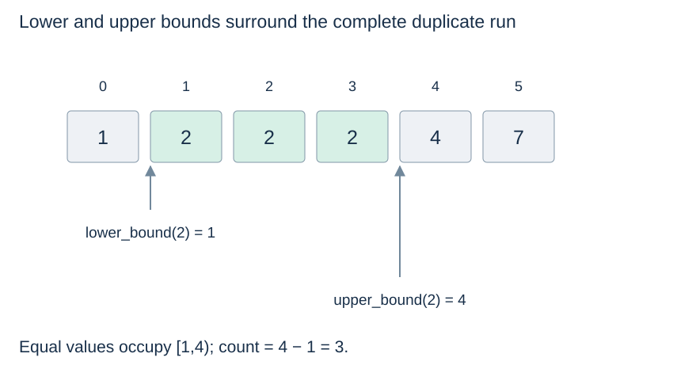

# Binary-search boundaries and duplicate runs

(lower-bound-search)=
## Find the first position at least the target

A lower-bound query returns the first index i with `a[i] >= target`, or `len(a)` if no such item exists. The sequence must already be ascending under the comparison used. Unlike exact search, an absent target still has a meaningful insertion position.

```python
def lower_bound(a, target):
    low, high = 0, len(a)
    while low < high:
        mid = (low + high) // 2
        if a[mid] < target:
            low = mid + 1
        else:
            high = mid
    return low
```

The candidate interval is **half-open**: `[low, high)`. Every position before low is known too small; every position at or after high is known at least the target. Equality keeps mid as a possible boundary by moving high to mid. The loop stops when the two boundaries coincide. Mixing these updates with the inclusive exact-search loop from the previous page would be incorrect.

(upper-bound-search)=
## Find the first position strictly greater

```python
def upper_bound(a, target):
    low, high = 0, len(a)
    while low < high:
        mid = (low + high) // 2
        if a[mid] <= target:
            low = mid + 1
        else:
            high = mid
    return low
```

Now positions before low are at most the target, while positions at or after high are strictly greater. Equal keys move the boundary right instead of left. Both functions work on an empty list and can return n without ever reading index n.

(duplicate-run-boundaries)=
## Two boundaries identify every occurrence

For `[1, 2, 2, 2, 4]`, lower bound of 2 is 1 and upper bound is 4. The duplicate run is indices `[1,4)`, containing three items. Their difference is the occurrence count; exact presence can be checked with `i < len(a) and a[i] == target` after lower bound.



For absent target 3, both functions return 4. These searches take $O(\log(n+1))$ time and constant auxiliary space under constant-time indexing/comparison. Actually inserting at that index can still shift $O(n)$ items.

(monotone-boundary-search)=
## Generalise only after proving monotonicity

Lower bound finds the first true value of the predicate `a[i] >= target`: it is false on an initial prefix and true thereafter. Similar boundary searches can locate a minimum feasible capacity or time when feasibility has that same false-to-true structure. Prove that monotonicity before discarding an interval; arbitrary predicates cannot safely be searched by halving.

Return to [binary search](binary-search.md) or continue to [tree terminology](tree-basics.md).
