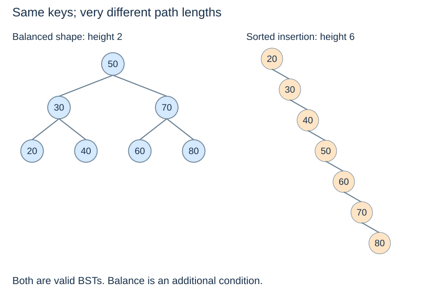

# Search costs and representation choices

**After this page, you should be able to:**

- Compare representation costs under explicit height and input assumptions.
- Separate construction, update paths, workspace and output costs.

**Builds on:** [The common ordered-set interface](ordered-set-operations.md) connects the implemented operations.

(bst-height-cost)=
## Height determines the longest search path

A BST with $n\geq1$ nodes can have height as small as $\Theta(\log n)$ or as large as $n-1$. Inserting distinct ascending keys into an ordinary BST creates a right-leaning chain. The ordering invariant still holds, but each comparison may eliminate almost nothing.

Search, insertion, deletion, minimum and maximum take $O(h+1)$ time. They are logarithmic only when height is logarithmic. One lucky root match remains constant-time even in a tall tree; worst-case costs describe the longest relevant path.

(search-representation-comparison)=
## Choose for queries and updates together

| Representation | Exact search | Ordered output | Updating the collection |
|---|---|---|---|
| Unsorted array | $O(n)$ scan | Sort first | Back append can be amortised $O(1)$ |
| Sorted array | $O(\log n)$ binary search | Sequential scan | Ordered insertion/removal can shift $O(n)$ items |
| Ordinary BST | $O(h+1)$ | $\Theta(n)$ inorder | $O(h+1)$ search and local edit |
| AVL tree | $O(\log(n+1))$ | $\Theta(n)$ inorder | $O(\log(n+1))$ with maintained balance |
| Hash table | Expected $O(1)$ under suitable assumptions | No key-sorted order supplied | Expected/amortised bounds depend on hashing and resizing |

The bounds assume constant-time key comparisons and the representations already exist. Building, sorting or hashing the input is additional work. Hash-table expected time is not a worst-case constant-time promise; see [Topic 6](../maps-sets-hashing/performance.md).

## Time and space by operation

See the [shared ordered-set cost table](ordered-set-operations.md#ordered-set-costs) for exact lookup, updates, neighbours, extraction, snapshots, ranges and cached size. Persistent tree storage is O(n+1); raw node helpers do not cache a global count. Iterative single-path readers use O(1) workspace; recursive updates and traversal use O(h+1), plus any output list. AVL makes that path logarithmic but does not remove output costs.

Implementation choices matter: array access is direct, sorted-array updates shift records, raw BST height depends on input order, and AVL pays to maintain balance. Repeated AVL insertion builds n keys in O(n log(n+2)) time. Static middle-key construction assumes already sorted distinct input and is conceptual here; neither code path includes sorting for free.

(bst-building-cost)=
## A cheap operation bound does not build the structure for free

Inserting $n$ ascending keys into an unbalanced BST can cost $1+2+\cdots+(n-1)=\Theta(n^2)$. A balanced structure avoids the growing chain, but still needs to perform the insertions. If sorted distinct keys are already available, a static BST can instead be constructed by recursively choosing middle keys, producing logarithmic height in linear node-construction time with index ranges.

Tree shape, storage and workload are separate considerations. A sorted array can be excellent for a mostly static dataset with frequent queries. A balanced BST is useful when ordered data changes repeatedly. A linked representation does not automatically make every update constant-time: locating the correct place remains part of the operation.

:::{tip} Common misconception
**A tree data structure guarantees logarithmic search.** Ordinary BST costs depend on height; AVL explicitly maintains a bound.
:::

(tree-costs-checks)=
## Check your understanding

Predict the returned result, links or invariant before opening the explanation.

**1. How much total work can ascending repeated insertions take in an ordinary BST?**

:::{dropdown} Show explanation
Quadratic: the growing chain makes successive paths proportional to 1,2,…,n−1.
:::

**2. Can a balanced tree report all n keys in logarithmic time?**

:::{dropdown} Show explanation
No. The output has n keys, so reporting alone requires linear work.
:::

Continue to [Topic 8: balanced search trees](../balanced-trees/balanced-trees.md), or return to the [concept index](../../concepts.md).
