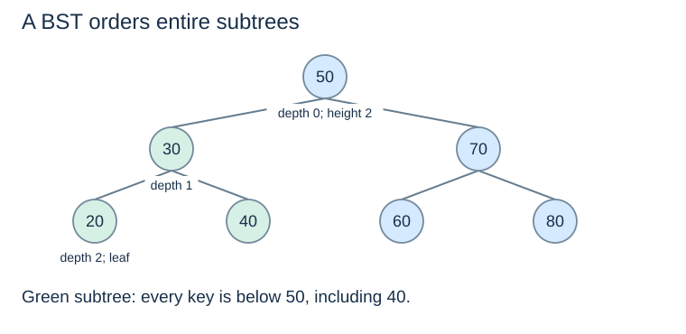
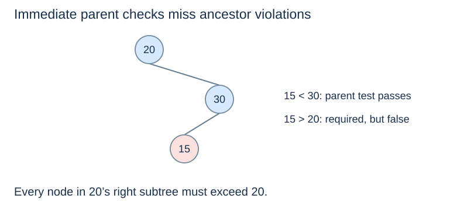

# Trees and whole-subtree ordering

(tree-terminology)=
## Read the structure before the keys

A rooted tree has a **root**, parent–child links and no cycles. Every non-root node has one parent. A **leaf** has no children; an internal node has at least one. A node's **subtree** consists of that node and all its descendants. An **ancestor** lies on the path from the root to the node.

The **depth** of a node counts edges from the root. The **height** of a node counts edges on its longest path to a leaf. We use height 0 for a leaf and −1 for an empty subtree, consistently with Topic 8. Depth belongs to a node's position; height describes what remains below it.

(binary-tree)=
## Binary does not mean balanced or ordered

A binary tree gives each node at most two child positions, named left and right. A node can have only a right child, only a left child, both, or neither. The definition alone imposes no key order and no height guarantee.

(bst-invariant)=
## A BST orders every descendant

For distinct keys, a **binary search tree (BST)** requires, at every node:

- every key in its left subtree is smaller than its key;
- every key in its right subtree is larger;
- both child subtrees obey the same rule.

The reference tree comes from inserting `50, 30, 70, 20, 40, 60, 80`. Key 40 is larger than 30 but smaller than 50; both constraints matter.

(bst-ancestor-bounds)=
## Bounds accumulate along the path

Going left of 50 establishes an upper bound of 50. Going right of 30 then establishes a lower bound of 30. Every descendant in that region must stay strictly between 30 and 50.

In the invalid example, `15 < 30` is locally plausible, but the node is in 20's right subtree and must also exceed 20. Checking only immediate parent–child comparisons misses the violation. A validator should pass lower and upper bounds down recursively.

(bst-duplicate-policy)=
## Declare what equal keys mean

This chapter stores one node per key: inserting an existing key is a no-op. A map can instead replace its associated value; a multiset can store an occurrence count. Whichever policy is chosen, insertion, lookup, traversal and deletion must agree.

Moving equal keys arbitrarily between subtrees changes the invariant and can invalidate search assumptions. Our strict left/right inequalities keep the core reasoning clear. Next: [BST lookup and insertion](bst-lookup-insertion.md).
