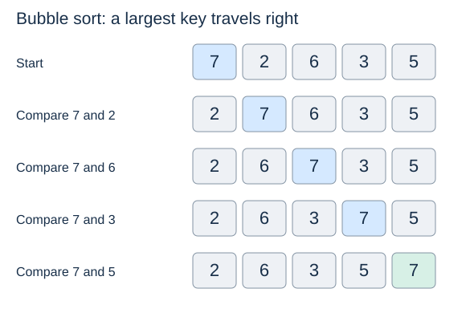

# Bubble sort

**After this page, you should be able to:**

- Trace adjacent swaps and the growth of a completed suffix.
- Distinguish early stopping, stability and inversion counts from total comparisons.

**Builds on:** [Insertion sort](insertion-sort.md) introduces invariants and inversions.

**Code languages:** Python defines the explanations, figures and self-checks. Use the [language guide](../../code-languages.md) for native conventions and dependencies. Complete runnable topic examples: [JavaScript](../../examples/languages/sorting.js) · [Julia](../../examples/languages/sorting.jl).

Teaching sorts retain their mutation/return policy: JavaScript mutators return undefined and Julia teaching mutators return nothing. Built-in sort APIs are shown separately: JavaScript sort and Julia sort! return their mutated arrays. The Timsort/Powersort discussion describes Python’s implementation, not the algorithms used by the other runtimes.

(bubble-sort)=
## Repair neighbouring pairs

Scan left to right, comparing adjacent values and swapping a pair when the left key is larger. A large value can move right repeatedly within one pass. After a complete pass, a largest value in the active region is at its rightmost position.



## Python implementation

::::{tab-set}
:class: code-language-tabs

:::{tab-item} Python
:sync: python

```python
def bubble_sort(a):
    for end in range(len(a) - 1, 0, -1):
        swapped = False
        for j in range(end):
            if a[j] > a[j + 1]:
                a[j], a[j + 1] = a[j + 1], a[j]
                swapped = True
        if not swapped:
            break
```

:::

:::{tab-item} JavaScript
:sync: javascript

```javascript
function bubble_sort(a) {
    for (let end = a.length - 1; end > 0; end--) {
        let swapped = false;
        for (let j = 0; j < end; j++) {
            if (a[j] > a[j + 1]) { [a[j], a[j + 1]] = [a[j + 1], a[j]]; swapped = true; }
        }
        if (!swapped) break;
    }
}
```

:::

:::{tab-item} Julia
:sync: julia

```julia
function bubble_sort!(a)
    for last in length(a):-1:2
        swapped = false
        for j in 1:last-1
            if a[j] > a[j + 1]
                a[j], a[j + 1] = a[j + 1], a[j]
                swapped = true
            end
        end
        !swapped && break
    end
    return nothing
end
```

:::

::::

(bubble-invariant)=
## The sorted suffix invariant

At the start of each pass, the suffix beyond `end` is sorted and already in its final positions; every suffix value is at least every value in the active prefix. The pass places a largest remaining value at `end`, so the suffix can grow by one.

`range(end)` stops at `end - 1`, so the last pair examined is `(end - 1, end)`. The completed suffix is not scanned again. This function modifies the list and returns `None`.

## Implementation choices

| Choice here | Consequence or alternative |
|---|---|
| Left-to-right adjacent comparisons | Large keys can travel far right in one pass; small keys move left only one place per pass |
| Shorten `end` after each pass | Avoids revisiting the completed suffix |
| Track a full pass with no swaps | Makes the sorted-input case linear; omitting it leaves quadratic comparisons |
| Swap only when strictly greater | Preserves equal-key order |

(adjacent-swap-stability)=
## Stability and in-place behaviour

An adjacent swap of a strictly inverted pair removes exactly one inversion, so the number of swaps equals the input inversion count. Equal-key records are never swapped across one another, making this implementation stable.

However, few inversions do not guarantee few comparisons. In `[2, 3, 4, 5, 1]`, the smallest value moves left only one position per pass. Generalising this pattern to $n$ items gives $n-1$ inversions but quadratic comparisons for the left-to-right algorithm above. Insertion sort handles that pattern in linear time because its cost follows $n+I$.

(bubble-early-stopping)=
## Why a pass with no swaps is enough

If a complete pass makes no swaps, every adjacent pair in the active prefix is already in order. Together with the suffix invariant, the entire list is sorted. One comparison that makes no swap is insufficient: later pairs may still be inverted.

With this flag, already sorted input takes $\Theta(n)$ time. Without it, the fixed sequence of passes still performs $n(n-1)/2$ comparisons even on sorted input. Reverse-sorted distinct input needs all passes and takes $\Theta(n^2)$ time. Working space is $\Theta(1)$.

## When to use it

Useful for learning adjacent exchanges and a suffix invariant. Insertion sort is usually the more useful elementary method for nearly sorted lists. Under uniformly random distinct-key permutations, the expected number of inversions, hence swaps, is Θ(n²); total average time is therefore Θ(n²). Empty and singleton lists do no passes and return `None`. The loop uses O(1) storage, so this is strictly in place as well as mutating.

:::{tip} Common misconception
**One comparison without a swap proves the list sorted.** Early stopping requires a complete active pass without swaps.
:::

(sorting-bubble-checks)=
## Check your understanding

Predict the answer before opening the explanation.

**1. After one full pass on [7,2,6,3,5], which item is guaranteed final?**

:::{dropdown} Show explanation
7 is final at the right end. The remaining prefix [2,6,3,5] is not yet sorted.
:::

**2. Does a linear number of inversions guarantee linear comparisons here?**

:::{dropdown} Show explanation
No. In [2,3,…,n,1], 1 moves left one step per pass. There are n−1 inversions but quadratic comparisons.
:::

Next: [Merge sort](merge-sort.md).
