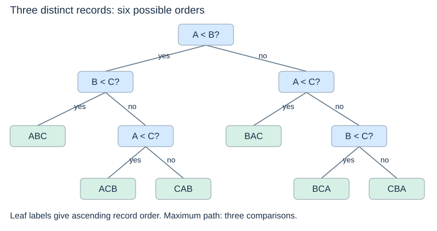

# The comparison lower bound

(comparison-sorting)=
## Specify the model first

A **comparison sort** discovers key order by comparisons between keys. We consider arbitrary inputs of $n$ distinct keys, so a binary comparison has two possible outcomes. There are $n!$ possible relative input orders, and a correct algorithm must distinguish all of them.

This is a statement about information gained from comparisons. It is not a claim that every sorting problem, under every possible key restriction, needs the same amount of time.

(sorting-decision-tree)=
## A decision tree records possible histories

Each internal node represents a comparison; its outgoing edges represent outcomes. A root-to-leaf path records the comparisons for one input. A leaf specifies the resulting order of the input records. For three distinct records A, B and C, a valid tree has six leaves:

Here `ABC` means A has the smallest key, followed by B and C; the letters name records, not fixed key values. Some paths need two comparisons and others three. The height measures the **worst-case** number of comparisons, not the number on every input.

(sorting-lower-bound)=
## Count leaves, then bound height

A binary tree of height $h$ has at most $2^h$ leaves. Distinguishing all $n!$ orders therefore requires

$$ 2^h \geq n!, \qquad h \geq \lceil\log_2(n!)
ceil. $$

To turn this into a lower bound in terms of $n$, use the large factors of the factorial. For $n\geq4$, at least $n/2$ factors are at least $n/2$, so

$$ n! \geq (n/2)^{n/2}, \qquad
\log_2(n!) \geq \frac n2\log_2(n/2) = \Omega(n\log n). $$

Also $n!\leq n^n$, giving $\log_2(n!)\leq n\log_2 n$. Together these show $\log_2(n!)=\Theta(n\log n)$. The lower inequality is essential: an upper bound on the factorial alone cannot establish a lower bound on sorting.

Thus every comparison sort has an input requiring $\Omega(n\log n)$ comparisons. Merge sort achieves $O(n\log n)$ worst-case comparisons, so its comparison growth is asymptotically optimal in this model. This does not make it best for every input size, memory limit or input order. Insertion sort can still take linear time on sorted input because the lower bound concerns the worst case over all orders.

(non-comparison-sorting)=
## Why restricted-key sorts can go further

Suppose keys are integers in `0..k-1`. Counting sort can use a key as an array index, count occurrences, and reconstruct the ordered result in $O(n+k)$ time. Its information access is not limited to comparisons between pairs of keys, so the decision-tree bound above does not apply.

That speed comes with assumptions and storage costs. A count array needs $\Theta(k)$ entries; a common stable record-sorting implementation also uses $\Theta(n)$ output space. If $k$ is huge relative to $n$, counting may be unattractive. Numeric-looking data alone does not guarantee a useful small key range.

**Check your understanding:** does a measured linear-time run contradict the lower bound? No. One favourable input, or a method using restricted-key operations, is compatible with a worst-case comparison bound.

Return to the [sorting overview](sorting.md) or find a term in the [concept index](../../concepts.md).
