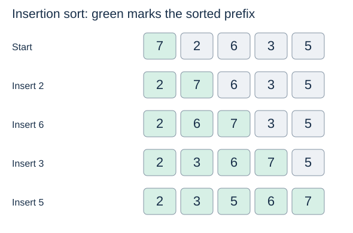
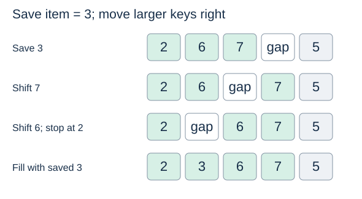

# Insertion sort

**After this page, you should be able to:**

- Trace shifting through a sorted prefix without losing the saved item.
- Explain stability, adaptiveness and costs for this shifting implementation.

**Builds on:** [Sorting contracts](sorting-properties.md) define order, multiplicities and equal-key stability.

(insertion-sort)=
## Grow a sorted prefix

Imagine arranging cards in your hand. Keep the cards already considered in order, take the next card, and insert it in its proper position. The unprocessed part need not be ordered.



## Python implementation

```python
def insertion_sort(a):
    for i in range(1, len(a)):
        item = a[i]
        j = i - 1
        while j >= 0 and a[j] > item:
            a[j + 1] = a[j]
            j -= 1
        a[j + 1] = item
```

(insertion-invariant)=
## The prefix invariant

Before outer iteration `i`, the prefix `a[:i]` is sorted and contains exactly the records originally in those first `i` positions. Initially, a one-element prefix is sorted. Each iteration inserts the next record without losing any earlier record. When the prefix covers the entire list, the sorting specification follows.

The function modifies `a` and returns `None`. Saving `item` is essential: shifting overwrites its original position. Python's `and` short-circuits, so `a[j]` is examined only when `j >= 0`.

(insertion-shifting)=
## Shift, then fill the gap

To insert `3` into the prefix `[2, 6, 7]`, save `3`, shift `7` and `6` one position right, and stop at `2`. Place `3` after `2`. During this process, the saved item lives in a variable; duplicated values in the list are temporary copies awaiting replacement.



Why can the search stop at `2`? The prefix is sorted, so all earlier keys are also at most `3`. Scanning them would establish nothing new. The strict `>` comparison means an equal key is not shifted past the new item, making this implementation stable.

## Implementation choices

| Choice here | Consequence or alternative |
|---|---|
| Save one item and shift larger records | Opens a gap with assignments; adjacent swaps are another implementation |
| Stop at the first key at most the saved item | Uses the sorted-prefix invariant to avoid unnecessary comparisons |
| Use a strict `>` test | Equal keys are not moved past the new record |
| Search linearly backwards | Binary insertion can reduce search comparisons, but still shifts records |

## Stability and in-place behaviour

This implementation is stable, mutates the supplied list, returns `None`, and uses O(1) extra storage. The elementary listing compares values directly; it does not accept `key` or `reverse`. An alternative returning a new list would add O(n) output storage even if its insertion loop used constant workspace.

(inversions)=
## Inversions measure disorder

An **inversion** is a pair of positions `i < j` with `a[i] > a[j]`. The list `[3, 1, 2]` has two inversions: `(3, 1)` and `(3, 2)`. Equal keys do not form inversions.

(adaptive-sorting)=
## Adaptiveness and cost

Each shift moves an earlier, larger item past the item being inserted, removing one inversion. Therefore the total number of shifts equals the initial inversion count $I$. With constant-time comparisons and list assignments, this implementation takes $\Theta(n+I)$ time for $n\geq1$.

- Already sorted: $I=0$, so time is $\Theta(n)$.
- Reverse sorted with distinct keys: $I=n(n-1)/2$, so time is $\Theta(n^2)$.
- Nearly sorted with few inversions: relatively little shifting is necessary.

This response to existing order is **adaptiveness**. Additional working space is $\Theta(1)$; the algorithm creates no growing temporary lists. Empty and singleton lists require no insertion iterations.

## When to use it

Useful for small inputs, nearly sorted data and short runs inside hybrid sorts. For uniformly random distinct-key permutations, expected inversions are n(n−1)/4, so average time is Θ(n²); this distribution assumption is different from the Θ(n+I) bound for one particular input.

:::{tip} Common misconception
**A saved item may be discarded after shifting.** The gap must be filled; sorted order alone does not prove record preservation.
:::

(sorting-insertion-checks)=
## Check your understanding

Predict the answer before opening the explanation.

**1. Insert 3 into [2,6,7]. Which records shift, and what is saved?**

:::{dropdown} Show explanation
Save 3; shift 7 then 6 right; write the saved 3 after 2.
:::

**2. Would changing `>` to `>=` preserve stability for equal keys?**

:::{dropdown} Show explanation
No. An earlier equal record could shift after the later one, reversing their original order.
:::

Next: [Bubble sort](bubble-sort.md), which grows order from the other end.
