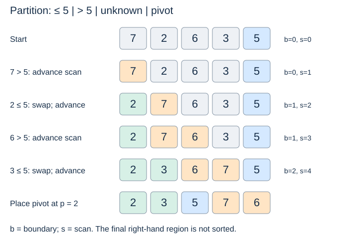

# Partitioning around a pivot

(partitioning)=
## Classification before sorting

Choose a value called a **pivot**. A partition operation reorganises a range so values on one side satisfy one comparison with the pivot and values on the other side satisfy the opposite comparison. Neither side must be internally sorted.

Here we follow the lecture's rule: keys **less than or equal to** the pivot go left; larger keys go right. Other partition schemes use different tie rules and return different boundaries. Their recursion contracts must be read separately.

(partition-contract)=
## A precise contract

The code uses an inclusive range `lo..hi`. It selects `a[hi]` as pivot and returns its final index `p`. Afterwards:

- `a[lo:p]` contains keys at most the pivot;
- `a[p]` is the selected pivot;
- `a[p+1:hi+1]` contains keys greater than the pivot;
- the range contains the same records, and positions outside it are unchanged.

```python
def partition(a, lo, hi):
    pivot = a[hi]
    boundary = lo
    for scan in range(lo, hi):
        if a[scan] <= pivot:
            a[boundary], a[scan] = a[scan], a[boundary]
            boundary += 1
    a[boundary], a[hi] = a[hi], a[boundary]
    return boundary
```

Call this only with `0 <= lo <= hi < len(a)`. `hi` is inclusive here, although Python slices and `range` exclude their stop index. The scan excludes `hi` so the pivot stays in place until the final swap.

(partition-invariant)=
## Four regions explain the scan

Before each comparison, `a[lo:boundary]` contains keys at most the pivot; `a[boundary:scan]` contains larger keys; `a[scan:hi]` is unknown; and `a[hi]` holds the pivot.



If the scanned key is larger, extend the larger-key region by advancing the scan. Otherwise, swap it with the first larger-key position and advance `boundary` as well. If that region is empty, the swap is with the same position and is harmless.

Once no unknown values remain, swap the pivot with the first larger key. For `[7, 2, 6, 3, 5]`, the result is `[2, 3, 5, 7, 6]` with `p = 2`. The right side remains unsorted, yet partitioning is correct.

(partition-cost)=
## Cost and ties

On a range of $m$ items, the scan makes exactly $m-1$ pivot comparisons and uses constant additional space. Its time is $\Theta(m)$. This is a Lomuto-style partition.

Equal keys go left in this version. If all keys equal the pivot, `boundary` reaches `hi` and the pivot stays at the right end. That is a valid partition but creates a very uneven recursive split. The swaps can also reorder equal-key records: partitioning `[2_A, 2_B, 1]` produces `[1, 2_B, 2_A]` when comparisons use the numeric key.

Next: [Quicksort](quicksort.md), which recursively sorts the two sides.
