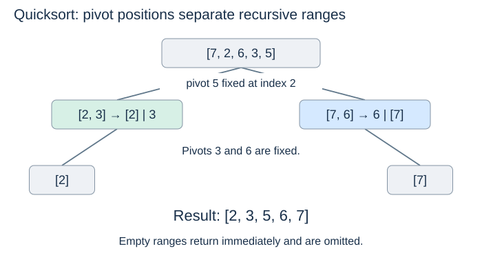

# Quicksort

(quicksort)=
## Partition, then recurse

Merge sort first splits by position and later combines sorted results. Quicksort first partitions by key and then sorts the resulting ranges. Because the pivot separates the ranges, no merge step is needed.

The following code uses exactly the `partition` function from [the preceding page](partitioning.md), including its inclusive bounds and `<=` tie rule.

```python
def quicksort(a):
    def sort_range(lo, hi):
        if lo >= hi:
            return
        p = partition(a, lo, hi)
        sort_range(lo, p - 1)
        sort_range(p + 1, hi)

    sort_range(0, len(a) - 1)
```

It modifies `a` and returns `None`. Empty lists start with `(lo, hi) = (0, -1)` and immediately return. Singleton ranges also need no partition.

(quicksort-progress)=
## Why the recursion terminates and sorts

The pivot must be excluded from both recursive ranges. Each nontrivial call fixes one pivot and delegates only strictly smaller ranges. If either side is empty, the other still has one fewer item than the original range.

Assume both recursive calls correctly sort their smaller ranges. Every left key is at most the pivot, every right key is larger, and each side is now internally sorted. Together they form a sorted range containing the original records. These are the inductive steps behind correctness.



(quicksort-balanced)=
## Balanced partitions

If pivots repeatedly split ranges into roughly equal halves, there are $\Theta(\log n)$ levels. Partition scans across one level total $O(n)$ work, giving $\Theta(n\log n)$ time overall. The longest live chain of recursive calls uses $\Theta(\log n)$ stack space. See [Topic 3's recursion costs](../recursion/recursion-costs.md) for the level-by-level reasoning.

(quicksort-worst-case)=
## One-sided partitions

If each pivot is an extreme key, the remaining sizes are $n-1,n-2,\ldots,1$. The comparison count is

$$ (n-1)+(n-2)+\cdots+1 = \frac{n(n-1)}{2}. $$

Time becomes $\Theta(n^2)$ and the straightforward recursive implementation uses $\Theta(n)$ stack space. With the last-element pivot, ascending and descending distinct inputs produce this behaviour. All-equal input also does so under our `<=` rule. Large bad cases may reach Python's recursion limit before finishing.

(randomised-quicksort)=
## What random pivots change

Choosing a uniformly random pivot in each range, then swapping it to `hi` before partitioning, removes the dependence on a particular distinct-key input order. For distinct keys, expected running time over those random choices is $\Theta(n\log n)$ for every fixed input. Worst-case time is still quadratic: random choices can repeatedly be unlucky.

(three-way-partition)=
## Equal keys need a separate idea

Random selection cannot improve an all-equal input with our two-way partition: every possible pivot has the same key. A **three-way partition** groups keys as less than, equal to, and greater than the pivot, then recurses only on the less-than and greater-than groups. This avoids repeatedly processing a large equal-key group. It is a different algorithmic variant, not a property of the code shown above.

Next: [Comparing strategies](comparing-strategies.md).
