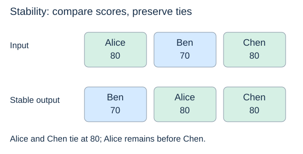

# What sorting promises

(sorting-specification)=
## Order without losing records

A sorting algorithm must satisfy two conditions: its output is ordered, and it contains exactly the same records, with the same multiplicities, as its input. Returning an empty list is ordered but fails the second condition. Repeated values must not disappear.

For ascending numeric order, adjacent output values satisfy `a[i] <= a[i + 1]`. This chapter assumes a consistent ordering and constant-time comparisons. If comparing long strings or computing expensive keys takes more work, include that cost separately.

(sorting-key)=
## Sorting keys

A record can contain several fields. The **key** is the field or computed value that determines order. Sorting students by score does not mean rearranging the fields within each student record.

```python
students = [("Alice", 80), ("Ben", 70), ("Chen", 80)]
by_score = sorted(students, key=lambda student: student[1])
assert by_score == [("Ben", 70), ("Alice", 80), ("Chen", 80)]
assert students[0] == ("Alice", 80)  # original list is unchanged
```

(stable-sorting)=
## Stability preserves the order of ties

A **stable** sort preserves the input order of records whose keys compare equal. Alice originally precedes Chen; both have score 80. A stable score sort keeps that order. Either order of these two records satisfies ascending score order, but only one preserves stability.



Stability matters when earlier ordering carries information. To order records by score and then by name within each score, one option is a single tuple key `(score, name)`. Another is a stable sort by name followed by a stable sort by score: the last sort establishes the primary key and preserves the earlier order within ties.

(in-place-sorting)=
## In-place work and additional space

An algorithm using only a constant amount of additional working storage is **in-place** in the strict space sense. Insertion sort and bubble sort below use a few variables while modifying the supplied list.

Quicksort's partition uses constant additional storage, but recursive calls require stack frames. State the stack cost as well; modifying the input alone does not prove constant auxiliary space. A function can also modify its input while allocating substantial temporary storage.

(python-sorting)=
## Python's two interfaces

`sorted(iterable, key=...)` returns a new list. `a.sort(key=...)` rearranges an existing list and returns `None`. Both provide stable sorting. These interfaces are useful for practical code; implementing the elementary algorithms lets us examine why they work.

```python
values = [3, 1, 2]
result = values.sort()
assert values == [1, 2, 3]
assert result is None
```

**Check your understanding:** if two implementations return the same sequence of numeric scores, does that establish that both are stable? No: attach distinguishable records to equal keys to observe their relative order.

Next: [Insertion sort](insertion-sort.md).
