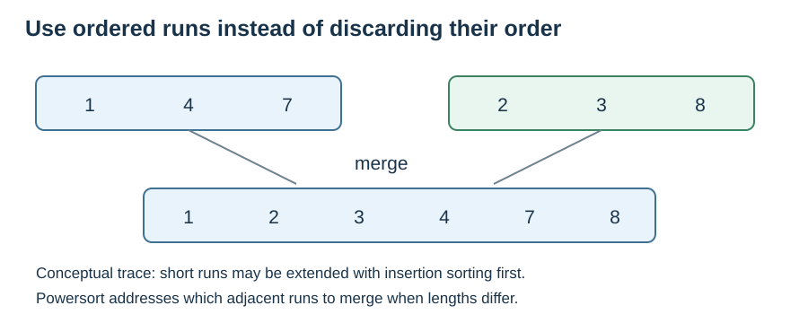

# Timsort and Powersort: reuse existing order

**After this page, you should be able to:**

- Connect natural runs, insertion sorting and stable merging in a hybrid algorithm.
- Explain merge-order costs and distinguish mutation from constant-space sorting.

**Builds on:** [Insertion sort](insertion-sort.md), [merge sort](merge-sort.md) and [stability](sorting-properties.md#stable-sorting). This is a conceptual overview, not a complete Timsort implementation.

**Code languages:** Python defines the explanations, figures and self-checks. Use the [language guide](../../code-languages.md) for native conventions and dependencies. Complete runnable topic examples: [JavaScript](../../examples/languages/sorting.js) · [Julia](../../examples/languages/sorting.jl).

Teaching sorts retain their mutation/return policy: JavaScript mutators return undefined and Julia teaching mutators return nothing. Built-in sort APIs are shown separately: JavaScript sort and Julia sort! return their mutated arrays. The Timsort/Powersort discussion describes Python’s implementation, not the algorithms used by the other runtimes.

(timsort)=
## Idea and visual trace

A **run** is a contiguous stretch already in order. A natural merge sort discovers runs rather than always splitting at the midpoint. Timsort combines run detection, short-run insertion sorting and stable merging.

Consider `[1,4,7,2,3,8]`: two ascending runs, `[1,4,7]` and `[2,3,8]`, can be merged into `[1,2,3,4,7,8]`. Existing order becomes useful work already done.



This tiny example isolates the run/merge idea. A production implementation may extend a short run using insertion sort rather than execute these exact two merge steps.

## Python interface

::::{tab-set}
:class: code-language-tabs

:::{tab-item} Python
:sync: python

```python
records = [("A", 4), ("B", 1), ("C", 4)]
ordered = sorted(records, key=lambda record: record[1])
assert ordered == [("B", 1), ("A", 4), ("C", 4)]
assert records == [("A", 4), ("B", 1), ("C", 4)]
result = records.sort(key=lambda record: record[1], reverse=True)
assert result is None
assert records == [("A", 4), ("C", 4), ("B", 1)]
```

:::

:::{tab-item} JavaScript
:sync: javascript

```javascript
// Native sort API comparison; this does not claim its engine uses Powersort.
let records = [["A", 4], ["B", 1], ["C", 4]];
let ordered = records.slice().sort((a, b) => a[1] - b[1]);
console.assert(JSON.stringify(ordered) === JSON.stringify([["B", 1], ["A", 4], ["C", 4]]));
let result = records.sort((a, b) => b[1] - a[1]);
console.assert(result === records);
console.assert(JSON.stringify(records) === JSON.stringify([["A", 4], ["C", 4], ["B", 1]]));
```

:::

:::{tab-item} Julia
:sync: julia

```julia
# Native API comparison, explicitly choosing stable merging, not Powersort.
records = [("A", 4), ("B", 1), ("C", 4)]
ordered = sort(records; by=r -> r[2], alg=MergeSort)
@assert ordered == [("B", 1), ("A", 4), ("C", 4)]
@assert records == [("A", 4), ("B", 1), ("C", 4)]
result = sort!(records; by=r -> r[2], rev=true, alg=MergeSort)
@assert result === records
@assert records == [("A", 4), ("C", 4), ("B", 1)]
```

:::

::::

Both interfaces preserve equal-key order, including with `reverse=True`. These are calls to Python's implementation, not a hand-written Timsort listing.

## Why it works

Identify or construct sorted runs, then merge adjacent runs without dropping records. A stable merge preserves tie order. Repeat until one run covers the list. The difficult engineering question is which merges to perform when run lengths differ.

(timsort-implementation-choices)=
## Implementation choices

Short runs can be extended with stable binary insertion sorting; binary search reduces comparisons, but shifting records still costs work. Descending-run normalisation must preserve equal-key order: blindly reversing `[4_A,4_B,2]` would put B before A.

CPython's Timsort-derived natural merge sort uses a **Powersort merge policy** in the Python 3.14 design notes. We retain “Timsort” for this introductory family overview; its original merge scheduling rules should not be presented as current CPython internals. Thresholds and optimisations such as galloping are beyond this page.

(powersort)=
## Powersort: choose the merge order

Merging runs of lengths a and b performs work proportional to a+b in the simple full-merge model. With adjacent run lengths **100,10,10**, merging left-to-right costs 110+120=230 units. Merging the two short runs first costs 20+120=140. The output is the same, but the long run participates in less repeated work. These are illustrative run lengths, not a claim about how a particular tiny list is processed.

Powersort uses run positions and lengths to assign boundary “powers” and schedule adjacent merges into a nearly optimal merge tree. It is not simply “always merge the two shortest runs”: adjacency and original order matter. In CPython it supplies the merge policy inside the natural-run sorting implementation; it is not another Python sorting function. The detailed power calculation is an optional advanced topic.

This example compares abstract full-merge work, not exact comparisons, wall-clock timings or CPython's optimised merge counts. See [Munro and Wild's original Powersort paper](https://www.wild-inter.net/publications/munro-wild-2018).

## Stability and in-place behaviour

The built-in sort is stable. `list.sort()` changes the existing list, but merging may require O(n) temporary storage. Thus “in place” in the interface documentation describes mutation; it does not imply O(1) auxiliary space. `sorted()` additionally constructs a new output list.

## Time and space costs

With constant-cost comparisons, best time is Θ(n) when existing order permits a scan with little further work; worst time is O(n log n). Randomly ordered data typically requires Θ(n log n) work. Worst-case additional storage is O(n). Expensive key functions and comparisons add their own costs; Python evaluates a supplied key once per record.

## When to use it

For ordinary Python applications, start with `sorted()` or `.sort()`. This hybrid explains why useful order in real data matters alongside worst-case bounds.

References: [Python sorting guide](https://docs.python.org/3/howto/sorting.html) for interface guarantees; [CPython 3.14 sorting design notes](https://github.com/python/cpython/blob/3.14/Objects/listsort.txt) for run handling, temporary storage and merge-policy details.

:::{tip} Common misconception
**Timsort is just merge sort with a new name.** It discovers existing runs and combines several strategies; the teaching merge sort always splits by position.
:::

(sorting-timsort-checks)=
## Check your understanding

**1. For adjacent run lengths 100,10,10, how much abstract full-merge work is saved by merging the two short runs first?**

:::{dropdown} Show explanation
Left-to-right costs 110+120=230 units; the short pair first costs 20+120=140. The saving is 90 units. This models merge lengths, not exact comparisons or a measured runtime.
:::

**2. Does `records.sort()` returning None prove constant auxiliary space?**

:::{dropdown} Show explanation
No. The return convention describes the interface. Internal merge buffers can still grow with the list.
:::

Next: [Compare the strategies](comparing-strategies.md).
