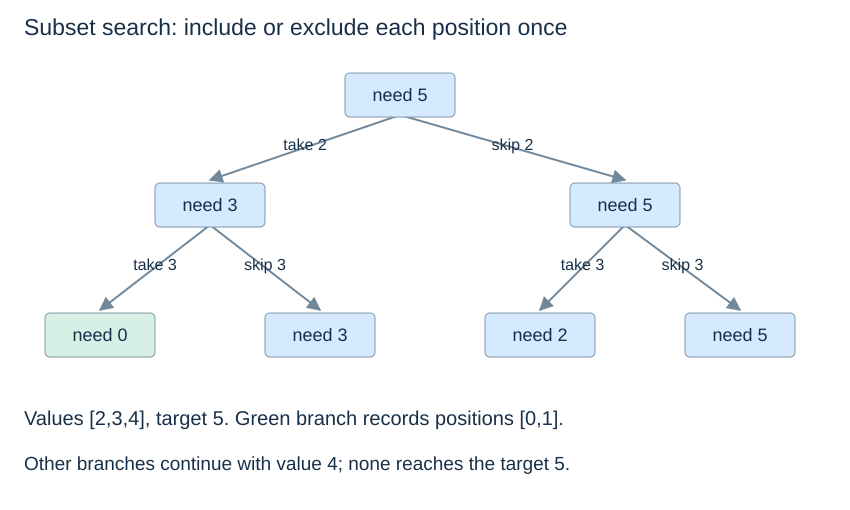

# Backtracking and safe pruning

(backtracking)=
## Build a candidate, explore, then undo

Backtracking explores alternatives from a partial candidate. It adds a choice, recursively explores the consequences, then restores the earlier state before trying another branch. The restoration matters when the partial candidate is a shared mutable list.

For subset sum, choose each input position at most once and report every subset totalling a target. This version requires strictly positive integer values and a nonnegative integer target. Equal values at different positions are distinct selectable items.

```python
def subset_sum_indices(values, target):
    values = list(values)
    if type(target) is not int or target < 0:
        raise ValueError("target must be a nonnegative integer")
    if any(type(v) is not int or v <= 0 for v in values):
        raise ValueError("values must be positive integers")
    results, chosen = [], []

    def search(i, remaining):
        if remaining == 0:
            results.append(chosen.copy())
            return
        if i == len(values):
            return
        if values[i] <= remaining:
            chosen.append(i)
            search(i + 1, remaining - values[i])
            chosen.pop()
        search(i + 1, remaining)

    search(0, target)
    return results
```

(backtracking-pruning)=
## A prune must follow from the domain

Skipping an item larger than the remaining target is safe because all other values are positive: no future negative item can undo an overshoot. Likewise, once the remainder reaches zero, adding another item cannot preserve the sum. These arguments would need revision if zero or negative values were allowed.



For values `[2,3,4]` and target 5, the result is `[[0,1]]`. For target 0, the only solution under this positive-item model is the empty subset. Copying `chosen` when saving a solution prevents later pops from changing the stored answer.

(backtracking-cost)=
## Small local updates do not make the search space small

There are up to $2^n$ include/skip combinations for n positions. Traversal can be exponential, and copying reported subsets gives an $O(n2^n)$ worst-case upper bound including output. The active recursion and chosen list use $O(n)$ working space, plus stored results.

If only feasibility or a count is required, a DP keyed by `(position, remaining)` may merge equivalent future subproblems. Enumerating every distinct solution needs to retain their distinct choices. State compression must respect the requested result.

Next: [Sequence patterns](sequence-patterns.md).
