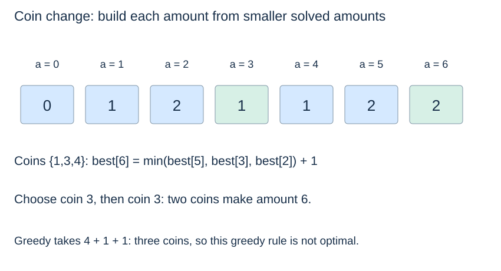

# Dynamic programming: states, reuse and reconstruction

**After this page, you should be able to:**

- Define sufficient states and justify a minimum-coin recurrence.
- Compare memoisation, tabulation, reconstruction and their full resource costs.

**Builds on:** [State relevance](strategy-selection.md#state-and-subproblem), [recursive progress](../recursion/recursive-calls.md) and [shortest-path predecessors](../graph-algorithms/shortest-path-state.md).

**Code languages:** Python defines the explanations, figures and self-checks. Use the [language guide](../../code-languages.md) for native conventions and dependencies. Complete runnable topic examples: [JavaScript](../../examples/languages/strategies.js) · [Julia](../../examples/languages/strategies.jl).

State definitions, pruning conditions and tie policies are shared. Julia returns one-based position tuples/subsets, and its coin table uses slot a+1 for amount a. The finite numeric examples require representable intermediate arithmetic in each runtime.

(dynamic-programming)=
## Solve equivalent subproblems once

Dynamic programming (DP) stores results for well-defined subproblems and reuses them. It is useful when different choices lead to the same future state. For optimisation, the recurrence must also justify how an optimum is assembled from correct smaller-state results; this is often called **optimal substructure**.

Consider minimum coin count for a nonnegative integer amount A, with unlimited copies of positive integer denominations. Let C(a) be the fewest coins totalling a. Then

$$C(0)=0,\qquad C(a)=1+\min_{c\leq a} C(a-c).$$

An impossible state has value infinity; a minimum over no available choices is infinity. This recurrence considers the last coin of every possible solution. The remaining solution must be optimal for its remainder, or replacing it would improve the whole answer.

(memoisation)=
## Top-down memoisation retains recursive structure

::::{tab-set}
:class: code-language-tabs

:::{tab-item} Python
:sync: python

```python
def coin_problem(coins, amount):
    coins = tuple(coins)
    if type(amount) is not int or amount < 0:
        raise ValueError("amount must be a nonnegative integer")
    if any(type(c) is not int or c <= 0 for c in coins):
        raise ValueError("coins must be positive integers")
    return tuple(sorted(set(coins)))

def min_coins_memo(coins, amount):
    coins = coin_problem(coins, amount)
    memo = {0: 0}

    def solve(a):
        if a not in memo:
            memo[a] = min((1 + solve(a - c) for c in coins if c <= a),
                          default=float("inf"))
        return memo[a]

    result = solve(amount)
    return None if result == float("inf") else result
```

:::

:::{tab-item} JavaScript
:sync: javascript

```javascript
function coin_problem(coins, amount) {
    coins = [...coins];
    if (!Number.isSafeInteger(amount) || amount<0 || coins.some(c=>!Number.isSafeInteger(c)||c<=0))
        throw new RangeError("nonnegative amount and positive integer coins required");
    return [...new Set(coins)].sort((a,b)=>a-b);
}
function min_coins_memo(coins, amount) {
    coins = coin_problem(coins,amount); const memo = new Map([[0,0]]);
    function solve(a) {
        if (!memo.has(a)) {
            let best = Infinity;
            for (const c of coins) if (c<=a) best = Math.min(best,1+solve(a-c));
            memo.set(a,best);
        }
        return memo.get(a);
    }
    const result = solve(amount); return result === Infinity ? null : result;
}
```

:::

:::{tab-item} Julia
:sync: julia

```julia
function coin_problem(coins, amount)
    coins = collect(coins)
    (amount isa Int && amount >= 0) || throw(ArgumentError("invalid amount"))
    all(c isa Int && c > 0 for c in coins) || throw(ArgumentError("invalid coin"))
    return sort(unique(coins))
end
function min_coins_memo(coins, amount)
    coins = coin_problem(coins,amount); memo = Dict{Int,Float64}(0=>0)
    function solve(a)
        if !haskey(memo,a)
            best = Inf
            for c in coins; c <= a && (best = min(best,1+solve(a-c))); end
            memo[a] = best
        end
        return memo[a]
    end
    result = solve(amount); return result == Inf ? nothing : Int(result)
end
```

:::

::::

The dictionary caches both possible and impossible states. Positive denominations ensure recursive amounts decrease. Recursion depth can still grow with A, so Python can reach its recursion limit; memoisation reduces repeated work, not necessarily depth.

:::{note} Pause and trace
Work out the minimum counts for a few small amounts using the recurrence first. Then read the bottom-up version as another dependency order for those states. Reconstruction adds a separate question: which decision produced each best count?
:::

(tabulation)=
## Bottom-up tabulation follows the state dependencies

::::{tab-set}
:class: code-language-tabs

:::{tab-item} Python
:sync: python

```python
def min_coin_change(coins, amount):
    coins = coin_problem(coins, amount)
    best = [float("inf")] * (amount + 1)
    choice = [None] * (amount + 1)
    best[0] = 0
    for a in range(1, amount + 1):
        for c in coins:
            if c <= a and best[a - c] + 1 < best[a]:
                best[a] = best[a - c] + 1
                choice[a] = c
    if best[amount] == float("inf"):
        return None
    selected = []
    a = amount
    while a > 0:
        selected.append(choice[a])
        a -= choice[a]
    return best[amount], selected
```

:::

:::{tab-item} JavaScript
:sync: javascript

```javascript
function min_coin_change(coins, amount) {
    coins = coin_problem(coins,amount);
    const best = Array(amount+1).fill(Infinity), choice = Array(amount+1).fill(null); best[0] = 0;
    for (let a=1;a<=amount;a++) for (const c of coins) {
        if (c<=a && best[a-c]+1<best[a]) { best[a]=best[a-c]+1; choice[a]=c; }
    }
    if (best[amount] === Infinity) return null;
    const selected = []; let a=amount;
    while (a>0) { selected.push(choice[a]); a-=choice[a]; }
    return [best[amount],selected];
}
```

:::

:::{tab-item} Julia
:sync: julia

```julia
function min_coin_change(coins, amount)
    coins = coin_problem(coins,amount)
    best = fill(Inf,amount+1); choice = zeros(Int,amount+1); best[1]=0
    for a in 1:amount, c in coins
        if c<=a && best[a-c+1]+1<best[a+1]; best[a+1]=best[a-c+1]+1; choice[a+1]=c; end
    end
    best[amount+1] == Inf && return nothing
    selected = Int[]; a=amount
    while a>0; push!(selected,choice[a+1]); a-=choice[a+1]; end
    return (Int(best[amount+1]),selected)
end
```

:::

::::

(coin-change-contract)=
## Compare count-only and reconstructed answers

| Function | Returned result | Impossible / zero amount |
|---|---|---|
| `coin_problem(coins, amount)` | Sorted tuple of distinct validated denominations | Empty denominations are valid |
| `min_coins_memo(coins, amount)` | Minimum integer count | `None` / `0` |
| `min_coin_change(coins, amount)` | `(minimum_count, selected_coins)` | `None` / `(0, [])` |

Run `coin_problem` before either solver; the listings share this helper. Each consumes a finite denomination iterable and leaves an input list unchanged. Amount must be an exact nonnegative `int`; denominations must be exact positive `int` values. Booleans and other invalid values raise `ValueError`. Validation still happens for amount zero. Duplicated denominations collapse because copies are unlimited, not because distinct physical coins have been removed.

The tabulated solver scans normalised coins in ascending order and records only strict improvement. Ties retain the earlier stored decision; reconstruction supplies one optimum coin sequence, not every optimum. Its order represents backtracking through amount states rather than a promise of sorted output.

(dp-reconstruction)=
## Store a decision when the route to the answer matters

The memoised function returns only a count or `None`; the tabulated version returns `(count, coin_list)` or `None`. Its `choice` array permits reconstruction, just as graph predecessors recover a route. Amount zero returns `(0, [])`; an empty denomination set cannot form a positive amount.



(dp-cost-and-model)=
## Count states times transitions, then check input encoding

With k distinct denominations and target A, the main DP has A+1 states and up to k transitions per state. For k≥1 and A≥1 this gives $O(kA)$ work and $O(A)$ state storage, assuming constant-time arithmetic. Including empty denomination sets and amount zero, the uniform bounds are $O((k+1)(A+1))$ work and $O(A+1)$ state storage. Normalising d supplied denominations adds expected $O(d+k\log(k+1))$ work for set construction and sorting; its temporary input tuple can occupy $O(d)$ storage. Reconstruction adds at most A selected coins. Memoisation visits only reachable requested states but has the same worst-case state bound.

This is an **unbounded** coin model. If each coin position can be used at most once, state must include which items remain, or a different iteration discipline must enforce that restriction. Also A is a numeric magnitude, not its bit length; [the complexity page](complexity-limits.md) explains why $O(kA)$ is pseudopolynomial.

## State invariants, storage and implementation choices

In tabulation, when amount a is processed, every smaller amount has already been solved. Positive coins make each dependency a−c smaller, and `choice[a]` records a coin only when its predecessor state supplies a finite improvement. Reconstruction decreases the amount until zero. Memoisation follows the same dependencies recursively and caches impossible states too; it does not remove Python's finite recursion limit.

With d supplied coins, k distinct denominations and amount A, add expected O(d+k log(k+1)+1) normalisation time and O(d+k+1) temporary space to the O((k+1)(A+1)) main bound. Tables/cache and possible recursive frames use O(A+1) working space. The count-only result occupies O(1) model words; reconstruction returns s coin values, requiring O(s+1) output space with s≤A for positive integer coins. Time bounds use constant-cost arithmetic and expected dictionary access where applicable.

Tabulation solves all amounts through A, whereas memoisation may visit fewer states but can still have a deep active chain. Neither is a general bounded-item solver. A state/index discipline enforcing item availability is needed for that different contract.

:::{tip} Common misconception
**Memoisation makes recursion shallow.** It reduces repeated state computation; the first chain of decreasing amounts can still be long.
:::

(dynamic-programming-checks)=
## Check your understanding

Predict the result or justify the choice before opening the explanation.

**1. For coins [1,3,4] and amount 6, what do the two public solvers return?**

:::{dropdown} Show explanation
The memoised solver returns 2. The tabulated solver returns (2, [3,3]). Largest-coin-first would instead use three coins.
:::

**2. What do the solvers return for no denominations and amount 0, and for no denominations and amount 2?**

:::{dropdown} Show explanation
For zero, the memoised result is 0 and the tabulated result is (0, []). For amount 2, both return None because no positive total can be formed.
:::

Next: [Backtracking](backtracking.md).
