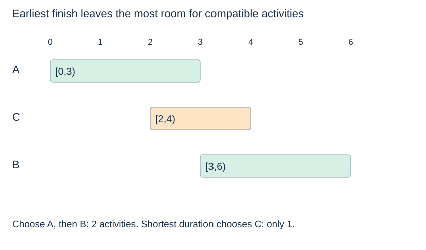

# Greedy design and exchange reasoning

**After this page, you should be able to:**

- Justify earliest-finish activity selection using an exchange argument.
- Specify ties, boundaries and the limits of a count-maximisation objective.

**Builds on:** [Strategy contracts](strategy-selection.md), [stable sorting](../sorting/sorting-properties.md) and [correctness arguments](../analysis/correctness.md).

(greedy-choice)=
## Fix a choice only when it is safe

A **greedy** algorithm makes a local choice and commits to it. The key obligation is to prove that the choice can participate in a globally correct result. Merely choosing the smallest, nearest or shortest candidate does not supply that proof.

(interval-scheduling)=
## Select as many compatible activities as possible

Activities occupy half-open intervals `[start,end)` with start < end. Touching endpoints are compatible: an activity ending at 3 can precede one starting at 3. To maximise the number selected, sort by finish time and repeatedly take the next compatible activity.

```python
def select_activities(activities):
    activities = list(activities)  # (name, start, end)
    if any(start >= end for _, start, end in activities):
        raise ValueError("activities require start < end")
    chosen = []
    last_end = float("-inf")
    for activity in sorted(activities, key=lambda a: (a[2], a[1])):
        if activity[1] >= last_end:
            chosen.append(activity)
            last_end = activity[2]
    return chosen
```

Finite numeric endpoints and bounded-cost comparisons are assumed. The function returns activity records and leaves the caller's input unchanged. Sorting dominates at $O(n\log(n+1))$ time; this copying implementation uses $O(n)$ space including the returned records' references.

(activity-selection-contract)=
## Specify input, result and tie choices

`select_activities(activities)` consumes a finite iterable of `(name, start, end)` records and returns a new list of selected records. Endpoints must be finite comparable numbers with start<end; an interval violating that inequality raises `ValueError`. Record shape, numeric types and finiteness are preconditions, not comprehensively validated. Empty input returns `[]`.

The function copies and sorts the input rather than editing an input list. Returned entries refer to the original records; it does not deep-copy their fields. It sorts by `(end, start)`, retaining input order when both are tied. Selection is therefore reproducible for that input order, but the optimum need not be unique. Compatibility allows a selected activity to start exactly at the preceding end.

(greedy-exchange-proof)=
## Replace an optimum's first activity

Let g be an activity with earliest finish, and let o be the first activity in some optimum selection. Because g finishes no later than o, replacing o with g leaves every later chosen activity feasible. The replacement has the same count, so an optimum exists beginning with g. Apply the same argument to the remaining compatible activities.



The plausible rule “choose shortest duration first” fails on A=[0,3), B=[3,6), C=[2,4): C is shortest but blocks both A and B. Earliest finish selects A and B, with count two.

(greedy-limits)=
## Changing the objective can invalidate the proof

If activities have rewards and the goal is maximum total reward, replacing an activity by an earlier-finishing one may lose reward. The count-maximisation proof no longer establishes optimality. Similarly, with coin values 1,3,4 and amount 6, repeatedly taking the largest coin gives 4+1+1, whereas 3+3 uses fewer coins.

## State, implementation choices and costs

After each accepted activity, `last_end` is its end and `chosen` is a compatible sequence. The next accepted start is at least that end. The exchange argument shows why committing to earliest finish preserves an optimum completion, not merely a feasible schedule.

For n supplied records, copying, sorting and scanning take O(n log(n+1)+1) time. Copied/sorted lists and sorting workspace use O(n+1); returned references use O(s+1) for s selected activities. Fixed-size records and constant-cost endpoint comparisons are assumed. Sorting already ordered records may be faster in a particular implementation, but this function still includes the sorting call.

Use this rule for maximum activity count on one resource under the stated interval model. Weighted rewards, multiple simultaneous resources or extra travel/setup constraints change the problem and require a new justification; the same method names or finish-time sorting do not establish optimality there.

:::{tip} Common misconception
**The shortest activity must be the safest choice.** Duration alone ignores which other activities it blocks. Earliest finish is the rule justified by this exchange proof.
:::

(greedy-design-checks)=
## Check your understanding

Predict the result or justify the choice before opening the explanation.

**1. For A=[0,3), B=[3,6), C=[2,4), which maximum-count selection is returned?**

:::{dropdown} Show explanation
A then B. Touching at 3 is compatible. Choosing the shorter C would block both and produce only one activity.
:::

**2. If activities gain unequal rewards, does the same exchange proof establish maximum reward?**

:::{dropdown} Show explanation
No. Replacing an activity by an earlier-finishing one can lose reward. The objective must be part of the proof.
:::

Compare the [MST cut argument](../graph-algorithms/spanning-trees.md): it proves a particular local choice safe under particular constraints. Next: [Dynamic programming](dynamic-programming.md).
