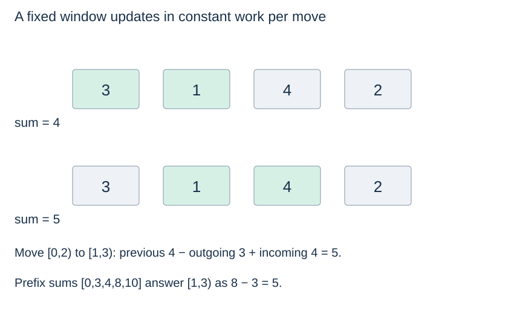

# Prefix sums, two pointers and sliding windows

**After this page, you should be able to:**

- Connect prefix totals, sorted endpoint elimination and fixed-window updates to invariants.
- Specify boundaries, duplicate positions, numeric assumptions and time/space costs.

**Builds on:** [Array indexing](../linear-structures/arrays.md), [ordered-search exclusion](../searching/binary-search.md) and [analysis conventions](../analysis/code-and-space.md).

(prefix-sums)=
## Precompute repeated range totals

Let `prefix[i]` be the sum of the first i values, so `prefix[0] = 0`. The sum of half-open range `[left,right)` is `prefix[right] - prefix[left]`.

```python
def prefix_sums(values):
    prefix = [0]
    for value in values:
        prefix.append(prefix[-1] + value)
    return prefix
```

For `[3,1,4,2]`, prefixes are `[0,3,4,8,10]`; indices `[1,3)` sum to `8-3=5`. Building takes $O(n)$ time and storage; each valid bounded range query then takes constant time. Updates to the original values invalidate affected prefix totals. Dynamic range-query structures are a separate extension.

(two-pointer-search)=
## Use sorted order to eliminate one endpoint

```python
def two_sum_sorted(values, target):
    left, right = 0, len(values) - 1
    while left < right:
        total = values[left] + values[right]
        if total == target:
            return left, right
        if total < target:
            left += 1
        else:
            right -= 1
    return None
```

The input must be ascending, with consistent numeric comparison and addition. A sum too small rules out the current left value with every remaining right value; a sum too large rules out the current right value with every remaining left value. Each step moves an endpoint, so time is $O(n)$ and auxiliary space is constant. Two equal values can be used if they occupy different positions.

(sliding-window-sum)=
## Update a fixed window by removing and adding one value

```python
def max_fixed_window_sum(values, k):
    if type(k) is not int or not 1 <= k <= len(values):
        raise ValueError("window size must be between 1 and input length")
    total = sum(values[i] for i in range(k))
    best = total
    for right in range(k, len(values)):
        total += values[right] - values[right - k]
        best = max(best, total)
    return best
```

Each iteration preserves the sum of the current k-item window. Negative numbers are allowed because the window size is fixed. Time is $O(n)$ and additional working space is $O(1)$ under the numeric word model; no sliced window lists are allocated.



(sequence-pattern-contracts)=
## State query boundaries and returned results

| Function | Required input / returned result | Boundaries and mutation |
|---|---|---|
| `prefix_sums(values)` | Finite numeric iterable; new n+1-item prefix list beginning with 0 | Empty input returns `[0]`; input lists unchanged, iterators consumed |
| `two_sum_sorted(values, target)` | Ascending indexable numeric sequence; one `(left,right)` with distinct indices, or `None` | Fewer than two positions return `None`; input unchanged; sortedness is a precondition, not validated |
| `max_fixed_window_sum(values, k)` | Indexable numeric sequence; best total among contiguous k-item windows | Exact integer 1≤k≤n required, otherwise `ValueError`; booleans rejected; input unchanged |

Arithmetic and comparisons must be consistent for the supplied numeric values. Prefix queries use 0≤left≤right≤n; an empty half-open range sums to zero. There is no separate checked query helper on this page: `prefix[right]-prefix[left]` assumes valid boundaries. The two-pointer result is one valid pair selected by its endpoint walk, not every pair or a promised smallest-index pair.

Negative values are permitted by all three shown algorithms, with sorted order additionally required for two-sum. A fixed window needs no positive-value monotonicity argument. Prefix totals are snapshots and must be rebuilt or appropriately updated after source values change.

(window-monotonicity)=
## Variable windows need an additional argument

A variable-size window seeking a target sum often relies on positivity or another monotone condition to know which endpoint to move. The fixed-window algorithm above needs no such claim. Do not transfer it to arbitrary constraints merely because both methods are called sliding windows.

## Compare preprocessing, working state and output

| Pattern | Time under constant-cost numeric operations | Working space; returned storage |
|---|---|---|
| Prefix construction | Θ(n+1); then O(1) per valid difference query | O(1) logical workspace; Θ(n+1) result slots |
| Sorted two-pointer search | O(n+1) worst-case | O(1); O(1) pair/absence result |
| Fixed-window maximum | Θ(n+1) on valid input | O(1); O(1) numeric result |

Prefix construction uses amortised list append. Temporary backing storage during growth remains within linear peak additional storage. The two-pointer invariant eliminates the current left endpoint when even its largest remaining partner is too small, or the right endpoint when even its smallest remaining partner is too large. Each move shrinks the candidate interval.

For a fixed window, updating by outgoing/incoming values preserves its k-item total; `best` remembers the maximum seen. Initialising best from the first valid window, rather than zero, is essential when every window has a negative sum. Variable windows and dynamic range updates need additional algorithms and assumptions.

:::{tip} Common misconception
**Every sliding-window problem requires positive values.** The fixed-size sum update works with negatives; variable-size endpoint decisions need their own argument.
:::

(sequence-pattern-checks)=
## Check your understanding

Predict the result or justify the choice before opening the explanation.

**1. For values [3,1,4,2], what is the sum of [1,3), and how many entries are in the prefix list?**

:::{dropdown} Show explanation
The sum is 5 and the prefix list has five entries: [0,3,4,8,10]. The leading zero represents the empty prefix.
:::

**2. For [-5,-2,-3] and k=2, what is the maximum fixed-window sum?**

:::{dropdown} Show explanation
−5, from [-2,-3]. Returning 0 would be incorrect because no window has that sum.
:::

These patterns reuse [array indexing](../linear-structures/arrays.md), [sorted-order exclusion](../searching/binary-search.md) and [rolling-window policies](../linear-structures/queues-and-deques.md#rolling-window). Next: [Complexity limits](complexity-limits.md).
