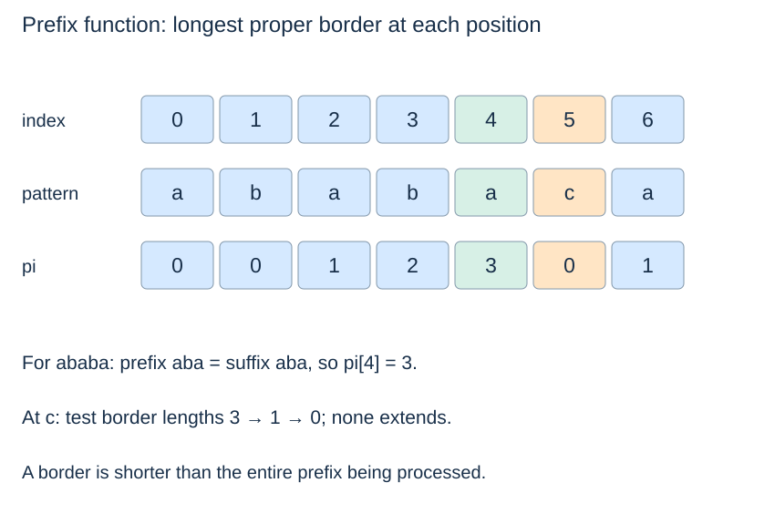
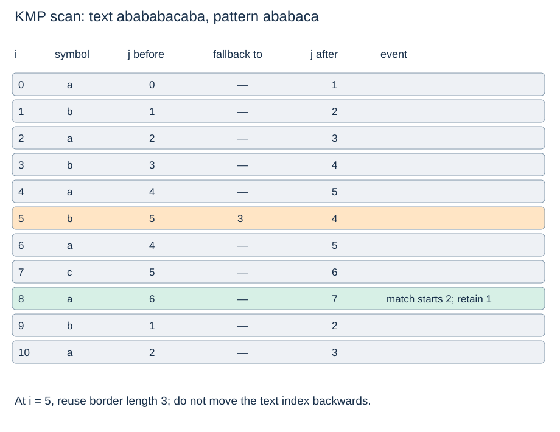

# KMP: reuse information after a mismatch

**After this page, you should be able to:**

- Use borders/fallback lengths to preserve viable alignments without rewinding text.
- Justify aggregate linear work and specify preprocessing, output and boundary behaviour.

**Builds on:** [All-match baseline](substring-baseline.md) and [aggregate/sequence analysis](../analysis/cases-and-bounds.md#expected-versus-amortised-analysis).

**Code languages:** Python defines the explanations, figures and self-checks. Use the [language guide](../../code-languages.md) for native conventions and dependencies. Complete runnable topic examples: [JavaScript](../../examples/languages/strings.js) · [Julia](../../examples/languages/strings.jl).

All matching positions count Unicode code points. JavaScript and Julia collect characters into arrays for constant-time access, adding O(n+m) preparation and storage to text/pattern scans; this is additional to the Python bounds. Julia results are one-based character-array positions, not byte indices into a Julia String. Rolling hashes use BigInt arithmetic explicitly; JavaScript custom base/modulus arguments are BigInts (for example 3n).

(pattern-border)=
## A border is a prefix that is also a suffix

A **proper border** is shorter than the whole string. In `"ababa"`, `"aba"` and `"a"` are proper borders. The prefix function `pi[i]` is the length of the longest proper border of `pattern[:i+1]`. Its entries are lengths, not indices of the next text character.

For pattern `"ababaca"`, the table is `[0,0,1,2,3,0,1]`. At index 4, the prefix `"ababa"` has longest border length 3. At index 5, `"ababac"` has no nonempty border.

(kmp-prefix-function)=
## Fall back through shorter known borders

::::{tab-set}
:class: code-language-tabs

:::{tab-item} Python
:sync: python

```python
def prefix_function(pattern):
    pi = [0] * len(pattern)
    j = 0
    for i in range(1, len(pattern)):
        while j > 0 and pattern[i] != pattern[j]:
            j = pi[j - 1]
        if pattern[i] == pattern[j]:
            j += 1
        pi[i] = j
    return pi
```

:::

:::{tab-item} JavaScript
:sync: javascript

```javascript
function prefix_function(pattern) {
    const p = [...pattern], pi = Array(p.length).fill(0); let j = 0;
    for (let i = 1; i < p.length; i++) {
        while (j > 0 && p[i] !== p[j]) j = pi[j-1];
        if (p[i] === p[j]) j++;
        pi[i] = j;
    }
    return pi;
}
```

:::

:::{tab-item} Julia
:sync: julia

```julia
function prefix_function(pattern)
    p = collect(pattern); pi = zeros(Int, length(p)); j = 0
    for i in 2:length(p)
        while j > 0 && p[i] != p[j+1]; j = pi[j]; end
        p[i] == p[j+1] && (j += 1)
        pi[i] = j
    end
    return pi
end
```

:::

::::

Before processing the next symbol, j describes a border of the previous prefix. If it cannot extend, any shorter viable border must also be a border of that border. `pi[j-1]` supplies the next candidate length, decreasing j without retrying every shorter length. Equality extends a border by one. The empty pattern gives an empty table.



:::{note} Pause and trace
Build the prefix table for a short pattern before tracing the text scan. Keep the text position and matched-prefix length in separate columns; a fallback changes the latter without moving the text backwards.
:::

(kmp-find-all)=
## Preserve the text position while shortening the matched prefix

::::{tab-set}
:class: code-language-tabs

:::{tab-item} Python
:sync: python

```python
def kmp_find_all(text, pattern):
    if not pattern:
        return list(range(len(text) + 1))
    pi = prefix_function(pattern)
    matches = []
    j = 0
    for i, char in enumerate(text):
        while j > 0 and char != pattern[j]:
            j = pi[j - 1]
        if char == pattern[j]:
            j += 1
        if j == len(pattern):
            matches.append(i - len(pattern) + 1)
            j = pi[j - 1]
    return matches
```

:::

:::{tab-item} JavaScript
:sync: javascript

```javascript
function kmp_find_all(text, pattern) {
    const t = [...text], p = [...pattern];
    if (!p.length) return Array.from({length:t.length+1}, (_,i) => i);
    const pi = prefix_function(p), matches = []; let j = 0;
    for (let i = 0; i < t.length; i++) {
        while (j > 0 && t[i] !== p[j]) j = pi[j-1];
        if (t[i] === p[j]) j++;
        if (j === p.length) { matches.push(i-p.length+1); j = pi[j-1]; }
    }
    return matches;
}
```

:::

:::{tab-item} Julia
:sync: julia

```julia
function kmp_find_all(text, pattern)
    t, p = collect(text), collect(pattern)
    isempty(p) && return collect(1:length(t)+1)
    pi = prefix_function(p); matches = Int[]; j = 0
    for (i,char) in enumerate(t)
        while j > 0 && char != p[j+1]; j = pi[j]; end
        char == p[j+1] && (j += 1)
        if j == length(p); push!(matches, i-length(p)+1); j = pi[j]; end
    end
    return matches
end
```

:::

::::

Before comparing the current text symbol, the previously matched prefix of length j equals a suffix of text processed so far. On mismatch, retain its longest border that might still extend with the current symbol. No occurrence is skipped: a surviving overlapping alignment must have that prefix/suffix agreement. The text index never moves backwards, although one symbol can be compared against several pattern positions.

(kmp-query-contract)=
## Reuse the all-match contract and declare preprocessing

Run `prefix_function` above before `kmp_find_all`; it is a helper definition, not an imported library function. Both take strings under the shared code-point comparison model and observe inputs without mutation. `prefix_function(pattern)` returns a new length-m integer table, or `[]` for an empty pattern. It does not return matched text positions.

`kmp_find_all(text, pattern)` returns the same ascending, overlapping occurrence list as the baseline. An empty pattern reports every boundary; a longer nonempty pattern returns no matches, although this implementation still preprocesses that pattern and scans the text. No explicit invalid-type validation pass is supplied. Equal-looking but differently normalised strings remain different inputs.

(kmp-trace-overlaps)=
## A full match can leave a useful border

For text `"abababacaba"` and pattern `"ababaca"`, the first mismatch is at text index 5: b disagrees with pattern[5], c. Fall back from j=5 to `pi[4]=3`; the same b matches pattern[3]. Continuing reaches a full match starting at index 2.



After reporting a match, `j = pi[j-1]` retains a possible overlap. With `"aba"` in `"ababa"`, the border length one enables the second occurrence at 2. Resetting to zero after a match would miss it in this single-pass routine.

(kmp-linear-cost)=
## Bound all fallback work across the scan

In prefix construction, j increases at most once per outer iteration; each fallback strictly decreases it. Total decreases are bounded by total increases. The same argument applies to the text scan, including resets after complete matches. Nested while loops therefore do not imply quadratic work here.

Including preprocessing and r results, time is $O(n+m+r+1)$; for a nonempty pattern, r≤n and the usual summary is $O(n+m+1)$. Auxiliary storage is $O(m+r+1)$ including output. The prefix table can be reused across searches for the same pattern, though this simple function rebuilds it per call. It does not build a full alphabet-by-state transition table.

KMP stands for Knuth–Morris–Pratt. See [Princeton's pattern-matching lecture](https://www.cs.princeton.edu/courses/archive/spr08/cos226/lectures/19PatternMatching.pdf) for the distinction between a full transition table and one-dimensional fallback information. This page's original implementation uses the latter.

## Implementation choices and storage

The shown algorithm stores one fallback length per pattern position, not a dense alphabet-by-state automaton. Prefix construction takes O(m+1) time and O(m+1) table storage. The query rebuilds that table per call; an API with reusable preprocessing could avoid rebuilding for repeated searches of one pattern, but is not provided here.

Including r reported starts, total time is O(n+m+r+1). Working storage is O(m+1), separate from O(r+1) output. The total-fallback argument bounds the whole sequence of j changes; it does not claim every text symbol triggers just one comparison. After a full match, falling back to the longest proper border preserves overlaps while keeping j within valid pattern positions.

:::{tip} Common misconception
**Nested fallback loops make KMP quadratic.** Each fallback decreases the matched length, and total decreases are bounded by earlier increases across the scan.
:::

(kmp-checks)=
## Check your understanding

Predict the result or justify the choice before opening the explanation.

**1. After finding aba at start 0 in ababa, why retain border length one?**

:::{dropdown} Show explanation
The final a can begin another aba. Retaining that border allows the occurrence at start 2 without rewinding the text.
:::

**2. For pattern ababaca, what is pi[4], and is that value a text index?**

:::{dropdown} Show explanation
It is 3, the length of the border aba of ababa. It describes a pattern-prefix length, not a text position.
:::

Next: [Rolling hashes](rolling-hash-search.md).
