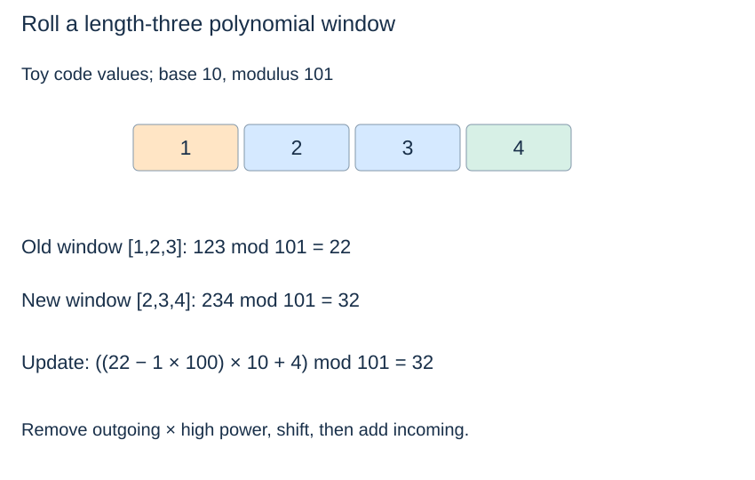
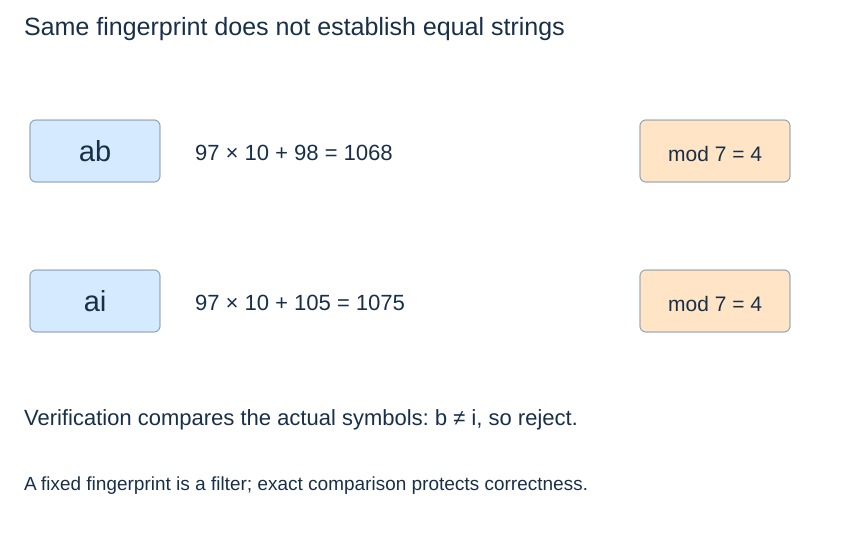

# Rolling hashes: filter, then verify

**After this page, you should be able to:**

- Derive the rolling polynomial update and maintain its current-window invariant.
- Explain exact verification, parameter validation and candidate-sensitive costs.

**Builds on:** [All-match contracts](substring-baseline.md), [hash collisions](../maps-sets-hashing/hashing.md) and [fixed-window updates](../strategies/sequence-patterns.md).

**Code languages:** Python defines the explanations, figures and self-checks. Use the [language guide](../../code-languages.md) for native conventions and dependencies. Complete runnable topic examples: [JavaScript](../../examples/languages/strings.js) · [Julia](../../examples/languages/strings.jl).

All matching positions count Unicode code points. JavaScript and Julia collect characters into arrays for constant-time access, adding O(n+m) preparation and storage to text/pattern scans; this is additional to the Python bounds. Julia results are one-based character-array positions, not byte indices into a Julia String. Rolling hashes use BigInt arithmetic explicitly; JavaScript custom base/modulus arguments are BigInts (for example 3n).

(polynomial-string-hash)=
## Treat a fixed-length window as a polynomial fingerprint

For code values x₀,...,xₘ₋₁, choose base b and modulus q and compute

$$H=(x_0 b^{m-1}+x_1 b^{m-2}+\cdots+x_{m-1})\bmod q.$$

If the window moves one position, remove its outgoing value, shift the remaining powers by multiplying by b, and add the incoming value:

$$H' = ((H-x_0 b^{m-1})b+x_m)\bmod q.$$

Only the residue of $b^{m-1}$ is needed. Python's modulo normalises a negative intermediate value for a positive modulus. The rolling formula is an algebraic update, not evidence that equal hashes imply equal strings.



(rabin-karp-verified)=
## A matching fingerprint is a candidate, not an answer

::::{tab-set}
:class: code-language-tabs

:::{tab-item} Python
:sync: python

```python
def rolling_find_all(text, pattern, *, base=257, modulus=1_000_000_007):
    if type(base) is not int or base < 2:
        raise ValueError("base must be an integer at least 2")
    if type(modulus) is not int or modulus < 2:
        raise ValueError("modulus must be an integer at least 2")
    n, m = len(text), len(pattern)
    if m == 0:
        return list(range(n + 1))
    if m > n:
        return []
    high = pow(base, m - 1, modulus)
    target_hash = window_hash = 0
    for j in range(m):
        target_hash = (target_hash * base + ord(pattern[j])) % modulus
        window_hash = (window_hash * base + ord(text[j])) % modulus
    matches = []
    for start in range(n - m + 1):
        if window_hash == target_hash:
            if all(text[start + j] == pattern[j] for j in range(m)):
                matches.append(start)
        if start + m < n:
            outgoing = ord(text[start])
            incoming = ord(text[start + m])
            window_hash = ((window_hash - outgoing * high) * base
                           + incoming) % modulus
    return matches
```

:::

:::{tab-item} JavaScript
:sync: javascript

```javascript
function rolling_find_all(text, pattern, {base=257n, modulus=1000000007n} = {}) {
    if (typeof base !== "bigint" || base < 2n || typeof modulus !== "bigint" || modulus < 2n)
        throw new RangeError("base and modulus must be BigInts at least 2");
    const t = [...text], p = [...pattern], n = t.length, m = p.length;
    if (!m) return Array.from({length:n+1}, (_,i) => i);
    if (m > n) return [];
    let high = 1n, power = m-1, factor = base % modulus;
    while (power > 0) {
        if (power % 2) high = high * factor % modulus;
        factor = factor * factor % modulus; power = Math.floor(power / 2);
    }
    const code = c => BigInt(c.codePointAt(0));
    const mod = x => (x % modulus + modulus) % modulus;
    let target_hash = 0n, window_hash = 0n;
    for (let j=0; j<m; j++) {
        target_hash = mod(target_hash * base + code(p[j]));
        window_hash = mod(window_hash * base + code(t[j]));
    }
    const matches = [];
    for (let start=0; start<=n-m; start++) {
        if (window_hash === target_hash && p.every((c,j) => t[start+j] === c)) matches.push(start);
        if (start+m<n) window_hash = mod((window_hash-code(t[start])*high)*base+code(t[start+m]));
    }
    return matches;
}
```

:::

:::{tab-item} Julia
:sync: julia

```julia
function rolling_find_all(text, pattern; base=257, modulus=1_000_000_007)
    (base isa Integer && !(base isa Bool) && base >= 2) || throw(ArgumentError("invalid base"))
    (modulus isa Integer && !(modulus isa Bool) && modulus >= 2) || throw(ArgumentError("invalid modulus"))
    b, q = big(base), big(modulus) # exact modular arithmetic, including custom parameters
    t, p = collect(text), collect(pattern); n, m = length(t), length(p)
    m == 0 && return collect(1:n+1)
    m > n && return Int[]
    high = powermod(b, m-1, q); target_hash = big(0); window_hash = big(0)
    for j in 1:m
        target_hash = mod(target_hash*b + Int(p[j]), q)
        window_hash = mod(window_hash*b + Int(t[j]), q)
    end
    matches = Int[]
    for start in 1:n-m+1
        if window_hash == target_hash && all(t[start+j-1] == p[j] for j in 1:m)
            push!(matches, start)
        end
        if start+m <= n
            window_hash = mod((window_hash-Int(t[start])*high)*b+Int(t[start+m]), q)
        end
    end
    return matches
end
```

:::

::::

This is a verified Rabin–Karp-style search. The invariant is that `window_hash` equals the polynomial hash of the current window. The initial loop establishes it; the update formula maintains it. Equal strings must have equal fingerprints, so no true occurrence is filtered out. Direct verification excludes false candidates.

(rolling-query-contract)=
## Keep exact answers separate from fingerprint choices

`rolling_find_all(text, pattern, base=..., modulus=...)` supplies the shared ascending all-match result, including overlaps and all empty-pattern boundaries. The strings are unchanged. Its keyword-only base and modulus must be exact integers at least 2; booleans and invalid values raise `ValueError` **before** empty/long-pattern returns. Text/pattern string types are preconditions rather than explicitly validated.

The parameters need not be prime or satisfy a collision-free claim. Direct symbol verification makes the answers exact for all accepted parameter choices. Smaller moduli can make many false candidates and increase work; fixed defaults do not imply a random-input expected-time guarantee.

(rolling-hash-collisions)=
## Deliberately small moduli expose the correctness issue

With base 10 and modulus 7, two-code-point strings `"ab"` and `"ai"` both hash to 4: their code values are (97,98) and (97,105), differing by 7 in the last position. Thus `rolling_find_all("ai", "ab", base=10, modulus=7)` returns `[]` after rejecting a real hash collision.



The defaults are fixed parameters, not a randomised guarantee. A prime modulus or a second fingerprint can reduce collisions under suitable models, but neither alone proves equality. This is also not a cryptographic hash. In our exact search, verification is what protects correctness.

(rolling-hash-cost)=
## Verification can dominate the window updates

For 1≤m≤n and c equal-hash candidate windows, the time bound is $O(n+m+cm)$ under fixed-parameter arithmetic costs. A fingerprint update takes constant work, but checking one candidate can inspect all m symbols. Candidates include true matches: a text with many overlapping equal matches can therefore be costly even without accidental collisions.

The worst case is $O(nm)$, while [KMP](kmp-matching.md) guarantees linear scanning plus output for this contract. Working storage is constant apart from $O(r)$ returned positions; indexed verification avoids allocating m-symbol slices. Empty patterns cost $O(n+1)$ output, and patterns longer than the text return immediately. If base or modulus are allowed to grow in bit length, their arithmetic costs must also be counted.

This page builds the rolling fingerprint explicitly; Python's `hash()` does not provide this update interface. Concept reference: [Princeton's verified Rabin–Karp implementation](https://algs4.cs.princeton.edu/53substring/RabinKarp.java.html), which uses a different parameter policy and returns the first match.

## Costs and implementation alternatives

For 1≤m≤n and c equal-fingerprint candidates, preprocessing, rolling and verification use O(n+m+cm) time under fixed-parameter arithmetic. Results occupy O(r+1) storage; local working state uses O(1) model words. A candidate can be a real match or a collision, and verifying true matches still costs work. Many overlapping matches can therefore produce worst-case O(nm) time even without false positives.

Empty-pattern output takes Θ(n+1) time/storage; a longer pattern returns an empty list after validation/setup. If base/modulus grow in bit length, count modular arithmetic and exponentiation costs rather than treating arbitrary integers as fixed-size. Double fingerprints can filter more candidates under suitable assumptions, but do not replace verification in this exact contract.

Use rolling fingerprints when the reusable summary of a sliding window is useful. Use KMP when its deterministic worst-case all-match bound is the priority. These choices differ in retained information, not in whether equal hashes prove equal strings.

:::{tip} Common misconception
**A prime modulus removes the need to compare candidate strings.** Fingerprints can collide; the direct comparison is what guarantees exact matches here.
:::

(rolling-hash-checks)=
## Check your understanding

Predict the result or justify the choice before opening the explanation.

**1. With base 10 and modulus 7, why does searching ai for ab return [] despite equal hashes?**

:::{dropdown} Show explanation
Verification compares the second code point and rejects the collision. Hash equality only admits a candidate.
:::

**2. Does an invalid base become acceptable when the pattern is empty?**

:::{dropdown} Show explanation
No. Parameter checks run before the empty-pattern branch, so invalid base/modulus values still raise ValueError.
:::

Next: [Choose a string method](string-choices.md).
