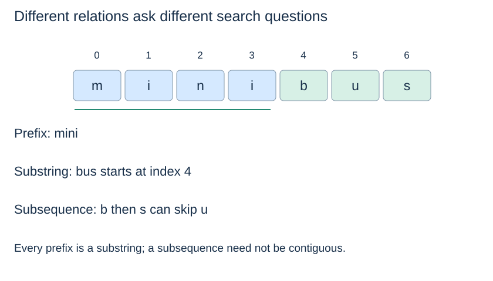

# String models and query contracts

**After this page, you should be able to:**

- Distinguish exact, prefix, substring and subsequence query contracts.
- Apply a consistent code-point, case and normalisation model to inputs and indices.

**Builds on:** [Identity/equality and values](../foundations/objects-and-references.md) and [string-key hashing assumptions](../maps-sets-hashing/hashing.md).

**Code languages:** Python defines the explanations, figures and self-checks. Use the [language guide](../../code-languages.md) for native conventions and dependencies. Complete runnable topic examples: [JavaScript](../../examples/languages/strings.js) · [Julia](../../examples/languages/strings.jl).

All matching positions count Unicode code points. JavaScript and Julia collect characters into arrays for constant-time access, adding O(n+m) preparation and storage to text/pattern scans; this is additional to the Python bounds. Julia results are one-based character-array positions, not byte indices into a Julia String. Rolling hashes use BigInt arithmetic explicitly; JavaScript custom base/modulus arguments are BigInts (for example 3n).

(string-query-contracts)=
## Ask what must match

| Query | Example | Required relation |
|---|---|---|
| Exact key | Is `"bus"` stored? | A complete key equals the query |
| Prefix reporting | Which keys start with `"bu"`? | The query is an initial segment of each returned key |
| Longest stored prefix | Which stored key most specifically prefixes `"buses"`? | Return the longest stored initial segment |
| Substring search | Where does `"bus"` appear in `"minibus route"`? | Contiguous text positions equal the pattern |

A prefix is a substring beginning at index zero. A substring need not begin there. A **subsequence** can skip intervening positions: `"bs"` is a subsequence of `"bus"`, but is not its substring. These are different contracts.



(unicode-string-positions)=
## Specify what one position means

Python `str` is an immutable sequence of Unicode code points. An index counts code points, not UTF-8 bytes and not necessarily displayed characters. For example, `"é"` has length one, while `"e\u0301"` has length two: the latter combines e with a combining accent. They can look alike but compare unequal.

::::{tab-set}
:class: code-language-tabs

:::{tab-item} Python
:sync: python

```python
import unicodedata

composed = "é"
decomposed = "e\u0301"
assert composed != decomposed
assert unicodedata.normalize("NFC", composed) == unicodedata.normalize("NFC", decomposed)
```

:::

:::{tab-item} JavaScript
:sync: javascript

```javascript
var composed = "é", decomposed = "e\u0301";
console.assert(composed !== decomposed);
console.assert(composed.normalize("NFC") === decomposed.normalize("NFC"));
```

:::

:::{tab-item} Julia
:sync: julia

```julia
using Unicode
composed = "é"; decomposed = "e\u0301"
@assert composed != decomposed
@assert Unicode.normalize(composed, :NFC) == Unicode.normalize(decomposed, :NFC)
```

:::

::::

These examples use the same units for text, pattern, trie edges and returned indices. They do not split displayed grapheme clusters or decode byte sequences automatically. Reference: [Python's Unicode HOWTO](https://docs.python.org/3/howto/unicode.html).

(string-normalisation-policy)=
## Apply the same comparison policy to stored data and queries

Case-insensitive lookup may use `casefold()`; canonical-equivalence lookup may require Unicode normalisation. Decide the policy before building an index and apply it consistently. Our trie stores the exact strings supplied: `"Bus"` and `"bus"` are distinct.

Python's default lexicographic ordering compares code points; it is not locale-aware dictionary collation.

Transformations can change lengths: `"Straße".casefold()` is `"strasse"`. An index in transformed text does not automatically identify the corresponding span in the original display text. A user-facing search system may need an explicit position mapping and preserved display labels.

(string-cost-model)=
## Count inspected code points, not just container operations

Let L be key length, n text length and m pattern length. Lexicographic string comparison may inspect a long common prefix. Computing a string hash can inspect the whole string; cached hashes may improve repeated operations in a particular runtime. Topic 6's expected constant-time table probe does not imply that processing an arbitrary new L-code-point key is independent of L.

We assume constant-time code-point indexing/comparison and bounded-cost arithmetic where stated. Proper slices generally allocate new strings; the search algorithms below compare by index so their stated working-space bounds do not hide candidate copies.

## Representation, costs and comparison policy

The algorithms here accept Python strings as their documented domain. Trie methods explicitly reject nonstrings; substring helpers rely on the stated string precondition rather than performing a universal validation pass. Strings remain unchanged. Search returns positions in the exact text passed to it, not automatically in an original string from before normalisation or case folding.

For key length L, processing characters can require work growing with L even when the containing hash-table lookup has expected constant probe cost. A trie shares key prefixes, KMP stores pattern borders, and a rolling hash stores a window fingerprint. Their state supports different future operations.

Use one policy for stored/query strings, preserve display labels where needed, and treat transformed-position mapping as a separate application concern. A normalisation policy is part of the contract; these helpers do not silently apply one.

:::{tip} Common misconception
**A visible character always occupies one string index.** Python positions count Unicode code points; one displayed character can contain multiple code points.
:::

(string-model-checks)=
## Check your understanding

Predict the result or justify the choice before opening the explanation.

**1. Do "é" and "e\u0301" necessarily compare equal or have the same length as supplied?**

:::{dropdown} Show explanation
No. The supplied strings compare unequal and have lengths one and two. Consistent NFC normalisation can make this example equal.
:::

**2. After casefolding "Straße" to "strasse", can a transformed result index automatically be used as an original display span?**

:::{dropdown} Show explanation
No. The transformation changes length; returning original spans needs a mapping policy rather than assuming unchanged positions.
:::

Next: [Trie representation](trie-representation.md).
