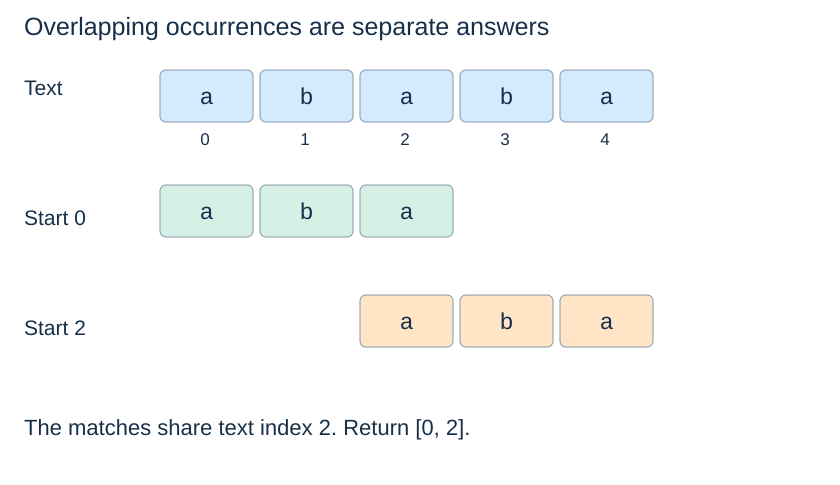

# A substring-search baseline

**After this page, you should be able to:**

- Specify all-match, overlap, empty-pattern and code-point-position semantics.
- Justify exhaustive alignment checks and separate scanning from result storage.

**Builds on:** [String models](string-model.md), [first-occurrence contracts](../foundations/data-and-algorithms.md#first-search-contract) and [loop correctness](../analysis/correctness.md).

**Code languages:** Python defines the explanations, figures and self-checks. Use the [language guide](../../code-languages.md) for native conventions and dependencies. Complete runnable topic examples: [JavaScript](../../examples/languages/strings.js) · [Julia](../../examples/languages/strings.jl).

All matching positions count Unicode code points. JavaScript and Julia collect characters into arrays for constant-time access, adding O(n+m) preparation and storage to text/pattern scans; this is additional to the Python bounds. Julia results are one-based character-array positions, not byte indices into a Julia String. Rolling hashes use BigInt arithmetic explicitly; JavaScript custom base/modulus arguments are BigInts (for example 3n).

(substring-match-contract)=
## Return every starting index, including overlaps

The functions in the remaining pages take text and pattern strings and return all exact occurrence indices in ascending order. They preserve inputs and use code-point positions. Overlaps count: `"aba"` occurs at indices 0 and 2 in `"ababa"`.

The empty pattern matches every boundary, so on text length n it returns `[0, 1, ..., n]`. A longer nonempty pattern has no matches. These choices are part of the contract, not consequences to discover accidentally from a loop.

(naive-substring-search)=
## Check each alignment directly

::::{tab-set}
:class: code-language-tabs

:::{tab-item} Python
:sync: python

```python
def naive_find_all(text, pattern):
    n, m = len(text), len(pattern)
    if m == 0:
        return list(range(n + 1))
    matches = []
    for start in range(n - m + 1):
        j = 0
        while j < m and text[start + j] == pattern[j]:
            j += 1
        if j == m:
            matches.append(start)
    return matches
```

:::

:::{tab-item} JavaScript
:sync: javascript

```javascript
function naive_find_all(text, pattern) {
    const t = [...text], p = [...pattern], n = t.length, m = p.length;
    if (m === 0) return Array.from({length:n+1}, (_,i) => i);
    const matches = [];
    for (let start = 0; start <= n - m; start++) {
        let j = 0; while (j < m && t[start+j] === p[j]) j++;
        if (j === m) matches.push(start);
    }
    return matches;
}
```

:::

:::{tab-item} Julia
:sync: julia

```julia
function naive_find_all(text, pattern)
    t, p = collect(text), collect(pattern); n, m = length(t), length(p)
    m == 0 && return collect(1:n+1)
    matches = Int[]
    for start in 1:n-m+1
        j = 0
        while j < m && t[start+j] == p[j+1]; j += 1; end
        j == m && push!(matches, start)
    end
    return matches
end
```

:::

::::

At an alignment, the first j positions have matched. A mismatch proves this alignment is not an occurrence; reaching m proves it is. Trying every possible starting index proves completeness, and moving by one retains overlaps. A negative range bound naturally gives no alignments when m>n.



(naive-substring-cost)=
## Repeated prefixes can repeat comparisons

For 1≤m≤n, at most m comparisons are made at each of n−m+1 alignments, giving $O((n-m+1)m)$ time. Text made of many a's and pattern `"aaaab"` illustrate near-complete matches that fail late and restart. This can be quadratic when m grows proportionally to n.

The main search uses constant working space plus $O(r)$ output for r matches. The empty-pattern result needs $O(n+1)$ time and output. No candidate substring is sliced, so there is no hidden $O(m)$ temporary string per alignment. When m>n, this function returns immediately after a constant number of setup steps.

The baseline is a valuable independent check for more elaborate algorithms. It does not describe the internal implementation of Python's `str.find` or `in`; use those interfaces in applications when their contracts fit rather than assuming they use this teaching algorithm.

## Contract, implementation choices and costs

`naive_find_all(text, pattern)` returns a new ascending list of starting positions and does not mutate its string inputs. It has no `start`, case-folding or first-match option; those would be separate contracts. Empty text/pattern returns `[0]`, while a nonempty pattern longer than the text returns `[]`. No invalid-type validation policy is promised beyond the string precondition.

For 1≤m≤n, worst-case scan work is O((n−m+1)m+1), with O(1) local working space and O(r+1) result slots. Empty-pattern output alone takes Θ(n+1) time and storage; m>n takes O(1) setup and an empty result. Comparing by index avoids copying an m-symbol candidate at every alignment.

This baseline is suitable for explanation and independent checking of KMP/rolling implementations. In applications, use built-in search when its specified first/all/overlap behaviour fits; its name does not imply that its internals match this baseline.

:::{tip} Common misconception
**Advancing by the pattern length after a match preserves all occurrences.** Overlapping matches can start before that jump ends.
:::

(substring-baseline-checks)=
## Check your understanding

Predict the result or justify the choice before opening the explanation.

**1. What does naive_find_all("aaaa", "aa") return?**

:::{dropdown} Show explanation
[0,1,2]. Each start is examined, so overlapping occurrences remain visible.
:::

**2. What does searching for the empty pattern in "bus" return, and why is the cost not constant?**

:::{dropdown} Show explanation
[0,1,2,3]. The contract reports all n+1 boundaries, so constructing that output requires linear work and storage.
:::

Next: [KMP](kmp-matching.md).
