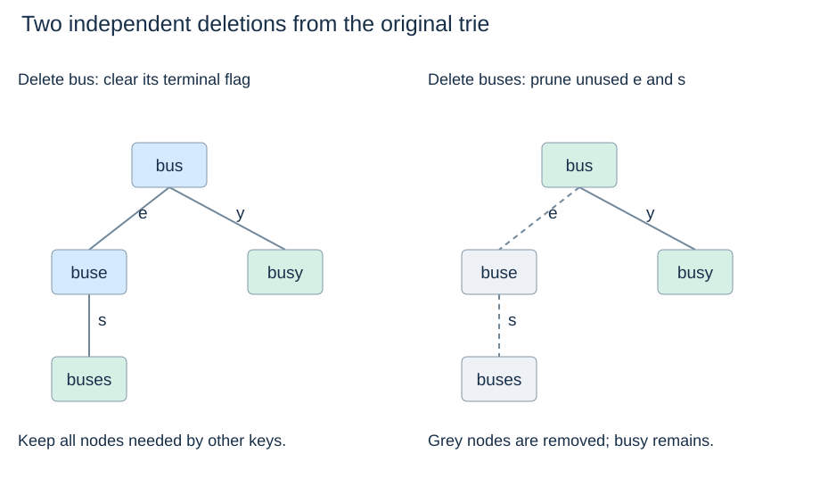

# Maintaining a trie string set

(trie-set-contract)=
## State duplicates, empty keys and return values

The following class reuses `TrieNode` from the previous page. `insert` returns whether a new key was added; `delete` returns whether a stored key was removed. Repeated insertion does not increase `size`. `contains` checks a complete key; `has_prefix` checks whether its path exists.

All query arguments must be strings. The empty prefix has a path even in an empty trie, so `has_prefix("")` returns `True`. The empty key is stored only when the root is terminal. Clients should use these operations rather than editing nodes or `size` directly.

(trie-set-implementation)=
## Walk, mark, and prune only unused suffixes

```python
class Trie:
    def __init__(self):
        self.root = TrieNode()
        self.size = 0

    def _walk(self, text):
        if not isinstance(text, str):
            raise TypeError("expected a string")
        node = self.root
        for char in text:
            node = node.children.get(char)
            if node is None:
                return None
        return node

    def contains(self, word):
        node = self._walk(word)
        return node is not None and node.terminal

    def has_prefix(self, prefix):
        return self._walk(prefix) is not None

    def insert(self, word):
        if not isinstance(word, str):
            raise TypeError("expected a string")
        node = self.root
        for char in word:
            if char not in node.children:
                node.children[char] = TrieNode()
            node = node.children[char]
        if node.terminal:
            return False
        node.terminal = True
        self.size += 1
        return True

    def delete(self, word):
        if not isinstance(word, str):
            raise TypeError("expected a string")
        node = self.root
        path = []
        for char in word:
            child = node.children.get(char)
            if child is None:
                return False
            path.append((node, char, child))
            node = child
        if not node.terminal:
            return False
        node.terminal = False
        self.size -= 1
        for parent, char, child in reversed(path):
            if child.terminal or child.children:
                break
            del parent.children[char]
        return True
```

Build the shared example once, in this order, for the prefix-query traces on the next page:

```python
trie = Trie()
for word in ["be", "bus", "buses", "busy", "car"]:
    trie.insert(word)
```

(trie-deletion-invariant)=
## Deleting a key must preserve other keys' prefixes

After unmarking the target, a nonterminal child with no descendants is unused and can be removed. Repeat upwards until a terminal node or a node with another child is reached. A missing key changes nothing.

Deleting `"bus"` only clears its flag because its descendants still store `"buses"` and `"busy"`. Starting from the original shared set, deleting `"buses"` removes its final s and then e, but stops at the terminal, branching `"bus"` node. Those are two separate scenarios, not cumulative updates.



Insertion preserves the invariant by adding only missing prefix nodes and marking exactly the final node. Deletion preserves every other key because it removes only nodes that neither terminate a key nor lead to one.

(trie-operation-costs)=
## Separate traversal space from new stored nodes

For a key of length L, lookup, insertion and deletion take expected $O(L+1)$ time under the dictionary model. Lookup and insertion use constant auxiliary working space; insertion can allocate up to L new persistent nodes. Deletion stores up to L path entries, using $O(L+1)$ auxiliary space. All loops are iterative, so a long key does not consume a recursive Python call per symbol.

`size` counts complete stored keys, not nodes. It is available in constant time. Turning this set into a map would require stored values at terminal nodes and a policy distinguishing absence from a legitimate value such as `None`.

Next: [Prefix queries](trie-prefix-queries.md).
