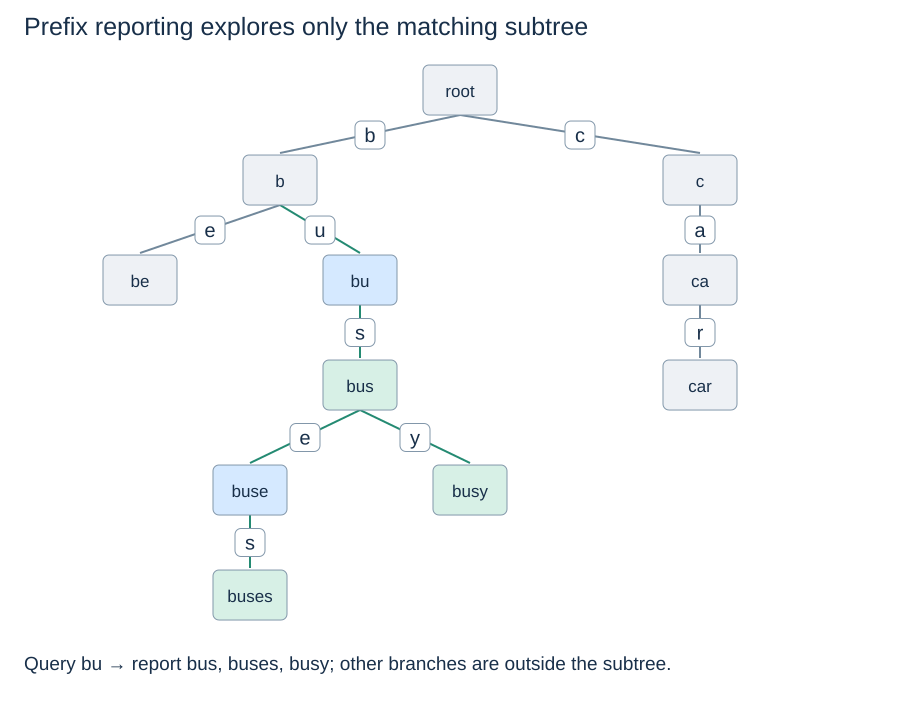

# Prefix reporting and longest stored prefixes

**After this page, you should be able to:**

- Trace prefix-subtree enumeration and restoration of suspended iterator/path state.
- Distinguish path existence, complete prefixes, lazy errors and output-sensitive costs.

**Builds on:** [The complete Trie class](trie-operations.md#trie-set-implementation) and [iterative DFS frames](../graphs/depth-first-search.md#iterative-dfs).

**Code languages:** Python defines the explanations, figures and self-checks. Use the [language guide](../../code-languages.md) for native conventions and dependencies. Complete runnable topic examples: [JavaScript](../../examples/languages/strings.js) · [Julia](../../examples/languages/strings.jl).

All matching positions count Unicode code points. JavaScript and Julia collect characters into arrays for constant-time access, adding O(n+m) preparation and storage to text/pattern scans; this is additional to the Python bounds. Julia results are one-based character-array positions, not byte indices into a Julia String. Rolling hashes use BigInt arithmetic explicitly; JavaScript custom base/modulus arguments are BigInts (for example 3n).

(trie-autocomplete)=
## Descend to a prefix, then report its terminal descendants

A prefix lookup first follows one path. Reporting completions must then visit the matching subtree; finding the prefix does not make every answer free. This generator reuses the preceding `Trie` class.

::::{tab-set}
:class: code-language-tabs

:::{tab-item} Python
:sync: python

```python
def words_with_prefix(trie, prefix):
    node = trie._walk(prefix)
    if node is None:
        return
    path = list(prefix)
    if node.terminal:
        yield prefix
    stack = [(node, iter(node.children.items()))]
    while stack:
        try:
            char, child = next(stack[-1][1])
        except StopIteration:
            stack.pop()
            if stack:
                path.pop()
            continue
        path.append(char)
        if child.terminal:
            yield "".join(path)
        stack.append((child, iter(child.children.items())))
```

:::

:::{tab-item} JavaScript
:sync: javascript

```javascript
function* words_with_prefix(trie, prefix) {
    const node = trie._walk(prefix); if (node === null) return;
    const path = [...prefix]; if (node.terminal) yield prefix;
    const stack = [[node, node.children.entries()]];
    while (stack.length) {
        const step = stack.at(-1)[1].next();
        if (step.done) { stack.pop(); if (stack.length) path.pop(); continue; }
        const [char,child] = step.value; path.push(char);
        if (child.terminal) yield path.join("");
        stack.push([child,child.children.entries()]);
    }
}
```

:::

:::{tab-item} Julia
:sync: julia

```julia
struct PrefixWords
    trie::Trie
    prefix
end
Base.IteratorSize(::Type{PrefixWords}) = Base.SizeUnknown()
Base.eltype(::Type{PrefixWords}) = String
words_with_prefix(t::Trie, prefix) = PrefixWords(t, prefix)
function Base.iterate(w::PrefixWords)
    node = trie_walk(w.trie, w.prefix) # validation is delayed until iteration
    node === nothing && return nothing
    state = (path=collect(w.prefix), stack=Any[(node,iterate(node.children))])
    node.terminal && return (String(w.prefix), state)
    return iterate(w, state)
end
function Base.iterate(w::PrefixWords, state)
    while !isempty(state.stack)
        node, step = state.stack[end]
        if step === nothing
            pop!(state.stack)
            !isempty(state.stack) && pop!(state.path)
            continue
        end
        (char,child), next_state = step
        state.stack[end] = (node,iterate(node.children,next_state))
        push!(state.path, char)
        push!(state.stack, (child,iterate(child.children)))
        child.terminal && return (join(state.path), state)
    end
    return nothing
end
```

:::

::::

For the shared keys inserted in the order on the preceding page, `list(words_with_prefix(trie, "bu"))` gives `["bus", "buses", "busy"]`. Prefix `"bus"` includes `"bus"` itself because its node is terminal. Missing prefixes yield nothing. Prefix `""` enumerates every stored key, including the empty key if present.

(trie-prefix-contracts)=
## Specify generators, missing results and order

`words_with_prefix(trie, prefix)` returns a **generator**, not a list. Use it with the preceding `Trie`/`TrieNode` definitions; it relies on their node invariant and `_walk` helper. Advancing it yields each matching stored key once, including the prefix itself when terminal. A missing path yields nothing. Empty prefix enumerates every key, while an empty trie yields no keys even though `has_prefix("")` is true.

`longest_stored_prefix(trie, text)` returns the longest complete stored prefix as a string, or `None`. If the empty key is stored, `""` may be a successful result. Both query arguments must be strings (`TypeError` otherwise). Generator validation is delayed until advancement; longest-prefix validation is immediate. Neither query mutates the trie.

Child insertion order determines the generator's depth-first output, not alphabetical or ranked order. Yielded strings are independent of the temporary path list. Do not mutate the index while a generator is being consumed; this is live traversal, not a snapshot of all keys at generator creation.

(trie-reporting-state)=
## Restore the path when a suspended frame completes

The list `path` spells the node at the top of the DFS stack. Each frame retains its child iterator, like [iterative DFS's suspended frames](../graphs/depth-first-search.md#iterative-dfs). Entering a child appends its symbol; finishing that child pops the symbol. Joined strings are independent outputs, so later path changes do not alter earlier results.



Dictionary insertion order determines traversal order; it is not a promise of alphabetical or relevance order. Sorting all results adds comparison work and storage. A ranked autocomplete service additionally needs scores and a top-k policy; this generator supplies prefix reporting only. Do not mutate the trie during iteration. Because this is a generator, traversal and argument validation occur when it is advanced.

(trie-prefix-output-cost)=
## Charge for visited nodes and emitted symbols

For prefix length L, V visited nodes in the selected subtree, and Z code points across the emitted strings, a full enumeration takes expected $O(L+V+Z+1)$ time. Joining each result costs its full length, including the shared prefix. The generator's working state is $O(L+H+1)$, where H is the maximum depth below the query node; it does not push every child at once. Collecting results into a list additionally stores the result references and their characters. A failed prefix lookup costs at most $O(L+1)$.

(trie-longest-stored-prefix)=
## Remember the deepest terminal node, not just the deepest path

::::{tab-set}
:class: code-language-tabs

:::{tab-item} Python
:sync: python

```python
def longest_stored_prefix(trie, text):
    if not isinstance(text, str):
        raise TypeError("expected a string")
    node = trie.root
    best = 0 if node.terminal else None
    for i, char in enumerate(text):
        node = node.children.get(char)
        if node is None:
            break
        if node.terminal:
            best = i + 1
    return None if best is None else text[:best]
```

:::

:::{tab-item} JavaScript
:sync: javascript

```javascript
function longest_stored_prefix(trie, text) {
    if (typeof text !== "string") throw new TypeError("expected a string");
    const chars = [...text]; let node = trie.root, best = node.terminal ? 0 : null;
    for (let i = 0; i < chars.length; i++) {
        node = node.children.get(chars[i]); if (node === undefined) break;
        if (node.terminal) best = i + 1;
    }
    return best === null ? null : chars.slice(0,best).join("");
}
```

:::

:::{tab-item} Julia
:sync: julia

```julia
function longest_stored_prefix(trie::Trie, text)
    text isa AbstractString || throw(ArgumentError("expected a string"))
    chars = collect(text); node = trie.root; best = node.terminal ? 0 : nothing
    for (i,char) in enumerate(chars)
        node = get(node.children, char, nothing); node === nothing && break
        node.terminal && (best = i)
    end
    return best === nothing ? nothing : join(chars[1:best])
end
```

:::

::::

`"buseshed"` returns `"buses"`; `"bustop"` returns `"bus"`; `"buoyant"` returns `None` in the shared set, even though part of its path exists. If the empty key is stored, it can be the answer `""`, which is distinct from `None`.

For text length L, scanning takes expected $O(L+1)$ time and constant working space, plus up to $O(L)$ storage to return a sliced prefix. Applications include hierarchical identifiers; actual IP routing uses bit prefixes and network masks, not naive character prefixes of dotted addresses.

## Compare working storage and retained outputs

For prefix length L, V visited subtree nodes and Z total emitted code points, a full enumeration takes expected O(L+V+Z+1) time. Working path/iterator state is O(L+H+1), where H is maximum depth below the query node. Collecting r yielded strings adds O(r+Z+1) retained output storage; stopping early may avoid later traversal and output work.

Longest stored prefix scans at most L query code points with O(1) local working state, plus up to O(L+1) returned string storage. It remembers the last terminal position rather than returning the deepest nonterminal path. Sorting or top-k ranking are additional operations with their own costs; the current generator supplies neither.

:::{tip} Common misconception
**A prefix query takes only the time to descend to its node.** Reporting all matching keys must also traverse the subtree and construct emitted strings.
:::

(trie-prefix-checks)=
## Check your understanding

Predict the result or justify the choice before opening the explanation.

**1. In the shared trie, what does longest_stored_prefix(trie, "buoyant") return despite the bu path?**

:::{dropdown} Show explanation
None. bu is not a complete key, and no longer stored prefix matches this text. Path existence alone is insufficient.
:::

**2. When does words_with_prefix(trie, 42) raise TypeError: construction or first advancement?**

:::{dropdown} Show explanation
On advancement. Calling a generator function creates the generator; its body, including _walk validation, runs when iteration begins.
:::

Next: [Substring-search baseline](substring-baseline.md).
