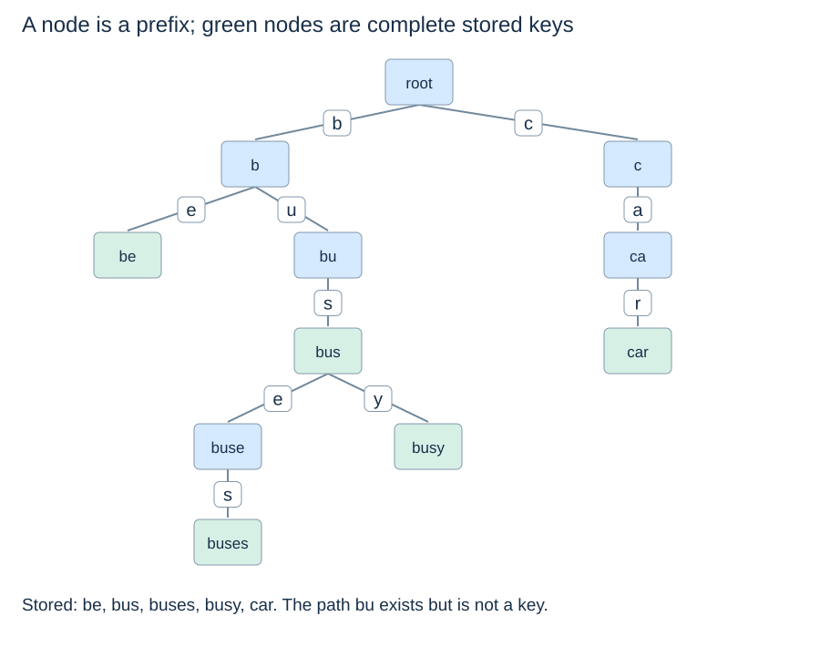

# Trie representation and complete keys

(trie-prefix-invariant)=
## A node represents the path from the root

A **trie** stores keys by successive symbols. The root represents the empty prefix. Following an edge labelled b, then u, then s reaches the prefix `"bus"`. Keys with a common prefix share that path instead of repeating it in separate root-to-key comparisons.

Our shared set is `{"be", "bus", "buses", "busy", "car"}`. Nodes do not store whole prefixes; the path and edge labels determine them.



(trie-terminal-marker)=
## A complete key can also have descendants

The node for `"bus"` is terminal and has children because `"buses"` and `"busy"` are stored too. Conversely, the node for `"bu"` exists but is not terminal. Reaching it proves a prefix path exists, not that `"bu"` is stored.

A leaf test cannot replace the terminal flag. Terminal flags also let the root store the empty key without inventing a special edge symbol that might collide with real input.

(trie-sparse-children)=
## Store only the outgoing symbols that exist

```python
class TrieNode:
    def __init__(self):
        self.children = {}
        self.terminal = False
```

Every child dictionary maps a one-code-point string to one node. Each node has at most one outgoing edge for a given symbol. Different incoming symbols lead to different nodes: this representation is a tree, not a graph that merges equal suffixes.

A fixed alphabet could use one array slot per symbol, trading direct access for empty slots. A dictionary stores sparse children and accommodates the Unicode symbols encountered. We use expected constant-time child lookup under the same hash-table assumptions as Topic 6; this is not an unconditional worst-case dictionary guarantee.

(trie-storage-bound)=
## Shared paths reduce nodes but do not erase overhead

Let S be the sum of lengths of all distinct stored keys. There is one node per distinct nonempty prefix, plus the root, so at most S+1 nodes. Space is $O(S+1)$ in the node/reference model. Even an empty trie has a root. Many Python objects and small dictionaries can still consume substantial memory.

This shape depends on symbols, not on balance rotations or numerical key intervals. A long single key creates a long path. Trie lookup depends on key length rather than a logarithmic height guarantee in the number of stored keys.

Next: [Trie operations](trie-operations.md).
