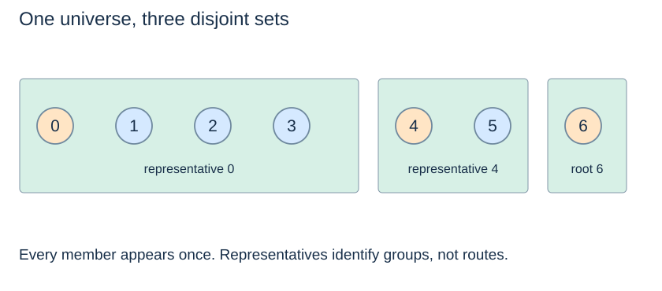

# Partitions and representatives

(disjoint-set-partition)=
## Every object belongs to exactly one group

A **partition** divides a universe into nonempty, pairwise disjoint sets whose union is the whole universe. The sets `{0,1,2,3}`, `{4,5}` and `{6}` partition indices 0 through 6. No member can appear in two sets, and no member is omitted. The empty universe has an empty partition.

(union-find-adt)=
## Specify the three central operations

| Operation | Meaning in this book |
|---|---|
| `find(x)` | Return a representative of x's current set |
| `connected(a, b)` | Report whether a and b belong to the same set |
| `union(a, b)` | Merge their sets; return `True` only if two different sets merged |

Initially every member is in its own singleton set. A successful union decreases the number of sets by one. Union within an existing set returns `False` and leaves the partition unchanged. It does not create a duplicate member or another copy of the group.

(disjoint-set-representative)=
## A representative identifies a current set

The representative is an implementation-selected member identifying a set. It need not be the smallest member, earliest arrival, most important vertex or geometric centre. A later union can change a member's representative by attaching its former root below another root.

Compare `find(a) == find(b)` when you need current connectivity. Do not assume that a saved representative remains the root forever. If an application needs a persistent label or a minimum member, maintain that information explicitly as component metadata.

(union-find-versus-sets)=
## A partition structure is not a general set container

A Python set supports membership and set operations on its stored elements. Union–find specialises in identifying and merging **groups of elements** efficiently. Its parent array does not directly list every member of a component or recover a route between two graph vertices.

Static undirected components can be computed once with BFS or DFS in $O(n+m)$ time. Union–find is useful when merges and connectivity queries are interleaved. These structures answer related but different operational requirements.

Next: [Parent forests](parent-forests.md).
