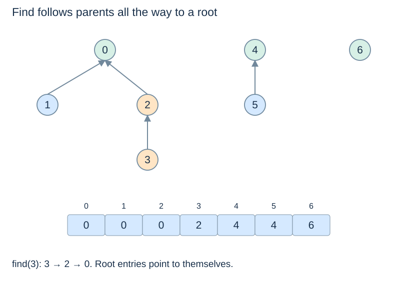

# Parent forests and finding a root

**After this page, you should be able to:**

- Follow parent links to roots and state the parent-forest invariant.
- Explain why root linking preserves groups but arbitrary reparenting may not.

**Builds on:** [Partitions and representatives](disjoint-sets.md) and [array/reference models](../linear-structures/arrays.md).

**Code languages:** Python defines the explanations, figures and self-checks. Use the [language guide](../../code-languages.md) for native conventions and dependencies. Complete runnable topic examples: [JavaScript](../../examples/languages/union-find.js) · [Julia](../../examples/languages/union-find.jl).

JavaScript member indices are 0..n−1; Julia members are 1..n. Element count, component count and component size remain distinct. Julia find_set! and union_sets! may mutate representation links, preserving the same abstract partition and union-by-size tie rule.

(union-find-parent-forest)=
## Represent each set as a rooted tree

Store one parent index per member. A root points to itself: `parent[root] == root`. Other members follow parent links until they reach that root. Different root trees represent different disjoint sets, forming a forest.

For `[0, 0, 0, 2, 4, 4, 6]`, the represented groups are `{0,1,2,3}`, `{4,5}` and `{6}`. Member 3's immediate parent is 2, but its representative is 0.



(basic-find)=
## Follow the entire path, not just one parent

::::{tab-set}
:class: code-language-tabs

:::{tab-item} Python
:sync: python

```python
def find_root(parent, x):
    while parent[x] != x:
        x = parent[x]
    return x
```

:::

:::{tab-item} JavaScript
:sync: javascript

```javascript
function find_root(parent, x) {
    while (parent[x] !== x) x = parent[x];
    return x;
}
```

:::

:::{tab-item} Julia
:sync: julia

```julia
function find_root(parent, x)
    while parent[x] != x; x = parent[x]; end
    return x
end
```

:::

::::

The helper assumes a valid index and a well-formed parent forest. `find_root(parent, 3)` follows **3, 2, 0** and returns 0. `find_root(parent, 1)` follows **1, 0** and returns the same representative. Testing only `parent[3] == parent[1]` would incorrectly claim they belong to different sets.

(union-find-root-linking)=
## Merge roots rather than arbitrary interior nodes

To combine two sets, first find their distinct roots, then make one root point to the other. Redirecting an arbitrary member can detach only part of a component or create a cycle in the representation. Root linking preserves all existing members and keeps one tree per abstract set.

Unrestricted root linking can still produce a chain, making one find take $\Theta(n)$ time. The next page controls that depth and shortens paths.

(union-find-links-versus-edges)=
## Parent links are bookkeeping, not original graph routes

Union may connect two root indices even when no original graph edge joins those roots. Path compression later adds further shortcuts that were never input edges. The parent forest therefore cannot be interpreted as a route network or as Kruskal's chosen spanning edges.

Keep accepted graph edges in a separate list if they are needed. This distinction also prevents confusing a graph traversal's discovery parent—which denotes an actual graph edge—with a union–find parent.

## Helper contract, costs and alternatives

`find_root(parent, x)` observes a supplied well-formed parent array and returns a root. It does not compress, check indices or maintain component sizes/counts. Invalid arrays can loop forever or raise errors; Python's negative indices are not an intended membership policy. The public [DisjointSet class](union-compression.md#disjoint-set-code) adds explicit checks.

For a path with h parent links, this iterative helper uses Θ(h+1) time and O(1) auxiliary space. A plain forest uses Θ(n+1) persistent storage and may have h=n−1. Root linking after roots are known costs O(1); finding those roots is additional work. Union by size controls height, while compression repairs paths during find. Neither operation needs to sort member labels or preserve input graph edges.

:::{tip} Common misconception
**Two members are connected exactly when their immediate parents match.** Their paths can differ and still end at the same root.
:::

(parent-forest-checks)=
## Check your understanding

Predict the result or state change before opening the explanation.

**1. For parent = [0,0,0,2,4,4,6], are 1 and 3 connected despite having parents 0 and 2?**

:::{dropdown} Show explanation
Yes. Both paths end at root 0. Compare representatives, not just one parent link.
:::

**2. Can a compressed parent link be used as a road in a recovered graph route?**

:::{dropdown} Show explanation
No. It records group membership and may never have been an input graph edge. Keep actual chosen edges separately.
:::

Next: [Union by size and compression](union-compression.md).
