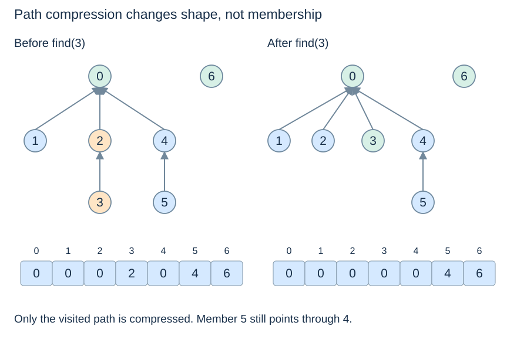
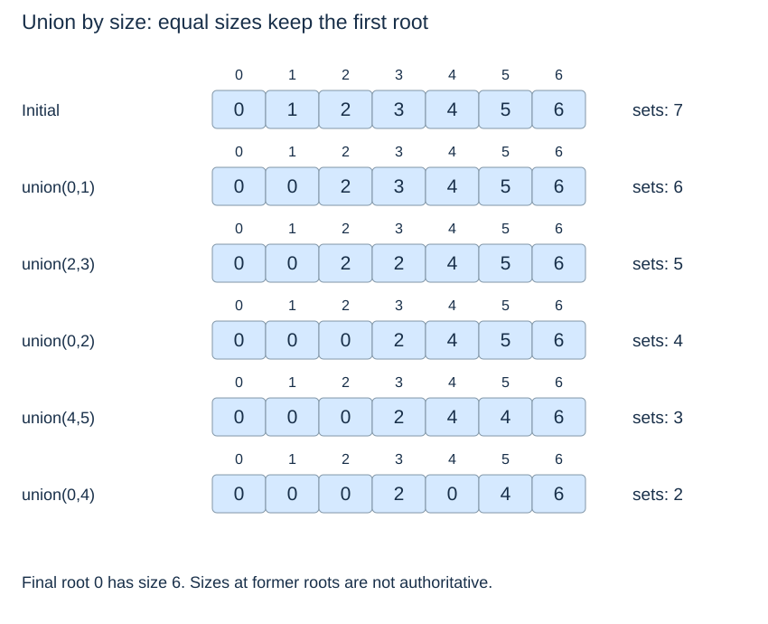

# Union by size and path compression

(union-by-size)=
## Attach the smaller root tree to the larger

Maintain a component size at each root. When two roots differ, attach the smaller set's root below the larger root and add its size to the surviving root. Only **root** sizes are authoritative; a former root's old size may remain stale after it becomes a child.

With union by size alone, a member's depth increases only when its whole component joins one at least as large. Its component size then at least doubles. It can experience at most $\lfloor\log_2 n\rfloor$ such depth increases, giving a logarithmic worst-case find path.

(path-compression)=
## Redirect a visited path to its representative

During find, first locate the root, then redirect every member on the traversed path to it. This changes the internal shape but preserves the partition and the chosen root. Save the old next index before overwriting it, so the rest of the path remains accessible.



(disjoint-set-code)=
## A complete fixed-universe implementation

```python
class DisjointSet:
    def __init__(self, n):
        if type(n) is not int or n < 0:
            raise ValueError("n must be a nonnegative integer")
        self.parent = list(range(n))
        self.size = [1] * n
        self.components = n

    def _check(self, x):
        if type(x) is not int or not 0 <= x < len(self.parent):
            raise IndexError("member index out of range")

    def find(self, x):
        self._check(x)
        root = x
        while self.parent[root] != root:
            root = self.parent[root]
        while self.parent[x] != x:
            next_x = self.parent[x]
            self.parent[x] = root
            x = next_x
        return root

    def union(self, a, b):
        ra, rb = self.find(a), self.find(b)
        if ra == rb:
            return False
        if self.size[ra] < self.size[rb]:
            ra, rb = rb, ra
        self.parent[rb] = ra
        self.size[ra] += self.size[rb]
        self.components -= 1
        return True

    def connected(self, a, b):
        return self.find(a) == self.find(b)
```

The explicit bounds check rejects negative Python indices rather than accidentally treating −1 as the last member. Equal sizes retain the first argument's root. Clients must preserve the internal arrays; changing them directly can break the forest or its metadata.

(union-find-shared-trace)=
## Trace the same five unions as the lecture

Start with seven singleton sets. Perform `(0,1), (2,3), (0,2), (4,5), (0,4)` in that order. The final parent array is `[0,0,0,2,0,4,6]`, root 0's size is 6, and there are two components. A subsequent `find(3)` changes parent[3] to 0 but leaves parent[5] equal to 4, because that other path was not traversed.



`connected` may compress internal paths even though it is an observer of the **logical partition**. This agrees with Topic 5's observer/mutator distinction at the abstract level: internal representation changes need not change externally meaningful membership.

(union-find-amortised-cost)=
## State sequence cost separately from one call

Initialisation takes $\Theta(n)$ time and storage. Union by size plus path compression gives $O(\alpha(n))$ amortised time per valid operation, where $\alpha$ is the inverse Ackermann function. For n≥2 and q operations after initialisation, the standard sequence bound is $O(n+q\alpha(n))$.

This is a worst-case sequence guarantee, not a probability claim and not a promise that every call takes the same constant number of steps. An individual uncompressed path can still contain $O(\log n)$ links with union by size. The iterative two-pass find uses constant auxiliary space; the full structure stores $\Theta(n)$ entries. Empty and singleton universes are handled directly without needing the asymptotic formula.

Next: [Connectivity applications](union-find-applications.md).
