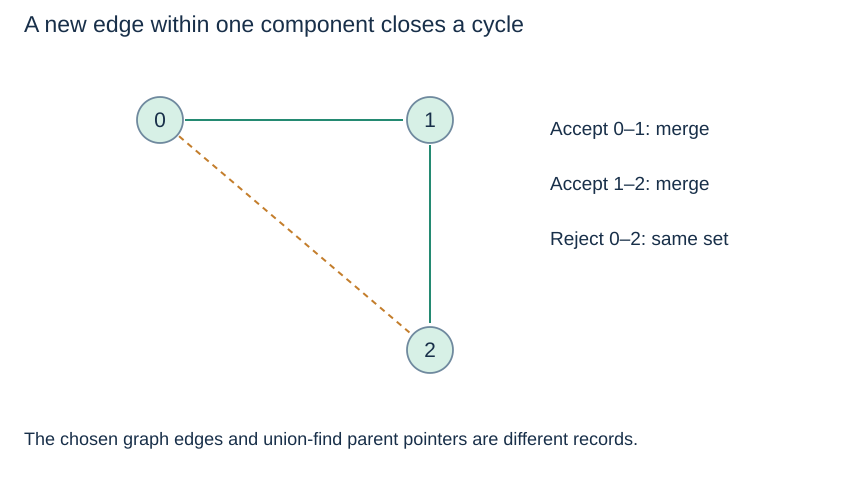

# Connectivity, cycle checks and limits

**After this page, you should be able to:**

- Use union returns for incremental connectivity and an unweighted forest.
- Identify unsupported route, directed-reachability and deletion queries.

**Builds on:** [The complete disjoint-set class](union-compression.md) and [graph components](../graphs/graph-components.md).

(incremental-connectivity)=
## Merge when an undirected connection arrives

Begin with every graph vertex in a singleton set. For each undirected edge a–b, union their components. Afterwards `connected(a,b)` answers whether the **processed edges** supply some path between them, even if no edge directly joins a and b.

The component count decreases exactly on successful unions. For n vertices, after k successful merges it is n−k. Isolated vertices remain singleton components until an incident connection is processed.

(union-find-cycle-check)=
## Reject a connection within one existing component

If a and b are already connected by previously accepted forest edges, adding a new edge between them closes a cycle. `union(a,b)` returns `False`, letting a forest builder reject that redundant connection. A repeated copy of an already processed edge is also redundant; whether parallel edges count as separate graph edges depends on the graph model.

```python
def connection_forest(n, edges):
    sets = DisjointSet(n)
    chosen, rejected = [], []
    for a, b in edges:
        if sets.union(a, b):
            chosen.append((a, b))
        else:
            rejected.append((a, b))
    return chosen, rejected, sets.components
```

This uses the class from the preceding page. It builds an undirected spanning forest of the processed connections, but does **not** minimise any weight. [Kruskal](../graph-algorithms/kruskal.md) adds the crucial increasing-weight scan.



(union-find-directed-limit)=
## Directed reachability is not an equivalence relation

For A→B and C→B, merging endpoints puts all three vertices together, but there is no directed path from A to C. Plain union–find therefore does not answer directed reachability, find strongly connected components, or detect directed cycles by ignoring arrow directions.

It can represent weak connectivity if the intended operation deliberately ignores direction. That is a different question and should be named explicitly.

(union-find-deletion-limit)=
## Merging does not support splitting

Ordinary union–find cannot undo a component merge after an arbitrary graph edge is removed. Removing an edge may or may not disconnect a graph, and the compressed parent forest does not retain enough original connection information to decide that.

For occasional deletions, rebuilding connectivity from the remaining graph can be appropriate. Rollback or dynamic-connectivity methods are separate extensions with different rules; simply setting one parent back to itself is not a valid general deletion algorithm.

(union-find-workload-choice)=
## Choose between traversal and maintained partitions

Use BFS/DFS when you need actual routes, traversal order, or static component membership. Use union–find for repeated merge/connectivity operations and undirected cycle checks. To enumerate current members of every union–find component, scan all elements, call `find` on each, and group by the returned root; membership lists are not provided automatically by the parent arrays.

## Function contract, implementation choices and costs

`connection_forest(n, edges)` requires valid integer endpoints in `0..n-1`, constructs a fresh `DisjointSet`, and consumes endpoint pairs from `edges`. Run the [class definition](union-compression.md#disjoint-set-code) first. It returns `(chosen, rejected, component_count)` and does not mutate an input list of edges. An iterable is consumed. Duplicate edges are separate processed records: the first may merge groups, while later repeats are rejected. A self-loop is rejected because its two endpoints already have the same representative.

For q edge records and n≥2, time is O(n+qα(n)) including initialisation. Working arrays occupy O(n+1); chosen and rejected output lists together occupy O(q+1), so total additional storage is O(n+q+1). The output can be much larger than the chosen forest alone. Empty inputs yield `([], [], n)`; invalid endpoints raise `IndexError` through the class.

For a static graph, full BFS/DFS computes components in O(n+m+1) expected time and can record actual routes. Union–find is suited to interleaved additions and connectivity queries. Grouping all current members by `find(x)` requires n finds: O(nα(n)) amortised time for n≥2, plus Θ(n+1) output references and expected dictionary grouping costs. It is a separate operation, not an O(1) result supplied by the parent array.

:::{tip} Common misconception
**Removing an input graph edge can be implemented by resetting one parent.** Compression and root linking discard the route information needed to know whether the remaining graph stays connected.
:::

(union-applications-checks)=
## Check your understanding

Predict the result or state change before opening the explanation.

**1. Process (0,1), (1,2), (0,2) with n=3. Which record is rejected, and how many components remain?**

:::{dropdown} Show explanation
(0,2) is rejected because its endpoints are already connected; one component remains. The first two records form an unweighted spanning tree.
:::

**2. Does sorting those records by weight change union–find itself?**

:::{dropdown} Show explanation
No. Kruskal adds a weight-ordered edge policy around the same connectivity interface. An unsorted connection forest is not guaranteed minimum-weight.
:::

Return to [Kruskal](../graph-algorithms/kruskal.md), the [topic overview](union-find.md), or the [coverage review](../../coverage-review.md) for remaining concepts and proposed extensions.
